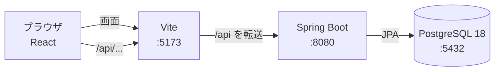

# TaskBoard（仮）

Trello のような、カンバン方式のタスク管理 Web アプリです。ボードにリスト（列）を並べ、タスクをカードとして管理します。

> **開発中です。** ログイン、ボードの表示、カードとリストの追加・変更・削除までできています。ラベル管理やドラッグ＆ドロップは、これから作ります（[進み具合](#進み具合)）。

## 進み具合

**できていること**

- ユーザー登録・ログイン・ログアウト（ログインしていないとボードは見られません）
- 登録すると、ボードと3つのリスト（未着手・作業中・完了）が自動でできる
- ボードの表示
  - リストとカード、ラベル
  - 期限の色分け（期限切れは赤、今日・明日は黄）
  - 重要度の色の帯、「至急」の印
  - 説明は3行まで表示し、URL はリンクにする
- カードの追加（リストの一番下）とリストの追加（右端）。Enter で続けて入力できる。上限（リスト20個・1リストのカード100枚）に達したら通知で知らせる
- カードの詳細画面：タイトル・説明・重要度・緊急度・期限・ラベルをまとめて保存。保存せずに閉じるときは確認する
- リスト名・ボード名を、クリックしてその場で変更
- カードとリストの削除（確認ダイアログを出してから。リストを消すと中のカードも消える）
- ラベル管理：ラベルの追加・名前と色の変更・削除（8色から選ぶ。30個まで）。ヘッダーと、カード詳細のラベル一覧から開く。削除すると付いていたカードからも外れる
- 30分操作しないとログアウトし、次の操作でログイン画面に戻る
- コードの自動チェック（サーバーは Checkstyle・SpotBugs、画面は oxlint・Prettier）

**これから作るもの**

- ドラッグ＆ドロップでの並び替え・移動
- ゲストログイン（登録なしで試せる）、退会
- GitHub Actions での自動テスト、AWS への公開

## 使っている技術

| 区分 | 技術 |
|---|---|
| 画面 | React 19・TypeScript 7・Vite 8・React Router 8・CSS Modules |
| サーバー | Java 25・Spring Boot 4.1（Spring Web MVC・Spring Data JPA・Spring Security・Spring Session JDBC）・Gradle 9 |
| データベース | PostgreSQL 18・Flyway（テーブルの作成と変更の管理） |
| テスト | JUnit 6・MockMvc・Testcontainers（サーバー）、Vitest 5（画面） |
| コードのチェック | Checkstyle・SpotBugs（サーバー）、oxlint・Prettier（画面） |
| その他 | Docker（開発用の DB）、GitHub（イシュー・プルリクエスト） |

細かいバージョンの一覧は [詳細設計書 5.1](docs/detailed-design.md#51-使っているバージョン2026-10-31-時点) にあります。

## 構成



- 開発中は、画面も API も `http://localhost:5173` から使います。Vite が `/api` を Spring Boot へ転送するので、画面と API が同じオリジンになり、CORS の設定がいりません
- ログイン状態はセッション（Cookie）で持ち、セッションは PostgreSQL に保存します

## 工夫したところ

- **先に設計してから作る**：要件定義 → 画面設計 → テーブル設計 → API 設計 → 動くモックアップ → 詳細設計の順に決め、設計書に残してから実装しています
- **他人のデータに触れさせない**：データを1件探すときは、必ず「ID ＋ 持ち主」の条件で探します。他人のデータも存在しないデータも、同じ 404 にしています
- **SQL の回数を増やさない**：ボードを開くときの SQL は、カードの枚数に関係なく4回です。カードとラベルを `left join fetch` でまとめて読み、カード1枚ごとに SQL が走る「N+1 問題」を避けています
- **安全なログイン**
  - パスワードは BCrypt でハッシュ化して保存します
  - ログインのたびにセッション ID を作り直します（セッション固定攻撃の対策）
  - CSRF 対策として、Cookie で渡したトークンをヘッダーで送り返してもらい、照合します
- **エラーの形をそろえる**：すべてのエラーを Problem Details（RFC 9457）の JSON にそろえ、種類を表す `code` を付けています。画面はこの `code` を見て、表示を変えます
- **テーブルは Flyway だけが作る**：JPA はエンティティとテーブルが合っているかを起動時に確かめるだけにしています（`ddl-auto: validate`）
- **本物の DB でテストする**：サーバーのテストは、Testcontainers で立ち上げた PostgreSQL 18 で動かします
- **イシューから始める運用**：イシュー → ブランチ → プルリクエスト → マージの流れで進め、`main` へ直接プッシュできないように GitHub で保護しています

## 設計書

| 文書 | 内容 |
|---|---|
| [要件定義書](docs/requirements.md) | 機能・非機能要件、技術スタック |
| [画面設計書](docs/screen-design.md)・[ワイヤーフレーム](docs/wireframes.html) | 画面の一覧と動き、メッセージ |
| [テーブル設計書](docs/database-design.md) | テーブル・制約・作成 SQL |
| [API 設計書](docs/api-design.md) | API の一覧、エラーの形、ログインと CSRF |
| [詳細設計書](docs/detailed-design.md) | パッケージ・層の分け方、処理の流れ、使うライブラリ |
| [モックアップ](mockup/README.md) | HTML・CSS・JavaScript だけで作った、動きを確かめるための試作品 |

## 手元で動かす

### 必要なもの

- Java 25（JDK）
- Node.js（26 で確認）
- Docker（Docker Desktop など）

### 1. DB のパスワードを決める

DB のパスワードは、コードには書かずに環境変数 `DB_PASSWORD` で渡します。好きな値を決めて設定してください（DB と Spring Boot の両方がこれを読みます）。

```powershell
# Windows（PowerShell）。そのターミナルの中だけで使う場合
$env:DB_PASSWORD = "好きなパスワード"
```

```bash
# macOS・Linux
export DB_PASSWORD="好きなパスワード"
```

### 2. 起動する（DB → Spring Boot → 画面の順）

ポートは **5432（DB）・8080（Spring Boot）・5173（画面）** に決めています。ほかのアプリが使っていたら、止めてから起動してください。

```bash
# DB（PostgreSQL 18）。リポジトリの一番上で実行
docker compose up -d

# Spring Boot。起動するとテーブルが自動でできる（Flyway）
cd backend
./gradlew bootRun        # Windows は .\gradlew.bat bootRun

# 画面（別のターミナルで）
cd frontend
npm install
npm run dev
```

`http://localhost:5173` を開き、「新規登録はこちら」からアカウントを作ると、ボードが表示されます。

止めるときは、Spring Boot と画面はそれぞれのターミナルで `Ctrl + C`、DB は `docker compose stop` です（データは残ります）。

### テスト

```bash
# サーバー（Docker が必要。テスト用の PostgreSQL を自動で立ち上げる）
cd backend
./gradlew test           # 自動テスト
./gradlew check          # 自動テストとコードのチェック（Checkstyle・SpotBugs）

# 画面
cd frontend
npm test              # 自動テスト
npm run lint          # コードのチェック（oxlint）
npm run format:check  # 書き方がそろっているかのチェック（Prettier。直すときは npm run format）
npm run build         # 本番用のファイルを作る
```

## フォルダ

```
.
├─ backend/      サーバー（Spring Boot）
├─ frontend/     画面（React）
├─ docs/         設計書
├─ mockup/       動きを確かめるためのモックアップ（本番では使わない）
├─ compose.yaml  開発用の DB（Docker）
└─ CLAUDE.md     AI（Claude Code）に守ってもらう開発のルール
```

## 開発の進め方

講座の課題として、AI（Claude Code）と相談しながら、要件定義から公開までを一通り経験することを目的に作っています。
