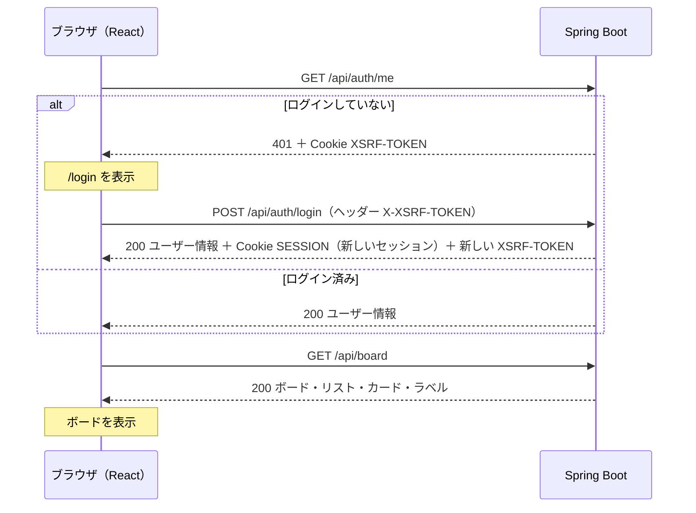

# API設計書：トレロ風タスク管理アプリ

最終更新：2026-10-25

要件は `requirements.md`、テーブルは `database-design.md`、画面は `screen-design.md` を参照。

## 1. 方針

| 項目 | 決定 | 理由 |
|---|---|---|
| URLの形 | REST形式。「何を」をURL、「どうする」をHTTPメソッドで表す。入れ子は作成のときだけ使う（例：`POST /api/columns/{id}/cards`）。それ以外は `/api/cards/{id}` のようにIDで直接指定する | 一般的な形で、URLが短くなる |
| ボードのURL | `/api/board`（単数形でIDなし）。サーバーがセッションから自分のボードを探す | ボードは1人1つなので、IDを送る必要がない。他人のボードIDを指定される心配もない。複数ボードに対応するときは `/api/boards/{id}` を追加する |
| ボード画面のデータ | `GET /api/board` の1回で、ボード・リスト・カード・ラベルをまとめて返す。カードはラベルのIDだけを持つ | 通信が1回で済み、読み込み中の状態が単純になる。ラベルの名前や色を変えても、ラベル一覧の1か所を直せばすべてのカードに反映される |
| 並び替え | 動かしたもの1件と、移動先の位置（0から）を送る。番号の振り直しはサーバーが行う | 送る情報が少なく、番号のルールがサーバーの1か所にまとまる。別のリストへの移動も1回で済む |
| エラーの形 | Problem Details（RFC 9457）に `code` と `errors` を足す | HTTP API のエラーの標準規格。Spring Boot の `ProblemDetail` クラスで作れる |
| CSRF対策 | サーバーが Cookie `XSRF-TOKEN` でトークンを渡し、React がヘッダー `X-XSRF-TOKEN` に付けて返す | Spring Security が SPA 向けに推奨している方式 |
| ログイン | JSONを受け取るログインAPIを自分で作る（Spring Security の `AuthenticationManager` を呼び出す） | ほかのAPIと同じくJSONとProblem Detailsで統一できる。ログインの中身を説明できるようになる |
| 変更のメソッド | 名前だけを変えるもの（ボード・リスト）は `PATCH`、変更できる項目をまとめて送るもの（カード・ラベル）は `PUT` | `PATCH` は「一部を変える」、`PUT` は「まるごと置き換える」という意味のため |

## 2. 共通のルール

### 2.1 URLと形式

- すべてのAPIは `/api` で始める。React の画面のURL（`/`・`/login` など）と区別するため
- 送る・返すデータは JSON（`Content-Type: application/json`）。エラーだけ `application/problem+json`
- JSONの項目名はキャメルケース（`dueDate`・`labelIds`）。Java の書き方に合わせる
- 日付は `"2026-10-30"` の形（時刻なし）。値がない項目は `null`
- 重要度・緊急度は `"HIGH"` / `"MEDIUM"` / `"LOW"`
- 一覧の並びは、配列の順番そのものが並び順。`position` の数字は返さない

### 2.2 ログインとセッション

- ログインすると、サーバーがセッションを作り、Cookie（`SESSION`）でブラウザに渡す。以降はブラウザが自動で送る
- セッション Cookie は `HttpOnly`（JavaScript から読めない）・`SameSite=Lax`、本番では `Secure`（HTTPSのときだけ送る）を付ける
- `/api/auth/signup`・`/api/auth/login`・`/api/auth/guest` 以外のAPIは、ログインが必要。ログインしていなければ 401 を返す
- 無操作30分でセッションが切れる（要件 U-09）。切れたあとのAPIは 401 を返す
- ログインのたびにセッションIDを新しくする（セッション固定攻撃の対策）

### 2.3 CSRF対策

- サーバーは Cookie `XSRF-TOKEN` にトークンを入れて返す。この Cookie だけは React が読めるように `HttpOnly` を付けない
- データを変えるAPI（POST・PUT・PATCH・DELETE）では、React が Cookie の値をヘッダー `X-XSRF-TOKEN` に入れて送る。ログイン・登録・ゲストログインも対象
- トークンが合わなければ 403 を返す
- ログインやログアウトでトークンが変わるため、React は値を覚えておかず、**送るたびに Cookie から読む**
- 画面とAPIは同じドメインから配信する（Cookie を読めるようにするため）。開発中は Vite の proxy 機能で `/api` を Spring Boot（ポート8080）に転送する。本番の構成は AWS の設計で決める
- **CORS の設定はしない**（2026-10-31）。画面と API が同じオリジンなので、ブラウザの CORS の制限にかからない。Spring Security は CORS を設定しなければ、ほかのオリジンからの呼び出しを許可しないので、そのほうが安全。本番も、画面と API を同じドメインにする構成を選ぶ（例：CloudFront で `/api/` だけを Spring Boot に振り分ける）。別のドメインに分けることになったら、CORS と Cookie の設定（`SameSite` など）を見直す

### 2.4 所有者の確認（要件 U-05）

- URLやJSONで受け取ったID（リスト・カード・ラベル）は、毎回ログイン中のユーザーのものか確認する（`database-design.md` 7章）
- 他人のデータ・存在しないデータを指定されたら 404 を返す

### 2.5 入力チェック

- 画面側とサーバー側の両方で行う（要件 G-02）。ルールは `requirements.md` 3章のとおり
- 名前・タイトルは、前後の空白を取り除いてから確認し、取り除いた値を保存する（空白だけのタイトルは「空」とみなす）
- メールアドレスは小文字にそろえてから確認・保存する
- 説明文が空文字のときは `null` として保存する

## 3. API一覧

| ID | メソッド | URL | 内容 | 要件 |
|---|---|---|---|---|
| A-01 | POST | `/api/auth/signup` | ユーザー登録し、そのままログインする | U-01, U-02 |
| A-02 | POST | `/api/auth/login` | ログイン | U-03, U-10 |
| A-03 | POST | `/api/auth/guest` | ゲストを作ってログイン | U-06, U-10 |
| A-04 | POST | `/api/auth/logout` | ログアウト。ゲストならデータを削除 | U-04, U-08 |
| A-05 | GET | `/api/auth/me` | ログイン中のユーザーを返す | U-05, U-07 |
| A-19 | POST | `/api/auth/withdraw` | 退会する（アカウントとすべてのデータを削除） | U-11 |
| A-06 | GET | `/api/board` | ボードの中身（リスト・カード・ラベル）をまとめて返す | L-01, C-05〜C-08 |
| A-07 | PATCH | `/api/board` | ボード名を変更する | B-01 |
| A-08 | POST | `/api/columns` | リストを追加する（右端） | L-02 |
| A-09 | PATCH | `/api/columns/{id}` | リスト名を変更する | L-03 |
| A-10 | DELETE | `/api/columns/{id}` | リストと中のカードを削除する | L-04 |
| A-11 | PUT | `/api/columns/{id}/position` | リストの並び順を変える | L-05 |
| A-12 | POST | `/api/columns/{id}/cards` | カードを追加する（一番下） | C-01 |
| A-13 | PUT | `/api/cards/{id}` | カードの詳細をまとめて保存する | C-02, T-02 |
| A-14 | DELETE | `/api/cards/{id}` | カードを削除する | C-03 |
| A-15 | PUT | `/api/cards/{id}/position` | カードを並び替える・別のリストへ移動する | C-04 |
| A-16 | POST | `/api/labels` | ラベルを追加する | T-01 |
| A-17 | PUT | `/api/labels/{id}` | ラベルの名前と色を変更する | T-01 |
| A-18 | DELETE | `/api/labels/{id}` | ラベルを削除する（カードからも外れる） | T-01, T-03 |

ラベルの一覧は A-06 に含まれるので、ラベル一覧だけを取るAPIは作らない。

## 4. ステータスコードとエラー

### 4.1 ステータスコード

| コード | 意味 | 使う場面 |
|---|---|---|
| 200 OK | 成功（中身あり） | 取得・変更 |
| 201 Created | 作成した | 登録・追加。作ったデータを返す |
| 204 No Content | 成功（中身なし） | 削除・並び替え・ログアウト |
| 400 Bad Request | 入力が正しくない | 入力チェックのエラー、並び替えの位置が範囲外 |
| 401 Unauthorized | ログインしていない | 未ログイン・セッション切れ・ログイン失敗 |
| 403 Forbidden | 許可されていない | CSRFトークンがない・合わない、ゲストが退会しようとした |
| 404 Not Found | 見つからない | 他人のデータ・存在しないデータ・存在しないAPI |
| 409 Conflict | 今の状態と合わない | メールアドレスやラベル名の重複、データ量の上限 |
| 429 Too Many Requests | 回数制限を超えた | ログイン失敗・ゲスト作成の回数制限（要件 U-10） |
| 500 Internal Server Error | サーバーの不具合 | 予期しないエラー |

### 4.2 エラーの形（Problem Details）

```json
{
  "type": "about:blank",
  "title": "Bad Request",
  "status": 400,
  "detail": "入力内容に誤りがあります",
  "code": "VALIDATION_ERROR",
  "errors": [
    { "field": "title", "message": "タイトルを入力してください" }
  ]
}
```

| 項目 | 内容 |
|---|---|
| type・title・status | 標準の項目。`type` は使わないので常に `about:blank`。`title` はステータスの英語名 |
| detail | 画面に表示する日本語のメッセージ（`screen-design.md` 7章） |
| code | エラーの種類。React はこれを見て処理を分ける（下の表） |
| errors | 入力チェックのエラーのときだけ。項目ごとのメッセージ。React は該当する入力欄の下に表示する |

### 4.3 エラーの種類（code）

| code | ステータス | detail の例 | React の動き |
|---|---|---|---|
| VALIDATION_ERROR | 400 | 入力内容に誤りがあります | `errors` を各入力欄の下に表示する |
| INVALID_POSITION | 400 | 移動先の位置が正しくありません | 通知を出し、並びを移動前に戻す |
| UNAUTHENTICATED | 401 | ログインしてください | ログイン中だった場合は「ログインの有効期限が切れました。もう一度ログインしてください」を表示して `/login` へ |
| LOGIN_FAILED | 401 | メールアドレスまたはパスワードが正しくありません | ログイン画面に表示する |
| CSRF_INVALID | 403 | 通信に失敗しました。画面を再読み込みしてください | 通知を出す |
| GUEST_NOT_ALLOWED | 403 | ゲストは退会できません | 通知を出す（画面にボタンを出さないので、ふつうは起きない） |
| NOT_FOUND | 404 | 対象のデータが見つかりません。画面を再読み込みしてください | 通知を出す |
| EMAIL_DUPLICATED | 409 | このメールアドレスは登録済みです | メールアドレス欄の下に表示する |
| LABEL_NAME_DUPLICATED | 409 | 同じ名前のラベルがあります | ラベル名欄の下に表示する |
| LIMIT_EXCEEDED | 409 | リストは20個までです | 通知を出す |
| RATE_LIMITED | 429 | しばらくしてから再度お試しください | ログイン画面に表示する |
| INTERNAL_ERROR | 500 | 通信に失敗しました。時間をおいて再度お試しください | 通知を出す |

- 429 のときは、何秒後に再度試せるかをヘッダー `Retry-After` で返す
- サーバーにつながらないとき（レスポンスがないとき）も、React は INTERNAL_ERROR と同じ通知を出す

## 5. APIの詳細

### 5.1 ログイン関係

A-19（退会）もログイン関係なので、この節に置く。

ユーザー情報（A-01〜A-03、A-05 で返す）：

```json
{ "id": 1, "email": "taro@example.com", "isGuest": false }
```

ゲストのときは `email` がダミーのアドレスになる。画面では `isGuest` を見て「ゲスト」と表示する（`screen-design.md` W-03）。

#### A-01 ユーザー登録 `POST /api/auth/signup`

リクエスト：

```json
{ "email": "Taro@example.com", "password": "password123" }
```

- 成功：201 ＋ ユーザー情報。そのままログインした状態になる。ボードと3つのリストも作る（`database-design.md` 9.1）
- 失敗：400 VALIDATION_ERROR、409 EMAIL_DUPLICATED
- パスワード（確認）は画面側だけでチェックするので、送らない

#### A-02 ログイン `POST /api/auth/login`

リクエスト：

```json
{ "email": "taro@example.com", "password": "password123" }
```

- 成功：200 ＋ ユーザー情報
- 失敗：401 LOGIN_FAILED（メールアドレスとパスワードのどちらが違うかは教えない）、429 RATE_LIMITED
- 入力が空などの場合も 401 LOGIN_FAILED にそろえる（入力チェックは画面側で行う）
- ゲストユーザーのメールアドレスではログインできない（パスワードがランダムなので、実際には一致しない）
- 失敗の回数をIPアドレスごとに数え、15分に10回を超えたら 429 を返す（要件 U-10）

#### A-03 ゲストログイン `POST /api/auth/guest`

リクエスト：なし

- 成功：201 ＋ ユーザー情報。一時ユーザーとサンプルデータを作り、ログインした状態になる（`database-design.md` 9.2）
- 失敗：429 RATE_LIMITED（IPアドレスごとに1時間10回まで。要件 U-10）

#### A-04 ログアウト `POST /api/auth/logout`

リクエスト：なし

- 成功：204。セッションを破棄する。ゲストなら、そのユーザーの行を削除する（要件 U-08）
- すでにセッションが切れていても 204 を返す

#### A-05 ログイン中のユーザー `GET /api/auth/me`

- 成功：200 ＋ ユーザー情報
- 未ログイン：401 UNAUTHENTICATED
- React はアプリの起動時（ページを開いたとき・再読み込みしたとき）に呼び、ログイン済みかどうかで `/` と `/login` を出し分ける（`screen-design.md` 3章）

#### A-19 退会 `POST /api/auth/withdraw`

リクエスト：

```json
{ "password": "password123" }
```

- 成功：204。ログイン中のユーザーの行を削除し（関連データは `ON DELETE CASCADE` で消える）、セッションを破棄する
- 失敗：400 VALIDATION_ERROR（パスワードが空、または正しくない。`errors` の `password` に「パスワードが正しくありません」）、403 GUEST_NOT_ALLOWED（ゲスト）
- `DELETE` メソッドではなく `POST` にする。`DELETE` でリクエストの中身（パスワード）を送るのは HTTP の仕様で意味が決まっておらず、環境によっては中身が捨てられることがあるため。ログイン・ログアウトと同じく `/api/auth/` の下に置く

### 5.2 ボード

#### A-06 ボードの取得 `GET /api/board`

レスポンス（200）：

```json
{
  "id": 1,
  "name": "マイボード",
  "labels": [
    { "id": 5, "name": "仕事", "color": "#e5484d" },
    { "id": 6, "name": "買い物", "color": "#30a46c" }
  ],
  "columns": [
    {
      "id": 10,
      "name": "未着手",
      "cards": [
        {
          "id": 100,
          "title": "牛乳を買う",
          "description": null,
          "importance": "MEDIUM",
          "urgency": "HIGH",
          "dueDate": "2026-10-30",
          "labelIds": [6]
        }
      ]
    },
    { "id": 11, "name": "作業中", "cards": [] },
    { "id": 12, "name": "完了", "cards": [] }
  ]
}
```

- `columns` は左から順、`cards` は上から順に並べて返す
- `labels` は作成順に並べて返す

#### A-07 ボード名の変更 `PATCH /api/board`

リクエスト：

```json
{ "name": "仕事用ボード" }
```

- 成功：200 ＋ `{ "id": 1, "name": "仕事用ボード" }`
- 失敗：400 VALIDATION_ERROR（1〜50文字）

### 5.3 リスト

リスト（A-08・A-09 で返す）：

```json
{ "id": 13, "name": "保留" }
```

#### A-08 リストの追加 `POST /api/columns`

リクエスト：

```json
{ "name": "保留" }
```

- 成功：201 ＋ リスト。ボードの右端に追加する
- 失敗：400 VALIDATION_ERROR（1〜50文字）、409 LIMIT_EXCEEDED（20個まで）

#### A-09 リスト名の変更 `PATCH /api/columns/{id}`

リクエスト：`{ "name": "あとで" }`

- 成功：200 ＋ リスト
- 失敗：400 VALIDATION_ERROR、404 NOT_FOUND

#### A-10 リストの削除 `DELETE /api/columns/{id}`

- 成功：204。中のカードも削除し、残ったリストの並び順を振り直す
- 失敗：404 NOT_FOUND
- 確認ダイアログのカード枚数は、React が手元のデータから数える

#### A-11 リストの並び替え `PUT /api/columns/{id}/position`

リクエスト：

```json
{ "position": 2 }
```

- `position` は、移動したあとの並びで左から何番目か（0から）
- 成功：204。ボード内のリストを振り直す
- 失敗：400 INVALID_POSITION（0〜リストの数−1 の範囲外）、404 NOT_FOUND

例：リスト「A, B, C」の A を `position: 2` に移動 → B, C, A

### 5.4 カード

カード（A-12・A-13 で返す）：

```json
{
  "id": 100,
  "title": "牛乳を買う",
  "description": null,
  "importance": "MEDIUM",
  "urgency": "MEDIUM",
  "dueDate": null,
  "labelIds": []
}
```

#### A-12 カードの追加 `POST /api/columns/{id}/cards`

リクエスト：

```json
{ "title": "牛乳を買う" }
```

- 成功：201 ＋ カード。リストの一番下に追加する。重要度・緊急度は「中」、ほかは空
- 失敗：400 VALIDATION_ERROR（1〜100文字）、404 NOT_FOUND（リスト）、409 LIMIT_EXCEEDED（1リストに100枚まで）

#### A-13 カードの保存 `PUT /api/cards/{id}`

リクエスト（カード詳細の全項目をまとめて送る）：

```json
{
  "title": "牛乳を買う",
  "description": "低脂肪のもの\nhttps://example.com",
  "importance": "HIGH",
  "urgency": "LOW",
  "dueDate": "2026-10-30",
  "labelIds": [5, 6]
}
```

- `labelIds` は、保存後にカードに付いているラベルの一覧。今付いているラベルを、この一覧でまるごと置き換える（空の配列ならすべて外す）
- 所属するリストと並び順は、このAPIでは変わらない（A-15 で変える）
- 成功：200 ＋ カード
- 失敗：400 VALIDATION_ERROR、404 NOT_FOUND（カード、または `labelIds` に他人・存在しないラベルが含まれる）

| 項目 | ルール |
|---|---|
| title | 必須。1〜100文字 |
| description | 2000文字まで。`null` または空文字なら説明文なし |
| importance | 必須。重要度。`HIGH` / `MEDIUM` / `LOW` |
| urgency | 必須。緊急度。`HIGH` / `MEDIUM` / `LOW` |
| dueDate | 日付または `null` |
| labelIds | 必須（空の配列は可）。重複したIDは1つとみなす |

#### A-14 カードの削除 `DELETE /api/cards/{id}`

- 成功：204。残ったカードの並び順を振り直す
- 失敗：404 NOT_FOUND

#### A-15 カードの並び替え・移動 `PUT /api/cards/{id}/position`

リクエスト：

```json
{ "columnId": 11, "position": 0 }
```

- `columnId` は移動先のリスト（同じリスト内の並び替えなら今のリスト）
- `position` は、移動したあとの移動先のリストで上から何番目か（0から）
- 成功：204。移動先のリスト（別のリストへ移動した場合は移動元も）を振り直す
- 失敗：400 INVALID_POSITION（範囲外）、404 NOT_FOUND（カードまたは移動先のリスト）、409 LIMIT_EXCEEDED（別のリストへ移動し、移動先がすでに100枚のとき）

位置の範囲：
- 同じリスト内：0〜（そのリストの枚数−1）
- 別のリストへ：0〜（移動先の今の枚数）。今の枚数と同じ値なら一番下

例：リスト11「A, B」へ、別のリストのカード X を `position: 1` で移動 → A, X, B

### 5.5 ラベル

ラベル（A-16・A-17 で返す）：

```json
{ "id": 7, "name": "急ぎ", "color": "#f76b15" }
```

#### A-16 ラベルの追加 `POST /api/labels`

リクエスト：

```json
{ "name": "急ぎ", "color": "#f76b15" }
```

- 成功：201 ＋ ラベル
- 失敗：400 VALIDATION_ERROR（名前1〜20文字、色は `screen-design.md` 6章の8色のみ）、409 LABEL_NAME_DUPLICATED、409 LIMIT_EXCEEDED（30個まで）

#### A-17 ラベルの変更 `PUT /api/labels/{id}`

リクエスト：`{ "name": "とても急ぎ", "color": "#e5484d" }`

- 成功：200 ＋ ラベル
- 失敗：400 VALIDATION_ERROR、404 NOT_FOUND、409 LABEL_NAME_DUPLICATED（自分自身の今の名前は重複とみなさない）

#### A-18 ラベルの削除 `DELETE /api/labels/{id}`

- 成功：204。付いていたカードからも外れる（要件 T-03）
- 失敗：404 NOT_FOUND
- 確認ダイアログのカード枚数は、React が手元のデータ（各カードの `labelIds`）から数える

## 6. 画面の動きとAPIの流れ

### 6.1 ページを開いてからボードを表示するまで



### 6.2 ドラッグ＆ドロップ

1. ドロップした瞬間に、React が画面の並びを先に変える（サーバーの返事を待たないので、すぐに反映される）
2. A-11 または A-15 を呼ぶ
3. 失敗したら、通知を出し、並びを移動前に戻す（`screen-design.md` 5章）

### 6.3 追加・変更・削除

- 追加・変更は、サーバーから返ってきたデータで画面の状態を更新する
- 削除は、204 が返ってきたら画面から取り除く
- 変更のあとに `GET /api/board` で全体を取り直すことはしない（通信を減らすため）

## 7. 実装のときの注意

- **ログインAPI**：`AuthenticationManager` で認証したあと、認証情報を `SecurityContextRepository` でセッションに保存する（Spring Security 6 以降は自動で保存されないため）。セッションIDの変更も忘れずに行う
- **CSRF**：Spring Security の SPA 向けの設定を使い、`XSRF-TOKEN` Cookie が毎回確実に返るようにする
- **401・403 の形**：Spring Security が返すエラー（未ログイン・CSRF）も、`AuthenticationEntryPoint`・`AccessDeniedHandler` を設定して Problem Details の形にそろえる
- **並び替え・削除**：振り直しは1つのトランザクションで行う（`database-design.md` 4章）
- **上限の数値**：設定ファイル（`application.yml`）に書き、変えられるようにする（要件 3.7）

## 8. まだ決めていないこと

- 回数制限の数え方の実装（メモリに持つか、DBに持つか）
- 本番でのドメイン構成（AWS の設計で決める）
