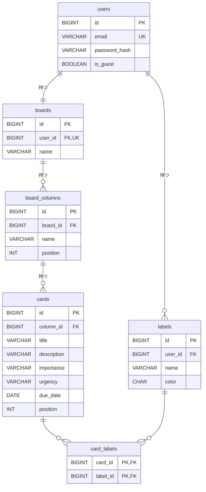

# テーブル設計書：トレロ風タスク管理アプリ

最終更新：2026-10-25

要件は `requirements.md` を参照。

## 1. 方針

| 項目 | 決定 | 理由 |
|---|---|---|
| ボード | `boards` テーブルを独立させる（今は1ユーザー1ボード） | 後回しにした「複数ボード」をテーブルの作り直しなしで追加できる |
| リストのテーブル名 | `board_columns`（Javaクラスは `BoardColumn`） | `COLUMNS` は MySQL で「テーブルの列」の意味でも使われ、紛らわしいため |
| 主キー | `BIGINT AUTO_INCREMENT` | 一般的で扱いやすい。IDを推測されても、所有者チェック（要件 U-05）で守る |
| 並び順 | `position` 列に 0 から始まる連番 | 仕組みがわかりやすい。移動したら同じリスト内を振り直す（4章） |
| 削除 | 外部キーに `ON DELETE CASCADE` を付け、DBに任せる | 消し忘れが起きない。ゲストデータも users の1行を消すだけで済む |
| 重要度・緊急度 | 列 `importance`・`urgency`。どちらも文字列 `HIGH` / `MEDIUM` / `LOW`（Javaは共通の enum） | DBを見ても意味がわかる |
| ラベルの色 | 色コード（`#e5484d` 形式） | DBを見て色がわかる。選択肢の一覧は Java と React の両方に持ち、サーバーでも一覧にない色を受け付けない |
| ラベルの持ち主 | ユーザー単位（`labels.user_id`）。ボード単位にはしない | 今は1人1ボードなので、どちらでも同じ動きになる。ユーザー単位なら、所有者の確認が `labels.user_id` を見るだけで済む。複数ボードを追加したときも、同じラベルを全ボードで共通に使える。ボードごとに分けたくなったら、`board_id` 列を追加する |
| ラベル名 | ユーザーごとに重複不可 | カード詳細で同じ名前が並ばないようにする |
| CHECK制約 | 基本的なものだけ付ける（3.7） | Java のチェックをすり抜けた値を、DBが最後の砦として止める |
| ストレージエンジン | InnoDB（CREATE TABLE に明記する） | 外部キーとトランザクションが使える。MySQLの標準だが、設定に左右されないように明記する |
| ゲスト | ゲストログインのたびに一時ユーザーを作る | 通常ユーザーと同じ仕組みで動かせる（5章） |
| テーブル作成 | Flyway で管理する | SQLファイルで変更履歴が残り、ローカルとAWSで同じテーブルを作れる |
| 文字コード | `utf8mb4`（照合順序はMySQL 8.4の標準 `utf8mb4_0900_ai_ci`）。CREATE TABLE に明記する | 日本語・絵文字を保存できる。DBやサーバーの設定が違っても同じになるように明記する |
| 日時 | UTCで保存する | AWSの標準とそろえ、ローカルと本番で動きを変えないため（6章） |
| 所有者の確認 | 毎回、持ち主をたどって確認する（テーブルに user_id を重複して持たせない） | 同じ情報を何か所にも持つと、食い違いが起きるため（7章） |

## 2. ER図



## 3. テーブル定義

全テーブル共通で、次の列を持つ（`card_labels` は `created_at` のみ）。

| 列 | 型 | 内容 |
|---|---|---|
| created_at | DATETIME | 作成日時。DBが自動で入れる |
| updated_at | DATETIME | 更新日時。DBが自動で更新する |

### 3.1 users（ユーザー）

| 列 | 型 | NULL | 初期値 | 内容 |
|---|---|---|---|---|
| id | BIGINT | 不可 | 自動採番 | 主キー |
| email | VARCHAR(255) | 不可 | | 一意。254文字まで。小文字にそろえて保存する。ゲストは `guest-ランダム文字列@guest.local` |
| password_hash | VARCHAR(255) | 不可 | | BCryptでハッシュ化したパスワード。ゲストはランダムな値のハッシュ |
| is_guest | BOOLEAN | 不可 | false | ゲストユーザーかどうか |

インデックス：`(is_guest, created_at)`（古いゲストを探して削除するため）

### 3.2 boards（ボード）

| 列 | 型 | NULL | 初期値 | 内容 |
|---|---|---|---|---|
| id | BIGINT | 不可 | 自動採番 | 主キー |
| user_id | BIGINT | 不可 | | `users.id` への外部キー。今は一意（1人1ボード）。複数ボードに対応するときに一意制約を外す |
| name | VARCHAR(50) | 不可 | マイボード | ボード名。1〜50文字。画面から変更できる（要件 B-01） |

### 3.3 board_columns（リスト）

| 列 | 型 | NULL | 初期値 | 内容 |
|---|---|---|---|---|
| id | BIGINT | 不可 | 自動採番 | 主キー |
| board_id | BIGINT | 不可 | | `boards.id` への外部キー |
| name | VARCHAR(50) | 不可 | | リスト名。1〜50文字 |
| position | INT | 不可 | | ボード内の並び順。0から始まる連番 |

インデックス：`(board_id, position)`

### 3.4 cards（カード）

| 列 | 型 | NULL | 初期値 | 内容 |
|---|---|---|---|---|
| id | BIGINT | 不可 | 自動採番 | 主キー |
| column_id | BIGINT | 不可 | | `board_columns.id` への外部キー |
| title | VARCHAR(100) | 不可 | | タイトル。1〜100文字 |
| description | VARCHAR(2000) | 可 | NULL | 説明文。2000文字まで |
| importance | VARCHAR(10) | 不可 | MEDIUM | 重要度。`HIGH` / `MEDIUM` / `LOW` |
| urgency | VARCHAR(10) | 不可 | MEDIUM | 緊急度。`HIGH` / `MEDIUM` / `LOW` |
| due_date | DATE | 可 | NULL | 期限（時刻なし） |
| position | INT | 不可 | | リスト内の並び順。0から始まる連番 |

インデックス：`(column_id, position)`

### 3.5 labels（ラベル）

| 列 | 型 | NULL | 初期値 | 内容 |
|---|---|---|---|---|
| id | BIGINT | 不可 | 自動採番 | 主キー |
| user_id | BIGINT | 不可 | | `users.id` への外部キー |
| name | VARCHAR(20) | 不可 | | ラベル名。1〜20文字。照合順序は `utf8mb4_bin`（下の注意を参照） |
| color | CHAR(7) | 不可 | | 色コード（例：`#e5484d`）。`screen-design.md` 6章の8色のみ |

一意制約：`(user_id, name)`

**注意**：MySQL標準の照合順序 `utf8mb4_0900_ai_ci` は、濁点・半濁点や大文字・小文字を区別せずに比べる。そのままだと「パン」と「ハン」が同じ名前とみなされ、一意制約に引っかかる。そこで `labels.name` だけ、文字を厳密に比べる `utf8mb4_bin` にする。

### 3.6 card_labels（カードとラベルの中間テーブル）

| 列 | 型 | NULL | 内容 |
|---|---|---|---|
| card_id | BIGINT | 不可 | `cards.id` への外部キー |
| label_id | BIGINT | 不可 | `labels.id` への外部キー |

主キー：`(card_id, label_id)`（同じカードに同じラベルを二重に付けられない）
インデックス：`(label_id)`（ラベルからカードを探すため）

### 3.7 CHECK制約

| テーブル | ルール |
|---|---|
| boards | `name` が空（空白だけ）でない |
| board_columns | `name` が空でない。`position` が0以上 |
| cards | `title` が空でない。`position` が0以上。`importance`・`urgency` が `HIGH`・`MEDIUM`・`LOW` のどれか |
| labels | `name` が空でない。`color` が `#` と小文字の英数字6桁（例：`#e5484d`） |

- 文字数の上限は列の型（`VARCHAR(50)` など）で決まるので、CHECK制約には書かない
- 色は「色コードの形」だけを確かめ、「8色のどれか」は Java で確かめる。8色をDBで決めると、色を変えるたびにテーブルの変更が必要になるため
- 色の確認には `REGEXP_LIKE(color, '^#[0-9a-f]{6}$', 'c')` を使う。最後の `'c'` は大文字・小文字を区別する指定。`color` 列の照合順序（`utf8mb4_0900_ai_ci`）のままだと区別されず、`#E5484D` も通ってしまうため
- CHECK制約に引っかかるのは Java のチェック漏れ（バグ）なので、そのときは500エラーになる

## 4. 並び順（position）のルール

- リストはボード内で、カードはリスト内で、0, 1, 2 … と隙間なく番号を振る
- 追加：今ある最大の position ＋ 1（一番右・一番下に並ぶ。要件 L-02, C-01）
- 削除：残ったものを 0 から振り直す
- 移動：移動先のリスト（別のリストへ移動した場合は移動元も）を 0 から振り直す
- 振り直しは1つのトランザクションの中で行い、途中で失敗したら全部元に戻す
- `(column_id, position)` などに一意制約は付けない。振り直しの途中で一時的に番号が重なり、エラーになるため

例：カード「A=0, B=1, C=2, D=3」の D を A と B の間に移動 → A=0, D=1, B=2, C=3

## 5. 削除の連鎖（ON DELETE CASCADE）

| 削除するもの | 一緒に消えるもの |
|---|---|
| users | boards、labels（→ その先もすべて） |
| boards | board_columns → cards → card_labels |
| board_columns | cards → card_labels（要件 L-04） |
| cards | card_labels |
| labels | card_labels（カードからラベルが外れる。カードは消えない。要件 T-03） |

ゲストユーザーは、users の行を削除するだけで関連データがすべて消える（要件 U-08）。

- ゲストがログアウトしたとき：そのゲストの users の行をすぐに削除する
- 定期削除：Spring の `@Scheduled` で1時間ごとに、次のSQLにあたる削除を行う
  ```sql
  DELETE FROM users WHERE is_guest = TRUE AND created_at < 現在時刻(UTC) - 24時間;
  ```
  `(is_guest, created_at)` のインデックスで、対象をすばやく探せる

## 6. 日時の扱い

- `created_at`・`updated_at` は UTC で保存する。Spring Boot から MySQL への接続設定で、タイムゾーンを UTC にそろえる
- `due_date`（期限）は時刻を持たない日付なので、タイムゾーンの影響を受けない
- 期限の色分け（要件 C-05）の「今日」は、React で利用者のブラウザの日付を使って判定する

## 7. 所有者の確認（要件 U-05）

他人のデータを操作させないために、APIで受け取ったIDについて毎回、ログイン中のユーザーのものかを確認する。

| 操作の対象 | 確認のしかた |
|---|---|
| リスト | board_columns → boards とたどり、`boards.user_id` がログイン中のユーザーか |
| カード | cards → board_columns → boards とたどり、`boards.user_id` がログイン中のユーザーか |
| ラベル | `labels.user_id` がログイン中のユーザーか |
| カードへのラベル付け | **カードとラベルの両方** が、ログイン中のユーザーのものか |
| カードの移動 | カードと移動先のリストの両方が、ログイン中のユーザーのものか |

- 他人のデータ（または存在しないデータ）を指定されたら、「404 見つかりません」を返す。403（権限なし）を返すと、そのIDのデータが存在することを教えてしまうため
- card_labels の外部キーは「カードとラベルが存在するか」しか確認しない。他人のラベルを自分のカードに付けることは DB では防げないので、必ずアプリで確認する

## 8. データ量の上限

要件 3.7 のとおり、リストは1ボードに20個、カードは1リストに100枚、ラベルは1ユーザーに30個まで。追加の前にアプリで件数を数えて確認する（DBの制約では表現しない）。

この上限により、1ユーザーのカードは最大2,000枚、並び順の振り直しは最大100行になる。連番方式（4章）で性能の問題は起きない。

## 9. 初期データ

### 9.1 ユーザー登録時（要件 U-02）

- boards に1行（名前「マイボード」）
- board_columns に3行：未着手（0）、作業中（1）、完了（2）

### 9.2 ゲストログイン時（要件 U-06）

- users に1行（`is_guest = true`、ダミーのメールアドレス）
- 9.1 と同じボードとリストに加えて、サンプルのカードとラベル。中身は実装時に決める

## 10. テーブル作成SQL（Flyway の `V1__create_tables.sql` の原案）

```sql
CREATE TABLE users (
    id            BIGINT       NOT NULL AUTO_INCREMENT,
    email         VARCHAR(255) NOT NULL,
    password_hash VARCHAR(255) NOT NULL,
    is_guest      BOOLEAN      NOT NULL DEFAULT FALSE,
    created_at    DATETIME     NOT NULL DEFAULT CURRENT_TIMESTAMP,
    updated_at    DATETIME     NOT NULL DEFAULT CURRENT_TIMESTAMP ON UPDATE CURRENT_TIMESTAMP,
    PRIMARY KEY (id),
    UNIQUE KEY uk_users_email (email),
    KEY idx_users_guest_created (is_guest, created_at)
) ENGINE=InnoDB DEFAULT CHARSET=utf8mb4 COLLATE=utf8mb4_0900_ai_ci;

CREATE TABLE boards (
    id         BIGINT      NOT NULL AUTO_INCREMENT,
    user_id    BIGINT      NOT NULL,
    name       VARCHAR(50) NOT NULL DEFAULT 'マイボード',
    created_at DATETIME    NOT NULL DEFAULT CURRENT_TIMESTAMP,
    updated_at DATETIME    NOT NULL DEFAULT CURRENT_TIMESTAMP ON UPDATE CURRENT_TIMESTAMP,
    PRIMARY KEY (id),
    UNIQUE KEY uk_boards_user (user_id),
    CONSTRAINT fk_boards_user FOREIGN KEY (user_id) REFERENCES users (id) ON DELETE CASCADE,
    CONSTRAINT chk_boards_name CHECK (CHAR_LENGTH(TRIM(name)) > 0)
) ENGINE=InnoDB DEFAULT CHARSET=utf8mb4 COLLATE=utf8mb4_0900_ai_ci;

CREATE TABLE board_columns (
    id         BIGINT      NOT NULL AUTO_INCREMENT,
    board_id   BIGINT      NOT NULL,
    name       VARCHAR(50) NOT NULL,
    position   INT         NOT NULL,
    created_at DATETIME    NOT NULL DEFAULT CURRENT_TIMESTAMP,
    updated_at DATETIME    NOT NULL DEFAULT CURRENT_TIMESTAMP ON UPDATE CURRENT_TIMESTAMP,
    PRIMARY KEY (id),
    KEY idx_board_columns_board_position (board_id, position),
    CONSTRAINT fk_board_columns_board FOREIGN KEY (board_id) REFERENCES boards (id) ON DELETE CASCADE,
    CONSTRAINT chk_board_columns_name CHECK (CHAR_LENGTH(TRIM(name)) > 0),
    CONSTRAINT chk_board_columns_position CHECK (position >= 0)
) ENGINE=InnoDB DEFAULT CHARSET=utf8mb4 COLLATE=utf8mb4_0900_ai_ci;

CREATE TABLE cards (
    id          BIGINT        NOT NULL AUTO_INCREMENT,
    column_id   BIGINT        NOT NULL,
    title       VARCHAR(100)  NOT NULL,
    description VARCHAR(2000) NULL,
    importance  VARCHAR(10)   NOT NULL DEFAULT 'MEDIUM',
    urgency     VARCHAR(10)   NOT NULL DEFAULT 'MEDIUM',
    due_date    DATE          NULL,
    position    INT           NOT NULL,
    created_at  DATETIME      NOT NULL DEFAULT CURRENT_TIMESTAMP,
    updated_at  DATETIME      NOT NULL DEFAULT CURRENT_TIMESTAMP ON UPDATE CURRENT_TIMESTAMP,
    PRIMARY KEY (id),
    KEY idx_cards_column_position (column_id, position),
    CONSTRAINT fk_cards_column FOREIGN KEY (column_id) REFERENCES board_columns (id) ON DELETE CASCADE,
    CONSTRAINT chk_cards_title CHECK (CHAR_LENGTH(TRIM(title)) > 0),
    CONSTRAINT chk_cards_position CHECK (position >= 0),
    CONSTRAINT chk_cards_importance CHECK (importance IN ('HIGH', 'MEDIUM', 'LOW')),
    CONSTRAINT chk_cards_urgency CHECK (urgency IN ('HIGH', 'MEDIUM', 'LOW'))
) ENGINE=InnoDB DEFAULT CHARSET=utf8mb4 COLLATE=utf8mb4_0900_ai_ci;

CREATE TABLE labels (
    id         BIGINT      NOT NULL AUTO_INCREMENT,
    user_id    BIGINT      NOT NULL,
    name       VARCHAR(20) COLLATE utf8mb4_bin NOT NULL,
    color      CHAR(7)     NOT NULL,
    created_at DATETIME    NOT NULL DEFAULT CURRENT_TIMESTAMP,
    updated_at DATETIME    NOT NULL DEFAULT CURRENT_TIMESTAMP ON UPDATE CURRENT_TIMESTAMP,
    PRIMARY KEY (id),
    UNIQUE KEY uk_labels_user_name (user_id, name),
    CONSTRAINT fk_labels_user FOREIGN KEY (user_id) REFERENCES users (id) ON DELETE CASCADE,
    CONSTRAINT chk_labels_name CHECK (CHAR_LENGTH(TRIM(name)) > 0),
    CONSTRAINT chk_labels_color CHECK (REGEXP_LIKE(color, '^#[0-9a-f]{6}$', 'c'))
) ENGINE=InnoDB DEFAULT CHARSET=utf8mb4 COLLATE=utf8mb4_0900_ai_ci;

CREATE TABLE card_labels (
    card_id    BIGINT   NOT NULL,
    label_id   BIGINT   NOT NULL,
    created_at DATETIME NOT NULL DEFAULT CURRENT_TIMESTAMP,
    PRIMARY KEY (card_id, label_id),
    KEY idx_card_labels_label (label_id),
    CONSTRAINT fk_card_labels_card  FOREIGN KEY (card_id)  REFERENCES cards (id)  ON DELETE CASCADE,
    CONSTRAINT fk_card_labels_label FOREIGN KEY (label_id) REFERENCES labels (id) ON DELETE CASCADE
) ENGINE=InnoDB DEFAULT CHARSET=utf8mb4 COLLATE=utf8mb4_0900_ai_ci;
```

## 11. まだ決めていないこと

- ゲストのサンプルデータの中身
