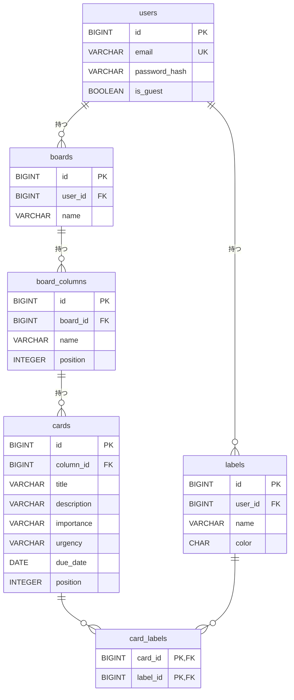

# テーブル設計書：トレロ風タスク管理アプリ

版：1.8（2026-11-01）。変更の履歴は 13章

要件は `requirements.md` を参照。

## 1. 方針

| 項目 | 決定 | 理由 |
|---|---|---|
| DB | PostgreSQL 18 | 講座の指定 |
| ボード | `boards` テーブルを独立させる。1ユーザーが複数のボードを持てる | 最初は1ユーザー1ボードだったが、テーブルを分けておいたので、一意制約を外すだけで複数ボードにできた（`V4__allow_multiple_boards.sql`） |
| リストのテーブル名 | `board_columns`（Javaクラスは `BoardColumn`） | `columns` は SQL で「テーブルの列」の意味でも使われ、紛らわしいため |
| 主キー | `BIGINT GENERATED ALWAYS AS IDENTITY`（自動採番） | 一般的で扱いやすい。IDを推測されても、所有者チェック（要件 U-05）で守る |
| 並び順 | `position` 列に 0 から始まる連番 | 仕組みがわかりやすい。移動したら同じリスト内を振り直す（4章） |
| 削除 | 外部キーに `ON DELETE CASCADE` を付け、DBに任せる | 消し忘れが起きない。ゲストデータも users の1行を消すだけで済む |
| 重要度・緊急度 | 列 `importance`・`urgency`。どちらも文字列 `HIGH` / `MEDIUM` / `LOW`（Javaは共通の enum） | DBを見ても意味がわかる |
| ラベルの色 | 色コード（`#e5484d` 形式） | DBを見て色がわかる。選択肢の一覧は Java と React の両方に持ち、サーバーでも一覧にない色を受け付けない |
| ラベルの持ち主 | ユーザー単位（`labels.user_id`）。ボード単位にはしない | 所有者の確認が `labels.user_id` を見るだけで済む。同じラベルを全ボードで共通に使える（複数ボードにしたときも、このままにした）。ボードごとに分けたくなったら、`board_id` 列を追加する |
| ラベル名 | ユーザーごとに重複不可 | カード詳細で同じ名前が並ばないようにする |
| CHECK制約 | 基本的なものだけ付ける（3.7） | Java のチェックをすり抜けた値を、DBが最後の砦として止める |
| ゲスト | ゲストログインのたびに一時ユーザーを作る | 通常ユーザーと同じ仕組みで動かせる（5章） |
| テーブル作成 | Flyway で管理する | SQLファイルで変更履歴が残り、ローカルとAWSで同じテーブルを作れる |
| 文字コード | UTF8（DBを作るときの標準。日本語・絵文字を保存できる） | 文字列の比べ方は PostgreSQL の標準のまま。PostgreSQL は文字を厳密に比べるので、濁点の有無や大文字・小文字は別の文字として扱われる（3.5） |
| 日時 | `TIMESTAMPTZ`（タイムゾーン付き）。中身は常にUTCで保存される | サーバーやPCのタイムゾーン設定が違っても、同じ時刻として正しく比べられる（6章） |
| 更新日時 | DBのトリガーで自動更新する（3.8） | PostgreSQL には MySQL の `ON UPDATE CURRENT_TIMESTAMP` がないため。手でSQLを流して更新したときも必ず更新される |
| 所有者の確認 | 毎回、持ち主をたどって確認する（テーブルに user_id を重複して持たせない） | 同じ情報を何か所にも持つと、食い違いが起きるため（7章） |

## 2. ER図



回数制限の記録 `rate_limit_events`（3.9）は、どのテーブルともつながらないので、図には入れていない。

## 3. テーブル定義

**テーブルの一覧**

| 論理名 | 物理名 | 中身 | 作る SQL |
|---|---|---|---|
| ユーザー | users | 登録したユーザーとゲスト（3.1） | V1 |
| ボード | boards | ユーザーのボード。1人10個まで（3.2） | V1（V4 で複数に） |
| リスト | board_columns | ボードの中の列（3.3） | V1 |
| カード | cards | タスク1件（3.4） | V1 |
| ラベル | labels | ユーザーのラベル。全ボードで共通（3.5） | V1 |
| カードのラベル | card_labels | カードとラベルの中間テーブル（3.6） | V1 |
| 回数制限の記録 | rate_limit_events | ログインの失敗・ゲストの作成・ユーザー登録の記録（3.9） | V3（V5 で種類を追加） |
| セッション | spring_session | ログイン状態（セッション）。Spring Session JDBC が読み書きする | V2 |
| セッションの属性 | spring_session_attributes | セッションに入れた値（ログイン中のユーザーなど）。Spring Session JDBC が読み書きする | V2 |

- 作る SQL は Flyway のファイル（`backend/src/main/resources/db/migration/V1__create_tables.sql` など。`detailed-design.md` 3.9）
- セッションの2つは Spring Session の決まった形なので、列の定義はこの設計書に書かない（`V2__create_session_tables.sql` を見る）

全テーブル共通で、次の列を持つ（`card_labels`・`rate_limit_events` は `created_at` のみ。セッションの2つは持たない）。

| 論理名 | 物理名 | 型 | 内容 |
|---|---|---|---|
| 作成日時 | created_at | TIMESTAMPTZ | 作成日時。DBが自動で入れる |
| 更新日時 | updated_at | TIMESTAMPTZ | 更新日時。DBのトリガーが自動で更新する（3.8） |

### 3.1 users（ユーザー）

| 論理名 | 物理名 | 型 | NULL | 初期値 | 内容 |
|---|---|---|---|---|---|
| ユーザーID | id | BIGINT | 不可 | 自動採番 | 主キー |
| メールアドレス | email | VARCHAR(255) | 不可 | | 一意。254文字まで。小文字にそろえて保存する。ゲストは `guest-ランダム文字列@guest.local` |
| パスワードのハッシュ | password_hash | VARCHAR(255) | 不可 | | BCryptでハッシュ化したパスワード。ゲストはランダムな値のハッシュ |
| ゲストか | is_guest | BOOLEAN | 不可 | false | ゲストユーザーかどうか |

インデックス：`(is_guest, created_at)`（古いゲストを探して削除するため）

### 3.2 boards（ボード）

| 論理名 | 物理名 | 型 | NULL | 初期値 | 内容 |
|---|---|---|---|---|---|
| ボードID | id | BIGINT | 不可 | 自動採番 | 主キー |
| ユーザーID | user_id | BIGINT | 不可 | | `users.id` への外部キー。1人が複数のボードを持てる（要件 B-02） |
| ボード名 | name | VARCHAR(50) | 不可 | マイボード | ボード名。1〜50文字。画面から変更できる（要件 B-01） |

インデックス：`(user_id)`（自分のボードの一覧を探すため）

最初は1人1ボードの一意制約 `uk_boards_user` があったが、複数ボードにしたときに外した（`V4__allow_multiple_boards.sql`）。一意制約と一緒に `user_id` のインデックスもなくなるので、ふつうのインデックスを作り直した。一覧の並び（作った順）は `id` の順で並べる（`id` は作った順に増えるため）

### 3.3 board_columns（リスト）

| 論理名 | 物理名 | 型 | NULL | 初期値 | 内容 |
|---|---|---|---|---|---|
| リストID | id | BIGINT | 不可 | 自動採番 | 主キー |
| ボードID | board_id | BIGINT | 不可 | | `boards.id` への外部キー |
| リスト名 | name | VARCHAR(50) | 不可 | | リスト名。1〜50文字 |
| 並び順 | position | INTEGER | 不可 | | ボード内の並び順。0から始まる連番 |

インデックス：`(board_id, position)`

### 3.4 cards（カード）

| 論理名 | 物理名 | 型 | NULL | 初期値 | 内容 |
|---|---|---|---|---|---|
| カードID | id | BIGINT | 不可 | 自動採番 | 主キー |
| リストID | column_id | BIGINT | 不可 | | `board_columns.id` への外部キー |
| タイトル | title | VARCHAR(100) | 不可 | | タイトル。1〜100文字 |
| 説明文 | description | VARCHAR(2000) | 可 | NULL | 説明文。2000文字まで |
| 重要度 | importance | VARCHAR(10) | 不可 | MEDIUM | 重要度。`HIGH` / `MEDIUM` / `LOW` |
| 緊急度 | urgency | VARCHAR(10) | 不可 | MEDIUM | 緊急度。`HIGH` / `MEDIUM` / `LOW` |
| 期限 | due_date | DATE | 可 | NULL | 期限（時刻なし） |
| 並び順 | position | INTEGER | 不可 | | リスト内の並び順。0から始まる連番 |

インデックス：`(column_id, position)`

### 3.5 labels（ラベル）

| 論理名 | 物理名 | 型 | NULL | 初期値 | 内容 |
|---|---|---|---|---|---|
| ラベルID | id | BIGINT | 不可 | 自動採番 | 主キー |
| ユーザーID | user_id | BIGINT | 不可 | | `users.id` への外部キー |
| ラベル名 | name | VARCHAR(20) | 不可 | | ラベル名。1〜20文字 |
| 色 | color | CHAR(7) | 不可 | | 色コード（例：`#e5484d`）。`screen-design.md` 6章の8色のみ |

一意制約：`(user_id, name)`

PostgreSQL は文字列を厳密に比べるので、「パン」と「ハン」、「Work」と「work」は別の名前として扱われる（どちらも登録できる）。

### 3.6 card_labels（カードとラベルの中間テーブル）

| 論理名 | 物理名 | 型 | NULL | 内容 |
|---|---|---|---|---|
| カードID | card_id | BIGINT | 不可 | `cards.id` への外部キー |
| ラベルID | label_id | BIGINT | 不可 | `labels.id` への外部キー |

主キー：`(card_id, label_id)`（同じカードに同じラベルを二重に付けられない）
インデックス：`(label_id)`（ラベルからカードを探すため）

**注意**：PostgreSQL は外部キーの列に、インデックスを自動では作らない。この設計では、外部キーの列はすべて上のインデックス・一意制約・主キーの先頭に入っているので、追加は不要。

### 3.7 CHECK制約

| テーブル | ルール |
|---|---|
| boards | `name` が空（空白だけ）でない |
| board_columns | `name` が空でない。`position` が0以上 |
| cards | `title` が空でない。`position` が0以上。`importance`・`urgency` が `HIGH`・`MEDIUM`・`LOW` のどれか |
| labels | `name` が空でない。`color` が `#` と小文字の英数字6桁（例：`#e5484d`） |
| rate_limit_events | `kind` が `LOGIN_FAILURE`・`GUEST_CREATION`・`REGISTRATION` のどれか |

- 文字数の上限は列の型（`VARCHAR(50)` など）で決まるので、CHECK制約には書かない
- 色は「色コードの形」だけを確かめ、「8色のどれか」は Java で確かめる。8色をDBで決めると、色を変えるたびにテーブルの変更が必要になるため
- 色の確認には正規表現の演算子 `~` を使う（`color ~ '^#[0-9a-f]{6}$'`）。`~` は大文字・小文字を区別するので、`#E5484D` は通らない
- CHECK制約に引っかかるのは Java のチェック漏れ（バグ）なので、そのときは500エラーになる

### 3.8 更新日時のトリガー

PostgreSQL には「行を更新したら、自動で更新日時を入れる」列の設定がない。そこで、次の2つを作る。

1. 関数 `set_updated_at()`：更新される行の `updated_at` を今の時刻にする（1回だけ作る）
2. トリガー：`updated_at` を持つ5つのテーブル（`users`・`boards`・`board_columns`・`cards`・`labels`）に「行を更新する直前に `set_updated_at()` を呼ぶ」仕掛けを付ける

`card_labels`・`rate_limit_events` は行を更新しない（足すか消すだけ）ので、`updated_at` もトリガーもない。SQLは10章。Java（JPA）からは `created_at`・`updated_at` に書き込まない。

### 3.9 rate_limit_events（回数制限の記録）

`V3__create_rate_limit_events.sql` で作る（`REGISTRATION` は `V5__add_registration_rate_limit.sql` で足した）。ログインの失敗・ゲストの作成・ユーザー登録のたびに1行を入れ、「直近の決まった時間に、同じ IP アドレスから何行あるか」を数える（要件 U-10、`detailed-design.md` 3.8.8）。

| 論理名 | 物理名 | 型 | NULL | 初期値 | 内容 |
|---|---|---|---|---|---|
| 記録ID | id | BIGINT | 不可 | 自動採番 | 主キー |
| 種類 | kind | VARCHAR(20) | 不可 | | 種類。`LOGIN_FAILURE`（ログインの失敗）/ `GUEST_CREATION`（ゲストの作成）/ `REGISTRATION`（ユーザー登録） |
| IPアドレス | ip_address | VARCHAR(45) | 不可 | | 接続元の IP アドレス。45文字は IPv6 の最長の書き方に合わせた |
| 記録日時 | created_at | TIMESTAMPTZ | 不可 | now() | 記録した日時。ほかのテーブルと違い、Java が入れる（数えるときの「今」と同じ時計にそろえるため） |

インデックス：`(kind, ip_address, created_at)`（数えるため）、`(created_at)`（古い行を消すため）

- users とは結びつけない（ログイン前の操作なので、まだ誰かわからない）。更新しないので `updated_at` もトリガーもない
- 古い行は、毎時0分に消す（いちばん長い数える時間の1時間より古いもの）。数えないので残す意味がなく、行が増え続けない

## 4. 並び順（position）のルール

- リストはボード内で、カードはリスト内で、0, 1, 2 … と隙間なく番号を振る
- 追加：今ある最大の position ＋ 1（一番右・一番下に並ぶ。要件 L-02, C-01）
- 削除：残ったものを 0 から振り直す
- 移動：移動先のリスト（別のリストへ移動した場合は移動元も）を 0 から振り直す
- 振り直しは1つのトランザクションの中で行い、途中で失敗したら全部元に戻す
- `(column_id, position)` などに一意制約は付けない。振り直しの途中で一時的に番号が重なり、エラーになるため

例：カード「A=0, B=1, C=2, D=3」の D を A と B の間に移動 → A=0, D=1, B=2, C=3

## 5. 削除の連鎖（ON DELETE CASCADE）

| 削除するもの | 一緒に消えるもの |
|---|---|
| users | boards、labels（→ その先もすべて） |
| boards | board_columns → cards → card_labels |
| board_columns | cards → card_labels（要件 L-04） |
| cards | card_labels |
| labels | card_labels（カードからラベルが外れる。カードは消えない。要件 T-03） |

ゲストユーザーは、users の行を削除するだけで関連データがすべて消える（要件 U-08）。

- ゲストがログアウトしたとき：そのゲストの users の行をすぐに削除する
- 定期削除：Spring の `@Scheduled` で1時間ごとに、次のSQLにあたる削除を行う
  ```sql
  DELETE FROM users WHERE is_guest = TRUE AND created_at < now() - INTERVAL '24 hours';
  ```
  `(is_guest, created_at)` のインデックスで、対象をすばやく探せる

## 6. 日時の扱い

- `created_at`・`updated_at` は `TIMESTAMPTZ`。PostgreSQL が内部でUTCに変換して保存するので、接続する側のタイムゾーン設定に左右されない。Java では `Instant`（世界共通のある瞬間）で受け取る
- 念のため、Spring Boot は JVM のタイムゾーンを UTC にして動かす（ログの時刻などをそろえるため）
- `due_date`（期限）は時刻を持たない日付（`DATE`）なので、タイムゾーンの影響を受けない。Java では `LocalDate`
- 期限の色分け（要件 C-05）の「今日」は、React で利用者のブラウザの日付を使って判定する

## 7. 所有者の確認（要件 U-05）

他人のデータを操作させないために、APIで受け取ったIDについて毎回、ログイン中のユーザーのものかを確認する。

| 操作の対象 | 確認のしかた |
|---|---|
| リスト | board_columns → boards とたどり、`boards.user_id` がログイン中のユーザーか |
| カード | cards → board_columns → boards とたどり、`boards.user_id` がログイン中のユーザーか |
| ラベル | `labels.user_id` がログイン中のユーザーか |
| カードへのラベル付け | **カードとラベルの両方** が、ログイン中のユーザーのものか |
| ボード | `boards.user_id` がログイン中のユーザーか |
| カードの移動 | カードがログイン中のユーザーのもので、移動先のリストが **カードと同じボード** にあるか（自分の別のボードへも移せない） |

- 他人のデータ（または存在しないデータ）を指定されたら、「404 見つかりません」を返す。403（権限なし）を返すと、そのIDのデータが存在することを教えてしまうため
- card_labels の外部キーは「カードとラベルが存在するか」しか確認しない。他人のラベルを自分のカードに付けることは DB では防げないので、必ずアプリで確認する

## 8. データ量の上限

要件 3.7 のとおり、ボードは1ユーザーに10個、リストは1ボードに20個、カードは1リストに100枚、ラベルは1ユーザーに30個まで。追加の前にアプリで件数を数えて確認する（DBの制約では表現しない）。

この上限により、1ボードのカードは最大2,000枚（1ユーザーでは最大20,000枚）、並び順の振り直しは最大100行になる。ボードの画面は1ボードずつ読むので、1回に読むカードは最大2,000枚のまま。連番方式（4章）で性能の問題は起きない。

## 9. 初期データ

### 9.1 ユーザー登録時・ボードの追加時（要件 U-02・B-03）

- boards に1行（名前は、登録時は「マイボード」、ボードの追加では入力した名前）
- board_columns に3行：未着手（0）、作業中（1）、完了（2）

### 9.2 ゲストログイン時（要件 U-06）

- users に1行（`is_guest = true`、ダミーのメールアドレス）
- 9.1 と同じボードとリストに加えて、サンプルのカードとラベル。中身はモックアップ（`mockup/js/sample-data.js` の `createGuestSampleBoard`）と同じにする（`detailed-design.md` 1章）

## 10. テーブル作成SQL（Flyway の `V1__create_tables.sql` の原案）

```sql
-- 更新日時を自動で入れる関数（3.8）
CREATE FUNCTION set_updated_at() RETURNS trigger AS $$
BEGIN
    NEW.updated_at = now();
    RETURN NEW;
END;
$$ LANGUAGE plpgsql;

CREATE TABLE users (
    id            BIGINT       GENERATED ALWAYS AS IDENTITY,
    email         VARCHAR(255) NOT NULL,
    password_hash VARCHAR(255) NOT NULL,
    is_guest      BOOLEAN      NOT NULL DEFAULT FALSE,
    created_at    TIMESTAMPTZ  NOT NULL DEFAULT now(),
    updated_at    TIMESTAMPTZ  NOT NULL DEFAULT now(),
    CONSTRAINT pk_users PRIMARY KEY (id),
    CONSTRAINT uk_users_email UNIQUE (email)
);
CREATE INDEX idx_users_guest_created ON users (is_guest, created_at);

CREATE TABLE boards (
    id         BIGINT      GENERATED ALWAYS AS IDENTITY,
    user_id    BIGINT      NOT NULL,
    name       VARCHAR(50) NOT NULL DEFAULT 'マイボード',
    created_at TIMESTAMPTZ NOT NULL DEFAULT now(),
    updated_at TIMESTAMPTZ NOT NULL DEFAULT now(),
    CONSTRAINT pk_boards PRIMARY KEY (id),
    CONSTRAINT uk_boards_user UNIQUE (user_id),
    CONSTRAINT fk_boards_user FOREIGN KEY (user_id) REFERENCES users (id) ON DELETE CASCADE,
    CONSTRAINT chk_boards_name CHECK (char_length(btrim(name)) > 0)
);

CREATE TABLE board_columns (
    id         BIGINT      GENERATED ALWAYS AS IDENTITY,
    board_id   BIGINT      NOT NULL,
    name       VARCHAR(50) NOT NULL,
    position   INTEGER     NOT NULL,
    created_at TIMESTAMPTZ NOT NULL DEFAULT now(),
    updated_at TIMESTAMPTZ NOT NULL DEFAULT now(),
    CONSTRAINT pk_board_columns PRIMARY KEY (id),
    CONSTRAINT fk_board_columns_board FOREIGN KEY (board_id) REFERENCES boards (id) ON DELETE CASCADE,
    CONSTRAINT chk_board_columns_name CHECK (char_length(btrim(name)) > 0),
    CONSTRAINT chk_board_columns_position CHECK (position >= 0)
);
CREATE INDEX idx_board_columns_board_position ON board_columns (board_id, position);

CREATE TABLE cards (
    id          BIGINT        GENERATED ALWAYS AS IDENTITY,
    column_id   BIGINT        NOT NULL,
    title       VARCHAR(100)  NOT NULL,
    description VARCHAR(2000) NULL,
    importance  VARCHAR(10)   NOT NULL DEFAULT 'MEDIUM',
    urgency     VARCHAR(10)   NOT NULL DEFAULT 'MEDIUM',
    due_date    DATE          NULL,
    position    INTEGER       NOT NULL,
    created_at  TIMESTAMPTZ   NOT NULL DEFAULT now(),
    updated_at  TIMESTAMPTZ   NOT NULL DEFAULT now(),
    CONSTRAINT pk_cards PRIMARY KEY (id),
    CONSTRAINT fk_cards_column FOREIGN KEY (column_id) REFERENCES board_columns (id) ON DELETE CASCADE,
    CONSTRAINT chk_cards_title CHECK (char_length(btrim(title)) > 0),
    CONSTRAINT chk_cards_position CHECK (position >= 0),
    CONSTRAINT chk_cards_importance CHECK (importance IN ('HIGH', 'MEDIUM', 'LOW')),
    CONSTRAINT chk_cards_urgency CHECK (urgency IN ('HIGH', 'MEDIUM', 'LOW'))
);
CREATE INDEX idx_cards_column_position ON cards (column_id, position);

CREATE TABLE labels (
    id         BIGINT      GENERATED ALWAYS AS IDENTITY,
    user_id    BIGINT      NOT NULL,
    name       VARCHAR(20) NOT NULL,
    color      CHAR(7)     NOT NULL,
    created_at TIMESTAMPTZ NOT NULL DEFAULT now(),
    updated_at TIMESTAMPTZ NOT NULL DEFAULT now(),
    CONSTRAINT pk_labels PRIMARY KEY (id),
    CONSTRAINT uk_labels_user_name UNIQUE (user_id, name),
    CONSTRAINT fk_labels_user FOREIGN KEY (user_id) REFERENCES users (id) ON DELETE CASCADE,
    CONSTRAINT chk_labels_name CHECK (char_length(btrim(name)) > 0),
    CONSTRAINT chk_labels_color CHECK (color ~ '^#[0-9a-f]{6}$')
);

CREATE TABLE card_labels (
    card_id    BIGINT      NOT NULL,
    label_id   BIGINT      NOT NULL,
    created_at TIMESTAMPTZ NOT NULL DEFAULT now(),
    CONSTRAINT pk_card_labels PRIMARY KEY (card_id, label_id),
    CONSTRAINT fk_card_labels_card  FOREIGN KEY (card_id)  REFERENCES cards (id)  ON DELETE CASCADE,
    CONSTRAINT fk_card_labels_label FOREIGN KEY (label_id) REFERENCES labels (id) ON DELETE CASCADE
);
CREATE INDEX idx_card_labels_label ON card_labels (label_id);

-- 更新日時のトリガー（card_labels は更新しないので付けない）
CREATE TRIGGER trg_users_updated_at         BEFORE UPDATE ON users         FOR EACH ROW EXECUTE FUNCTION set_updated_at();
CREATE TRIGGER trg_boards_updated_at        BEFORE UPDATE ON boards        FOR EACH ROW EXECUTE FUNCTION set_updated_at();
CREATE TRIGGER trg_board_columns_updated_at BEFORE UPDATE ON board_columns FOR EACH ROW EXECUTE FUNCTION set_updated_at();
CREATE TRIGGER trg_cards_updated_at         BEFORE UPDATE ON cards         FOR EACH ROW EXECUTE FUNCTION set_updated_at();
CREATE TRIGGER trg_labels_updated_at        BEFORE UPDATE ON labels        FOR EACH ROW EXECUTE FUNCTION set_updated_at();
```

セッション（ログイン状態）を保存する Spring Session JDBC のテーブルは、`V2__create_session_tables.sql` で作る（`detailed-design.md` 3.9）。回数制限の記録（3.9）は `V3__create_rate_limit_events.sql` で作る。1人1ボードの一意制約は `V4__allow_multiple_boards.sql` で外した（上の SQL は最初の形のまま残している）。`kind` の CHECK 制約は `V5__add_registration_rate_limit.sql` で作り直した。

## 11. まだ決めていないこと

- ~~ゲストのサンプルデータの中身~~ → モックアップと同じ（2026-10-25 決定）

## 12. CRUD 表

どの処理が、どのテーブルを作る（C）・読む（R）・変える（U）・消す（D）かの一覧。コード（Service・Repository）と合わせてある。

- 「D*」は、DB の `ON DELETE CASCADE`（5章）で一緒に消えるもの。アプリは親の行を消すだけ
- 鍵をかけて読む（`SELECT … FOR UPDATE`。上限の確認や並び順の振り直しを、同時の操作から守る）も R にしている
- セッションの2つ（`spring_session`・`spring_session_attributes`）は、まとめて「セッション」の列にした。ログインが必要な API は、どれもセッションを読み（R）、最後に使った時刻を変える（U）。下の表には、それ以外の操作だけを書く

| 処理 | users | boards | board_columns | cards | labels | card_labels | rate_limit_events | セッション |
|---|---|---|---|---|---|---|---|---|
| A-01 ユーザー登録 | CR | C | C | | | | CR | C |
| A-02 ログイン | R | | | | | | CR | CU |
| A-03 ゲストログイン | C | C | C | C | C | C | CR | C |
| A-04 ログアウト（ゲストのときは削除） | D | D* | D* | D* | D* | D* | | D |
| A-05 ログイン中のユーザー | R | | | | | | | D（ユーザーが消えていたとき） |
| A-19 退会 | RD | D* | D* | D* | D* | D* | CR | D（ほかの端末のものも） |
| A-20 メールアドレスの変更 | RU | | | | | | CR | CUD（ほかの端末のものを消す） |
| A-21 パスワードの変更 | RU | | | | | | CR | CUD（ほかの端末のものを消す） |
| A-22 ボードの一覧 | | R | | | | | | |
| A-23 ボードの作成 | R | CR | C | | | | | |
| A-06 ボードの取得 | | R | R | R | R | R | | |
| A-07 ボード名の変更 | | RU | | | | | | |
| A-24 ボードの削除 | | RD | D* | D* | | D* | | |
| A-08 リストの追加 | | R | CR | | | | | |
| A-09 リスト名の変更 | | R | RU | | | | | |
| A-10 リストの削除 | | R | RUD | D* | | D* | | |
| A-11 リストの並び替え | | R | RU | | | | | |
| A-12 カードの追加 | | R | R | CR | | | | |
| A-13 カードの保存 | | R | R | RU | R | CRD | | |
| A-14 カードの削除 | | R | R | RUD | | D* | | |
| A-15 カードの並び替え・移動 | | R | R | RU | | | | |
| A-16 ラベルの追加 | | | | | CR | | | |
| A-17 ラベルの変更 | | | | | RU | | | |
| A-18 ラベルの削除 | | | | | RD | D* | | |
| ゲストの定期削除（`GuestCleanupJob`。毎時） | D | D* | D* | D* | D* | D* | | |
| 古い回数制限の記録の削除（`RateLimitCleanupJob`。毎時） | | | | | | | D | |

- A-01・A-03 の rate_limit_events：数えて（R）から記録する（C）。A-02・A-19〜A-21 は、パスワードが違ったときだけ C
- A-04 の users の D は、ゲストのときだけ。ふつうのユーザーはセッションを消すだけ
- U（並び順）：A-10・A-14 は残ったものの並び順を振り直し、A-11・A-15 は動かしたものと周りの並び順を変える（4章）
- A-12〜A-15 の boards・board_columns の R は、持ち主の確認と、ボードへの鍵（`detailed-design.md` 3.8）
- A-13 の card_labels：付けたラベルの行を足し（C）、外したラベルの行を消す（D）。JPA が今の行と比べて足し引きする

## 13. 改訂履歴

テーブルの形や決めごとが変わったものだけを書く。それぞれの中身は、Git の履歴と、イシュー・PR で見られる。

| 版 | 日付 | 内容 | Flyway | イシュー |
|---|---|---|---|---|
| 1.0 | 2026-10-25 | 初版。6つのテーブル（users・boards・board_columns・cards・labels・card_labels）、ER図、並び順・削除の連鎖・所有者の確認の決めごと | | |
| 1.1 | 2026-10-25 | CHECK 制約と、文字コード・ラベルの持ち主の理由を追記 | | |
| 1.2 | 2026-10-25 | 優先度（priority）を重要度（importance）に改め、緊急度（urgency）の列を追加 | | |
| 1.3 | 2026-10-25 | DB を MySQL から PostgreSQL 18 に変更（日時は TIMESTAMPTZ、更新日時はトリガー） | | |
| 1.4 | 2026-10-25 | テーブルを Flyway で作る。セッションのテーブルを追加 | V1・V2 | |
| 1.5 | 2026-11-01 | 回数制限の記録 rate_limit_events を追加（3.9） | V3 | #41 |
| 1.6 | 2026-11-01 | 1人が複数のボードを持てるように、`boards.user_id` の一意制約を外す（3.2） | V4 | #51 |
| 1.7 | 2026-11-01 | 回数制限の種類に `REGISTRATION`（ユーザー登録）を追加 | V5 | #53 |
| 1.8 | 2026-11-01 | テーブルの一覧、論理名と物理名、CRUD 表（12章）、改訂履歴（13章）を追加。ER図の `boards.user_id` に残っていた一意の印と、3.8 のトリガーの対象の書き方を直す | | #59 |
