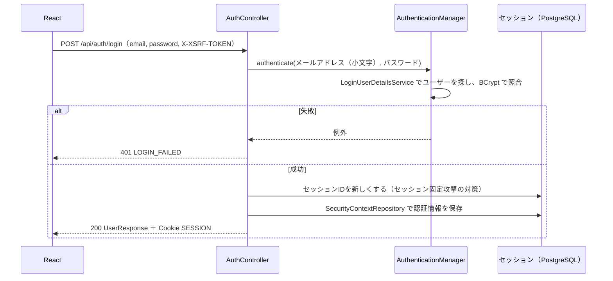

# 詳細設計書：トレロ風タスク管理アプリ

最終更新：2026-11-01（複数ボードを追加。イシュー #51）

要件は `requirements.md`、画面は `screen-design.md`、テーブルは `database-design.md`、APIは `api-design.md` を参照。
この設計書は、それらを「プログラムの中でどう作るか」に落とし込んだもの（内部設計）。

## 1. 方針

| # | 項目 | 決定 | 理由 |
|---|---|---|---|
| 1 | クラスの分け方 | Controller → Service → Repository の3層。フォルダ（パッケージ）は機能ごと | 「カードの処理は card を見ればよい」と説明しやすい。API設計書の章立てともそろう |
| 2 | パッケージ名 | `io.github.keiwebcreate.taskboard` | 自分のドメインを持っていない個人開発の一般的な付け方（GitHub のアドレスを逆にしたもの） |
| 3 | JSONの形 | エンティティとは別に DTO を作る。DTO は Java の `record` | パスワードなど返してはいけない項目を返さない。API設計書の形（`labelIds` など）をそのまま表せる |
| 4 | エンティティの関連 | 子→親（`@ManyToOne`）だけ書く。カードとラベルは `@ManyToMany`。親→子（`@OneToMany`）は書かない | N+1問題（SQLがデータの数だけ走る）を防ぐ。削除は DB の `ON DELETE CASCADE` に任せ、JPA と二重に管理しない |
| 5 | 所有者の確認 | Repository で「ID＋持ち主」を条件にして探す。見つからなければ 404 | SQLの段階で他人のデータが出てこないので、確認の入れ忘れが起きにくい |
| 6 | 入力チェック・エラー | 形のチェックは DTO の Bean Validation。ルール違反は Service が独自の例外を投げ、`@RestControllerAdvice` で Problem Details に変換する | Controller にエラー処理を書かずに済み、エラーの形が必ずそろう |
| 7 | React の言語 | TypeScript | APIの形を型にでき、書き間違いを動かす前に見つけられる |
| 8 | React の状態管理 | `useReducer`＋Context | 追加のライブラリがいらず、モックアップの `board-store.js` と同じ考え方。API設計書 6章の流れにそのまま合う |
| 9 | React のCSS | CSS Modules。共通の色などは CSS 変数にまとめる | モックアップの `style.css` を部品ごとに切り分けて移せる。クラス名がぶつからない |
| 10 | React のフォルダ | 機能ごと（`features/auth`・`board`・`card`・`label`）と共通（`shared`） | サーバー側と同じ考え方にそろえる |
| 11 | セッションの置き場所 | PostgreSQL（Spring Session JDBC） | サーバーを再起動してもログイン状態が残る。API設計書の Cookie 名 `SESSION` とも合う |
| 12 | ビルドツール | Gradle | Spring Initializr の初期値。設定が短く書ける |
| 13 | Lombok | 使わない | 書いたコードがそのまま動くので説明しやすい。DTO は record なので、getter が必要なのはエンティティだけ |

おすすめで決めた小さなこと（変えたくなったら変えてよい）：

| 項目 | 決定 |
|---|---|
| フォルダ | `beginner_version/backend`（Spring Boot）、`beginner_version/frontend`（React）。リポジトリは1つのまま |
| 画面の切り替え | React Router |
| APIの呼び出し | ブラウザ標準の `fetch` を包んだ関数を自作する（axios は使わない） |
| フォーム | `useState` で自作する（フォーム用のライブラリは使わない。入力欄が少ないため） |
| 開発用DB | Docker Compose（`compose.yaml`）で PostgreSQL 18 を動かす。起動・停止は自分で `docker compose up -d`・`stop`。データは Docker のボリュームに保存（2026-10-25 決定） |
| サーバーのテスト用DB | Testcontainers（テストのたびに Docker で PostgreSQL 18 を立ち上げる）。本番と同じ PostgreSQL で確かめられ、GitHub Actions でも動く |
| ゲストのサンプルデータ | モックアップの `mockup/js/sample-data.js` の `createGuestSampleBoard` と同じ中身（`database-design.md` 11章の未決事項） |
| バージョン | Java は 25（最新のLTS。講座の指定）。Spring Boot・Gradle・React などは、ひな形を作るときの最新の安定版にする（Java 25 には Gradle 9.1 以上が必要） |

## 2. 全体の構成

```
beginner_version/
├─ compose.yaml 開発用の PostgreSQL 18（Docker。ポート 5432）
├─ backend/    Spring Boot（ポート 8080）
├─ frontend/   React（Vite。開発中はポート 5173）
├─ docs/       設計書
└─ mockup/     モックアップ（本番では使わない）
```

- 開発中は、ブラウザで `http://localhost:5173` を開く。React（Vite）が `/api` で始まる通信を Spring Boot（8080）へ転送する（Vite の proxy 機能。API設計書 2.3）
- 本番での配信のしかたは、AWS の構成で決める

## 3. サーバー（Spring Boot）

### 3.1 パッケージ構成

```
io.github.keiwebcreate.taskboard
├─ TaskBoardApplication          起動クラス
├─ auth/                          ログイン関係（A-01〜A-05、A-19）
│   ├─ AuthController
│   ├─ AuthService               登録・ゲスト作成・退会
│   ├─ GuestSampleData           ゲストのサンプルデータを作る
│   ├─ GuestCleanupJob           24時間たったゲストを1時間ごとに削除する
│   ├─ RateLimiter               回数制限（ログインの失敗・ゲストの作成・ユーザー登録。3.8.8）
│   ├─ RateLimitEvent, RateLimitEventRepository, RateLimitKind
│   ├─ RateLimitProperties       回数制限の設定値（app.rate-limit）
│   ├─ RateLimitCleanupJob       古い回数制限の記録を1時間ごとに削除する
│   ├─ LoginUser                 ログイン中のユーザー（Spring Security の UserDetails）
│   ├─ LoginUserDetailsService   メールアドレスからユーザーを探す（ログイン時）
│   └─ dto/                      SignupRequest, LoginRequest, WithdrawRequest, UserResponse
├─ user/
│   ├─ User                      エンティティ
│   └─ UserRepository
├─ board/                         ボード（A-06・A-07・A-22〜A-24）
│   ├─ Board, BoardRepository
│   ├─ BoardController, BoardService
│   └─ dto/                      BoardResponse, BoardNameRequest, BoardSummaryResponse
├─ column/                        リスト（A-08〜A-11）
│   ├─ BoardColumn, BoardColumnRepository
│   ├─ ColumnController, ColumnService
│   └─ dto/                      ColumnRequest, ColumnResponse
├─ card/                          カード（A-12〜A-15）
│   ├─ Card, CardRepository, Level（重要度・緊急度の enum）
│   ├─ CardController, CardService
│   └─ dto/                      CardCreateRequest, CardRequest, CardResponse
├─ label/                         ラベル（A-16〜A-18）
│   ├─ Label, LabelRepository, LabelColor（8色の一覧）
│   ├─ LabelController, LabelService
│   └─ dto/                      LabelRequest, LabelResponse
└─ common/
    ├─ security/                 SecurityConfig、401・403 を Problem Details にする部品
    ├─ error/                    独自の例外、ApiExceptionHandler（@RestControllerAdvice）
    ├─ position/                 PositionRequest（並び替えの共通DTO）、並び順の振り直し
    └─ config/                   LimitsProperties（上限の設定値）など
```

### 3.2 層の役割とルール

| 層 | 役割 | ルール |
|---|---|---|
| Controller | APIの受け口。URL・HTTPメソッド・ステータスコードを決め、DTO を受け取って Service を呼び、DTO を返す | 処理の中身（判断）を書かない。リクエストの DTO には `@Valid` を付ける。ログイン中のユーザーは `@AuthenticationPrincipal LoginUser` で受け取る |
| Service | 処理の中身。所有者の確認、上限のチェック、重複のチェック、並び順の振り直し | 変更するメソッドには `@Transactional` を付ける（途中で失敗したら全部元に戻す。例外：退会は `TransactionTemplate`。3.8.7）。読むだけのメソッドは `@Transactional(readOnly = true)`。ルール違反は独自の例外を投げる。エンティティを DTO に変換して返す |
| Repository | DBとのやりとり（Spring Data JPA） | 持ち主を確認しないで1件を探すメソッド（`findById` など）は、Service から使わない（3.5） |

### 3.3 エンティティ

テーブル設計書 3章の1テーブルにつき1クラス（`card_labels` は `Card` の `@ManyToMany` で表すので、クラスは作らない）。

| クラス | テーブル | 親へのつながり | ほかの項目 |
|---|---|---|---|
| `User` | users | なし | email, passwordHash, guest（is_guest）, createdAt |
| `Board` | boards | `@ManyToOne User user` | name |
| `BoardColumn` | board_columns | `@ManyToOne Board board` | name, position |
| `Card` | cards | `@ManyToOne BoardColumn column` | title, description, importance, urgency, dueDate, position, `@ManyToMany Set<Label> labels`（card_labels） |
| `Label` | labels | `@ManyToOne User user` | name, color |
| `RateLimitEvent` | rate_limit_events | なし | kind（`RateLimitKind`）, ipAddress, createdAt |

- `@ManyToOne` は `fetch = FetchType.LAZY`（必要になるまで親を読まない）にする
- `Level`（`HIGH`・`MEDIUM`・`LOW`）は `@Enumerated(EnumType.STRING)` で文字列として保存する
- `created_at`・`updated_at` は DB が自動で入れる（更新日時はトリガー。テーブル設計書 3.8）ので、Java からは書き込まない（`insertable = false, updatable = false`）。型は `Instant`
  - 例外：`RateLimitEvent` の `createdAt` は Java の時計（`Instant.now()`）で入れる。数えるときの「今」と同じ時計にそろえるため（3.8.8）
- setter は作らず、変えてよい項目だけを変えるメソッドを用意する（例：`Card.update(title, description, ...)`、`Card.moveTo(column, position)`）
- 削除は DB の `ON DELETE CASCADE` に任せる。JPA の `cascade` 設定は使わない
- 設定 `spring.jpa.open-in-view: false`（画面に返したあとで勝手にSQLが走るのを防ぐ）、`spring.jpa.hibernate.ddl-auto: validate`（テーブルは Flyway だけが作る。JPA はクラスとテーブルが合っているかを確かめるだけ）

### 3.4 DTO

API設計書 5章のJSONと1対1で対応させる。項目名はキャメルケース（`dueDate`・`labelIds`）。

| API | リクエスト | レスポンス |
|---|---|---|
| A-01 登録 | `SignupRequest(email, password)` | `UserResponse(id, email, isGuest)` |
| A-02 ログイン | `LoginRequest(email, password)` | `UserResponse` |
| A-03 ゲスト | なし | `UserResponse` |
| A-05 自分 | なし | `UserResponse` |
| A-19 退会 | `WithdrawRequest(password)` | なし（204） |
| A-20 メールアドレスの変更 | `EmailChangeRequest(email, currentPassword)` | `UserResponse` |
| A-21 パスワードの変更 | `PasswordChangeRequest(currentPassword, newPassword)` | なし（204） |
| A-22 ボードの一覧 | なし | `List<BoardSummaryResponse(id, name)>` |
| A-23 ボードの作成 | `BoardNameRequest(name)` | `BoardSummaryResponse` |
| A-06 ボード | なし | `BoardResponse(id, name, labels, columns)`。中に `LabelResponse`、`ColumnWithCardsResponse(id, name, cards)`、`CardResponse` |
| A-07 ボード名 | `BoardNameRequest(name)` | `BoardSummaryResponse` |
| A-24 ボードの削除 | なし | なし（204） |
| A-08・A-09 リスト | `ColumnRequest(name)` | `ColumnResponse(id, name)` |
| A-11・A-15 並び替え | `PositionRequest(position)`、カードは `CardPositionRequest(columnId, position)` | なし（204） |
| A-12 カード追加 | `CardCreateRequest(title)` | `CardResponse` |
| A-13 カード保存 | `CardRequest(title, description, importance, urgency, dueDate, labelIds)` | `CardResponse(id, title, description, importance, urgency, dueDate, labelIds)` |
| A-16・A-17 ラベル | `LabelRequest(name, color)` | `LabelResponse(id, name, color)` |

入力チェックの付け方（例）：

```java
public record CardRequest(
        @NotBlank(message = "タイトルを入力してください")
        @Size(max = 100, message = "タイトルは100文字以内で入力してください")
        String title,
        @Size(max = 2000, message = "説明は2000文字以内で入力してください")
        String description,
        @NotNull Level importance,
        @NotNull Level urgency,
        LocalDate dueDate,
        @NotNull List<Long> labelIds) {}
```

- メッセージは `screen-design.md` 7章の文言にそろえる
- 前後の空白の除去（API設計書 2.5）は Service で行う。`@Size` は除去前の長さで数えるので、「空白を足して101文字以上」は 400 になる（画面側でも同じ長さで止めるので、ふつうは起きない）
- 色が8色のどれかは `LabelColor` を使って Service で確かめる

### 3.5 Repository と所有者の確認

持ち主（ログイン中のユーザーのID）を条件に入れて探すメソッドだけを使う（テーブル設計書 7章）。

| Repository | 主なメソッド | 内容 |
|---|---|---|
| `BoardRepository` | `findByIdAndUserId(boardId, userId)` | 自分のボード1件 |
| | `findByUserIdOrderById(userId)`、`countByUserId(userId)` | ボードの一覧（作った順）、ボードの数（上限の確認） |
| | `findWithLockByIdAndUserId`・`findWithLockByColumnIdAndUserId`・`findWithLockByCardIdAndUserId`（`@Lock`。あとの2つは `@Query`） | ボード・リスト・カードの ID から、そのボードに鍵をかけて取る（3.8.2） |
| `BoardColumnRepository` | `findByIdAndBoardUserId(columnId, userId)` | 自分のリスト1件 |
| | `findByIdAndBoardId(columnId, boardId)` | ボードの中のリスト1件（カードの移動先が同じボードか） |
| | `findByBoardIdOrderByPosition(boardId)` | ボードのリスト一覧（並び順） |
| | `countByBoardId(boardId)` | 上限の確認 |
| `CardRepository` | `findByIdAndColumnBoardUserId(cardId, userId)` | 自分のカード1件 |
| | `findByColumnIdOrderByPosition(columnId)` | リストのカード一覧（振り直し用） |
| | `findAllForBoard(boardId)`（`@Query` で自作） | ボードの全カードを、ラベルと一緒に1回のSQLで取る（3.8.1） |
| | `countByColumnId(columnId)` | 上限の確認 |
| `LabelRepository` | `findByIdAndUserId(labelId, userId)` | 自分のラベル1件 |
| | `findAllByIdInAndUserId(labelIds, userId)` | カードに付けるラベル（全部が自分のものか） |
| | `findByUserIdOrderById(userId)` | ラベル一覧（作成順） |
| | `countByUserId(userId)` | ラベルの数（上限の確認） |
| | `existsByUserIdAndName(userId, name)`、`existsByUserIdAndNameAndIdNot(userId, name, labelId)` | 同じ名前のラベルがあるか（追加のとき・変更のとき。変更では自分自身を除く）。ほぼ同時の操作は DB の一意制約 `uk_labels_user_name` で止め、そのエラーも 409 LABEL_NAME_DUPLICATED にする |
| `UserRepository` | `findByEmail(email)`、`existsByEmail(email)` | ログイン・登録 |
| | `findWithLockById(id)`（`@Lock`） | ユーザーの行に鍵をかけて取る（ボードの作成。3.8.10） |
| | `deleteGuestsCreatedBefore(time)`（`@Modifying @Query`） | 古いゲストの削除 |
| `RateLimitEventRepository` | `lock(key)`（`@Query` のネイティブ SQL） | 「種類:IPアドレス」に鍵をかける（3.8.8） |
| | `countByKindAndIpAddressAndCreatedAtAfter(kind, ip, since)` | 数える時間の中の回数 |
| | `findCreatedAtSkipping(kind, ip, since, skip)`（`@Query`。`limit 1 offset :skip`） | 古いほうから skip 件を飛ばした記録の日時（Retry-After を出すため） |
| | `deleteCreatedBefore(time)`（`@Modifying @Query`） | 古い記録の削除 |

- Service では、見つからなければ `NotFoundException`（404）を投げる。他人のデータも存在しないデータも同じ扱いになる
- カードにラベルを付けるとき：`findAllByIdInAndUserId` で取れた件数が、送られてきたID（重複を除く）の数より少なければ 404

### 3.6 例外とエラーの変換

Service は次の独自の例外を投げる。`common/error/ApiExceptionHandler`（`@RestControllerAdvice`）がまとめて受け取り、API設計書 4章の Problem Details に変換する。

| 例外 | ステータス | code | 投げる場面 |
|---|---|---|---|
| `NotFoundException` | 404 | NOT_FOUND | 他人・存在しないデータ |
| `LimitExceededException(message)` | 409 | LIMIT_EXCEEDED | 上限（リスト20・カード100・ラベル30） |
| `EmailDuplicatedException` | 409 | EMAIL_DUPLICATED | 登録済みのメールアドレス |
| `LabelNameDuplicatedException` | 409 | LABEL_NAME_DUPLICATED | 同じ名前のラベル |
| `InvalidPositionException` | 400 | INVALID_POSITION | 並び替えの位置が範囲外 |
| `FieldValidationException(field, message)` | 400 | VALIDATION_ERROR | Bean Validation では表せない入力のエラー（例：退会のパスワード違い、8色以外の色、空白だけの名前） |
| `GuestNotAllowedException` | 403 | GUEST_NOT_ALLOWED | ゲストの退会・メールアドレスの変更・パスワードの変更（メッセージは操作ごとに渡す） |
| `LoginFailedException` | 401 | LOGIN_FAILED | ログイン失敗 |
| `RateLimitedException(retryAfterSeconds)` | 429 | RATE_LIMITED | 回数制限（3.8.8）。ヘッダー `Retry-After` に秒数を入れる |

Spring が投げる例外も同じ形にそろえる。`ApiExceptionHandler` は Spring 標準の `ResponseEntityExceptionHandler` を継承する。Spring MVC の例外は、これが正しいステータスを決めて、最後に `handleExceptionInternal` を呼ぶ。そこで、ステータスに合わせて `code` と日本語の `detail` を付ける（2026-10-31、品質チェック #31。それまでは自分で例外を1つずつ受け取っていたため、URL の ID に数字以外が来ると 500 になっていた）。

| 例外 | 変換先 |
|---|---|
| ステータスが 400 になるもの（`@Valid` の失敗、JSON が壊れている・enum にない値、URL の ID が数字でないなど） | 400 VALIDATION_ERROR。`@Valid` の失敗のときは `errors` に項目ごとのメッセージ |
| ステータスが 404 になるもの（存在しない URL） | 404 NOT_FOUND |
| そのほかの Spring MVC の例外（405 メソッドの違い、415 Content-Type の違いなど） | そのステータスで、`code` はステータスの名前（`METHOD_NOT_ALLOWED` など）。画面からは起きない。405 のときは使えるメソッドを `Allow` ヘッダーで返す |
| 上のどれでもない例外 | 500 INTERNAL_ERROR。詳細（スタックトレース）はログにだけ出し、レスポンスには含めない（要件 5.2） |
| 未ログイン（Spring Security） | 401 UNAUTHENTICATED。`AuthenticationEntryPoint` で作る |
| CSRFトークンの不一致（Spring Security） | 403 CSRF_INVALID。`AccessDeniedHandler` で作る |

### 3.7 設定（application.yml）

| 設定 | 値 |
|---|---|
| DBの接続先・ユーザー・パスワード | 環境変数 `DB_URL`・`DB_USERNAME`・`DB_PASSWORD` から読む。コードやGitには書かない |
| DBの接続URL（ローカル） | `jdbc:postgresql://localhost:5432/task_app`。DB は `beginner_version/compose.yaml` の Docker（PostgreSQL 18）。`DB_URL`・`DB_USERNAME` は省略するとこの値と `task_app_user` を使う |
| JVMのタイムゾーン | UTC（ログの時刻などをそろえるため。テーブル設計書 6章） |
| セッション | `spring.session.timeout: 30m`（要件 U-09）。保存先は JDBC。テーブルは Flyway で作る（3.9） |
| 上限 | `app.limits.columns: 20`・`cards-per-column: 100`・`labels: 30`。`LimitsProperties`（`@ConfigurationProperties`）で読む（要件 3.7） |
| 回数制限 | `app.rate-limit.login-failure`（`max-count: 10`・`window: 15m`）、`app.rate-limit.guest-creation`（`max-count: 10`・`window: 1h`）、`app.rate-limit.registration`（`max-count: 10`・`window: 1h`）。`RateLimitProperties` で読む（要件 U-10、3.8.8）。`@Validated` で、書き忘れや0以下の数があれば起動の時点でエラーにする |
| Flyway | `src/main/resources/db/migration/` の SQL を起動時に流す |
| 開発だけの設定 | `application-dev.yml`（プロファイル `dev`）。`./gradlew bootRun` のときだけ読み込む（`build.gradle` の `bootRun`）。実行した SQL をログに出す（`logging.level.org.hibernate.SQL: debug`）。本番とテストでは出さない |

### 3.8 主な処理の流れ

#### 3.8.1 ボードの取得（A-06）

SQLはカードの枚数に関係なく、次の3回で済ませる。

1. `findByIdAndUserId` で自分のボード（他人のボードなら 404）
2. `findByBoardIdOrderByPosition` でリスト一覧
3. `findAllForBoard` で全カード（`left join fetch c.labels` でラベルも一緒に。`order by c.position`）
4. ラベル一覧は `findByUserIdOrderById`

Service でカードを `columnId` ごとに振り分け、`BoardResponse` を組み立てる。カードの `labelIds` は、付いているラベルのIDを並べたもの。

#### 3.8.2 並び替え（A-11・A-15）

テーブル設計書 4章のとおり、0からの連番に振り直す。

カードの移動（`CardService.move`）：

1. カードのボードに鍵をかける（`BoardRepository.findWithLockByCardIdAndUserId`。`SELECT … FOR UPDATE`）
2. 自分のカードと、**同じボードの** 移動先のリストを探す（`findByIdAndBoardId`。なければ 404。自分の別のボードのリストへも移せない。別のボードには鍵をかけていないため）
3. 位置の範囲を確かめる。同じリスト内は 0〜枚数−1、別のリストへは 0〜枚数（範囲外は 400 INVALID_POSITION）
4. 別のリストへ移すとき、移動先が100枚なら 409 LIMIT_EXCEEDED
5. 移動先のリストのカードを並び順で取り、Java の `List` の上で「取り除いて、指定の位置に差し込む」
6. 先頭から 0, 1, 2 … と `position` を付け直す。別のリストから移した場合は、移動元のリストも付け直す
7. 1〜6 を1つのトランザクションで行う（`@Transactional`）

リストの並び替え（`ColumnService.move`）も同じ手順。振り直しの処理は `common/position` に共通の部品として置き、リストとカードで使い回す。

**ボードの鍵**（2026-10-31 に追加。イシュー #35）：同じ人が2つのタブから同時に操作すると、「数える・並びを読む」と「書き込む」の間に割り込まれ、番号が重なったり上限を超えたりする。そこで、並び順や数を変える処理（リストとカードの追加・削除・並び替え）は、最初にボードの行に鍵をかける。同じボードへの別の処理は、鍵が放される（トランザクションが終わる）まで待つ。鍵はほかのデータを読む前にかける（先に読んだデータは古いままになるため）。テストは `BoardLockTest`。

複数ボード（イシュー #51）になってからは、鍵をかけるボードを「ユーザーのボード」ではなく、操作するもののボードにした。リストの追加はボードの ID から（`findWithLockByIdAndUserId`）、リストの変更・削除・並び替えとカードの追加はリストの ID から（`findWithLockByColumnIdAndUserId`）、カードの削除・並び替えはカードの ID から（`findWithLockByCardIdAndUserId`）。あとの2つは、`select b from Board b where b.user.id = :userId and b.id = (リストやカードのボードの ID を探す副問い合わせ)` に `@Lock` を付けたもの。持ち主の条件も入っているので、他人のリスト・カードならここで 404 になる。別々のボードへの操作は、互いに待たない。

#### 3.8.3 ログイン（A-02）とセッション



- `AuthenticationManager` を自分で呼ぶので、認証情報のセッションへの保存とセッションIDの変更は自分で書く（API設計書 7章）。登録（A-01）・ゲスト（A-03）のあとも同じ処理でログイン状態にする。この処理は `AuthService` の1つのメソッドにまとめる
- `LoginUser` にはユーザーのID・メールアドレス・ゲストかどうかを持たせる。Controller はここからユーザーのIDを取り出して Service に渡す
- ゲストのメールアドレスでのログインは、パスワードがランダムなので成功しない（API設計書 A-02）
- 回数制限（要件 U-10）：照合の前に確かめ、失敗したら記録する（3.8.8）
- ログ（要件 5章）：成功は「ログインしました（ユーザーID …）」、失敗は「ログインに失敗しました（IPアドレス …）」（まだ誰かわからず、メールアドレスは出さないため）。ゲストは「ゲストでログインしました（ユーザーID …）」。2026-11-01 追加（イシュー #53。前からの漏れ）

#### 3.8.4 CSRF

- Spring Security の SPA 向けの設定を使う。`CookieCsrfTokenRepository.withHttpOnlyFalse()` で Cookie `XSRF-TOKEN` を渡し、ヘッダー `X-XSRF-TOKEN` と照合する（API設計書 2.3）
- Cookie が確実に返るように、すべてのレスポンスでトークンを読み込む設定にする（ひな形を作るときに、そのバージョンの Spring Security の公式ドキュメントの書き方に合わせる）
- ログアウト（と、ユーザーが消えていたときの A-05）では、古いトークンを消したあとで新しいトークンを Cookie で返す（2026-10-31 に追加。イシュー #37）。ログイン画面は API を呼ばないので、これがないと、再読み込みせずにログイン・ゲストログインすると 403 になる
- テストの注意：MockMvc の `with(csrf())` は、CSRF の確認をする部品（アプリ全体で1つ）のトークンの保存先を、Cookie を使わないテスト用のものに差し替えたままにする。Cookie の動きを確かめるテストは、新しく起動したアプリ（`@DirtiesContext`）で `with(csrf())` を使わずに書く（`CsrfCookieTest`）

#### 3.8.5 ユーザー登録（A-01）とゲスト（A-03）

登録：

1. メールアドレスを小文字にそろえ、前後の空白を取り除く
2. 回数制限を確かめて（`REGISTRATION`。制限中は 429）、1回分を記録する（3.8.8。2026-11-01 追加、イシュー #53）
3. 登録済みなら 409 EMAIL_DUPLICATED（2 の記録は残す）
4. パスワードを BCrypt でハッシュ化し、users を作る。ボードと3つのリスト（未着手・作業中・完了）は `BoardService.createWithInitialColumns` で作る（ボードの作成 A-23 と共通。テーブル設計書 9.1）
   - 3 と 4 の間に同じメールアドレスで登録された（ほぼ同時の登録）ときは、DB の一意制約で users の保存が失敗する。その `DataIntegrityViolationException` を受け取り、3 と同じ 409 EMAIL_DUPLICATED にする（このときは 2 の記録も取り消される。同じ IP アドレスからは鍵で1つずつ処理されるので、別々の IP アドレスから同時に送ったときだけ起きる）
5. 登録をログに残す（ユーザー ID だけ。トランザクションを確定したあと。2026-11-01 追加、イシュー #53）
6. 3.8.3 と同じ処理でログイン状態にする

- トランザクションは `@Transactional` ではなく `TransactionTemplate` で 2〜4 にかける（退会 3.8.7 と同じ）。3 で例外を投げると 2 の記録も取り消されるので、中では null を返し、外で 409 にする

ゲスト：

1. メールアドレス `guest-（ランダムな文字列）@guest.local`、ランダムなパスワードのハッシュで users を作る（`is_guest = true`）。ランダムな文字列とパスワードは `UUID.randomUUID()`
2. `GuestSampleData` でボード・リスト・カード・ラベルを作る（中身は1章のとおり、モックアップと同じ）。期限の「今日」は日本の日付（`Asia/Tokyo`）で数える。サーバーは UTC で動くので、そのままだと日本の朝9時より前は前の日になるため
3. ログイン状態にする

#### 3.8.6 ログアウト（A-04）とゲストの削除

- ログアウト：ゲストなら users の行を削除する（`deleteGuestById`。ゲストでない行は消さない。関連データは `ON DELETE CASCADE` で消える）。そのあとセッションを破棄する
- `GuestCleanupJob`：`@Scheduled(cron = "0 0 * * * *")`（毎時0分）で `deleteGuestsCreatedBefore(現在時刻(UTC) − 24時間)` を呼ぶ（テーブル設計書 5章）。起動クラスに `@EnableScheduling` を付ける
- 削除されたゲストのセッションが残っていた場合：`GET /api/auth/me` はユーザーが見つからなければセッションを破棄して 401 を返す（Spring Security の `InsufficientAuthenticationException` を投げ、`ApiExceptionHandler` が 401 UNAUTHENTICATED にする）。ほかのAPIはボードなどが見つからないので 404 になる
- ゲストの作成の回数制限（要件 U-10）は 3.8.8

#### 3.8.7 退会（A-19）

1. ゲストなら 403 GUEST_NOT_ALLOWED
2. 回数制限を確かめる（ログインの失敗と同じ `LOGIN_FAILURE` で数える。3.8.8）。制限中は 429 RATE_LIMITED
3. パスワードを `PasswordEncoder.matches` で照合する。空・違えば 400 VALIDATION_ERROR（`errors` の `password` に「パスワードが正しくありません」）。違うときは失敗を1回記録する（空は、パスワードを試したことにならないので数えない）
4. users の行を削除し（関連データは CASCADE で消える）、その人のセッションを全部消す（ほかのブラウザ・端末のものも）。今のセッションの Cookie も消し、新しい CSRF トークンを渡す（ログアウトと同じ）
5. 退会をログに残す（ユーザー ID だけ。メールアドレスは出さない）

2026-11-01 に決めたこと（イシュー #43）：

| 項目 | 決定 | 理由 |
|---|---|---|
| パスワード違いの回数制限 | ログインの失敗と一緒に数える | 退会はパスワードが合っているかを答えるので、ログイン中のパソコンを使われたり、セッションを盗まれたりすると、ここで何度でも試されてしまう。一緒に数えれば、ログインと退会を交互に使ってすり抜けることもできない |
| ほかの端末のセッション | 全部消す | 消えたアカウントのログイン状態を残さない。消さないと、ほかの端末ではボードが見つからない 404 の通知になる。消せば 401 になり、ログイン画面へ移る |

- セッションは Spring Session の `FindByIndexNameSessionRepository.findByPrincipalName`（ログイン状態の持ち主の名前で探す）で探して消す。持ち主の名前は `LoginUser.getUsername()`（メールアドレス）で、Spring Session がログインのときに `SPRING_SESSION.PRINCIPAL_NAME` に入れている
- トランザクションは `@Transactional` ではなく、`TransactionTemplate`（コードの中でトランザクションの範囲を決める仕組み）で 2〜3 とユーザーの削除だけにかける。セッションを消すのは、削除を確定して DB の接続を返したあと（品質チェックで直した）
  - Spring Session はセッションの削除を別のトランザクション（`REQUIRES_NEW`）で動かす（jar で確かめた）。トランザクションの中で呼ぶと、削除が取り消されてもセッションだけ消え、1つの退会が DB の接続を2本使うので、退会が重なると接続が足りなくなる
  - パスワード違いでも失敗の記録は確定させたいので、中では例外を投げずに「消したか」（true / false）を返し、外で 400 にする
- テストは `WithdrawApiTest`

#### 3.8.9 メールアドレスの変更（A-20）とパスワードの変更（A-21）

2026-11-01 に追加（要件 U-12・U-13。イシュー #49）。作りは退会（3.8.7）と同じ。

1. ゲストなら 403 GUEST_NOT_ALLOWED
2. `TransactionTemplate` の中で：回数制限を確かめ（`LOGIN_FAILURE`）、今のパスワードを照合する（`findIfPasswordMatches`。退会と共通）。空・違えば失敗を記録して（空は数えない）、トランザクションを確定してから 400
3. 同じトランザクションの中で書き換える
   - A-20：新しいアドレスがほかの人に登録済みなら 409（今と同じアドレスは自分なので通す）。`User.changeEmail` で書き換え、`saveAndFlush` でその場で DB に書く。ほぼ同時の登録・変更とぶつかって一意制約で断られたら、外で 409 にする（登録と同じ）
   - A-21：`PasswordEncoder.encode` でハッシュにして `User.changePasswordHash`
4. 確定したあとで、ほかのセッションを消す（`endOtherSessions`）。`findByPrincipalName` で、**変える前の**メールアドレスで探し、今のセッション以外を消す
5. 今のセッションに、ログイン状態を入れ直す（`startSession`）。セッション ID を新しくし、CSRF トークンを作り直す。A-20 は新しいメールアドレスの `LoginUser` を入れるので、Spring Session の持ち主の名前（`PRINCIPAL_NAME`）も新しいアドレスになる（あとで退会・変更をしたときに、このセッションを探せる）
6. 新しい CSRF トークンを、この返事の Cookie ですぐ渡す（`issueCsrfToken`）
7. ログに残す（ユーザー ID だけ）

2026-11-01 に決めたこと（イシュー #49）：

| 項目 | 決定 | 理由 |
|---|---|---|
| 画面 | ▾ メニュー（スマートフォンは ☰）から、別々のモーダル（W-09・W-10）を開く | 退会（W-08）と同じ作りで、入力欄が少なく迷わない |
| 本人確認 | 今のパスワード。確認メールは送らない（メールを送る仕組みがない） | 開いたままのパソコンや盗まれたセッションで、アカウントを乗っ取られないように |
| ほかの端末（パスワード） | ログアウトさせる。今の画面は残す | 「パスワードが知られたかも」と思って変える人が多い。GitHub・Google と同じ動き |
| ほかの端末（メールアドレス） | ログアウトさせる。今の画面は残す | Spring Session は持ち主をメールアドレスで覚えている。ほかの端末を残すと古いアドレスのままになり、あとで退会やパスワードの変更をしても、その端末を見つけて消せない |
| 新しい CSRF トークン | 変更の返事ですぐ渡す | ふつうは次のリクエストで渡す（3.8.4）。ログインのあとは画面がボードを GET するので間に合うが、変更のあとは画面がそのまま残り、次がカードの保存などの PUT・POST になりうる。渡さないと 403 になる（テストで、渡さないと失敗することを確かめた） |
| 今と同じアドレス・パスワード | エラーにしない | 変わらないだけで害がない |

- テストは `AccountChangeApiTest`。CSRF トークンをすぐ受け取れることは `CsrfCookieTest`（MockMvc の `with(csrf())` を使うと Cookie が返らないため。3.10）

#### 3.8.10 複数ボード（A-22〜A-24。要件 B-02〜B-04）

2026-11-01 に追加（イシュー #51）。

- **テーブル**：`boards.user_id` の一意制約を外しただけ（`V4__allow_multiple_boards.sql`）。今あるボードはそのまま、一覧の1つ目になる
- **一覧（A-22）**：`findByUserIdOrderById`。ID は作った順に増えるので、作った順になる。ID と名前だけを返す（リストやカードは読まない）
- **作成（A-23）**：先にユーザーの行に鍵をかけ（`UserRepository.findWithLockById`）、ボードを数えて10個なら 409。まだないボードには鍵をかけられないので、数は「ユーザーの行」の鍵で守る（2つのタブから同時に作っても11個にならない）。作るのは登録と同じ `createWithInitialColumns`
- **削除（A-24）**：ボードに鍵をかけて取ってから消す（同じボードにカードを足している途中なら、それを待つ）。中のリスト・カードは DB の `ON DELETE CASCADE` で消える。ラベルはユーザー単位なので残る。0個になってもよい
- **ラベル**：ユーザー単位のまま。A-06 はどのボードでも同じラベル一覧を返す（テーブル設計書 1章）
- **テスト**：`BoardApiTest`（一覧・作成・上限・削除・他人のボード・別のボードへのカードの移動）、`BoardLockTest`（作成はユーザーの行の鍵、削除はボードの鍵を待つ）。ボードの ID が要るほかのテストは、`TestBoards.firstBoardId`・`firstBoardPath` で一覧の1つ目（登録したときのボード）を使う

#### 3.8.8 回数制限（要件 U-10）

2026-11-01 に追加（イシュー #41）。同じ IP アドレスからの、ログインの失敗・ゲストの作成・ユーザー登録の回数を数える。

| 種類（`RateLimitKind`） | 数えるもの | 上限 |
|---|---|---|
| `LOGIN_FAILURE` | A-02 のログインの失敗、A-19・A-20・A-21 のパスワード違い | 15分に10回 |
| `GUEST_CREATION` | A-03 のゲストの作成 | 1時間に10回 |
| `REGISTRATION` | A-01 のユーザー登録（登録できたときと、登録済み 409 で断ったとき。400 は数えない） | 1時間に10回（2026-11-01 追加。イシュー #53） |

**決めたこと**

| 項目 | 決定 | 理由 |
|---|---|---|
| 記録する場所 | DB（`rate_limit_events`。テーブル設計書 3.9）。1回ごとに1行を入れる | 起動し直しても回数が消えない。AWS でサーバーを2台以上にしても、台ごとにバラバラに数えない。セッションも DB に置いている |
| 数え方 | 「今から15分（1時間）前より新しい行」を数える（スライディングウィンドウ） | 要件の言い方どおり。「15分ごとの区切り」で数えると、区切りの直前と直後で短い間に20回試せてしまう |
| 制限中 | パスワードを照合せずに 429。正しいパスワードでも通さない。制限中の失敗は記録しない | 照合の結果で応答を変えると、制限中もパスワードを試せてしまう |
| ログインに成功したとき | 失敗の回数は消さない | 回数は IP アドレスごとなので、消すと「他人のパスワードを9回試す → 自分のアカウントで成功して0に戻す」をくり返せてしまう |
| 同時に送られたとき | 「種類:IPアドレス」の名前に鍵をかけてから数える（PostgreSQL の `pg_advisory_xact_lock`）。鍵はトランザクションが終わると外れる | 鍵がないと、一度に送られた分が全部「まだ0回」と数えられて通ってしまう。鍵をかける行がまだないので、行ではなく名前に鍵をかける |
| IP アドレス | `HttpServletRequest.getRemoteAddr()` | 中継役（ロードバランサーなど）の扱いは Spring Boot に任せる（下の「AWS で公開するとき」） |
| Retry-After | 古いほうから数えて「これが外れれば上限を下回る」記録が、数える時間から外れるまでの秒数（切り上げ、最低1秒）。ふつうはいちばん古い記録 | そのときに1回分あいて、また試せる。上限の数を設定で下げたあとは、上限より多く記録が残っていることがあるので、その分も待たせる |
| 時刻 | 記録の `created_at` も Java の時計で入れる | 数えるときの「今」（`Instant.now()`）と同じ時計にそろえる。DB は Docker の中で動き、時計が少しずれることがある |

2026-11-01 に決めたこと（ユーザー登録。イシュー #53）：

| 項目 | 決定 | 理由 |
|---|---|---|
| ゲストの作成と | 別に数える（`REGISTRATION`） | ポートフォリオを見る人がゲストを何度か試しても、本当に登録したいときに止められない。上限も別々に変えられる |
| 数えるもの | 登録できたときと、登録済み（409）で断ったとき。入力の誤り（400）は数えない | アカウントの大量作成と、409 の返事で「このメールアドレスは使われているか」を次々に調べられるのを両方防ぐ。400 は打ち間違えただけの人を数えないため |
| 上限 | 1時間に10回 | ゲストと同じ。家族や職場で IP アドレスを共有していても、ふつうは困らない |
| 制限中 | 登録済みかどうかを確かめずに 429 | 確かめて 409 と 429 を出し分けると、制限中も調べられてしまう |

**流れ**

- ゲスト（`AuthService.guest`、`TransactionTemplate`）：`check`（鍵をかけて数える。上限に達していたら 429）→ `record`（1行入れる）→ ゲストを作る。ゲストの作成が失敗したら、記録も一緒に取り消される。確定したあとでログを出し、ログイン状態にする
- 登録（`AuthService.signup`、`TransactionTemplate`）：`check` → `record` → 登録済みなら null を返して確定し、外で 409 → ユーザーとボードを作る（3.8.5）
- ログイン（`AuthService.login`、`TransactionTemplate`）：`check` → パスワードを照合 → 失敗なら `record` して null を返す → 確定したあとでログを出し、401
  - 中で例外を投げると、トランザクションの変更（失敗の記録）が取り消される。なので中では null を返し、外で 401 にする（登録・退会と同じ）
  - 2026-11-01 に、`@Transactional(noRollbackFor = LoginFailedException.class)` からこの形に変えた（イシュー #53）。ログを確定のあとに出すため（確定の前に出すと、確定に失敗したときにログだけが残る）
  - 鍵は照合（BCrypt。0.1秒ほど）の間もかかったままなので、同じ IP アドレスからのログインは1つずつ順に処理される。ほかの IP アドレスは待たない
- `RateLimiter.check`・`record` は `@Transactional(propagation = MANDATORY)`。呼ぶ側のトランザクションがないとエラーにする（鍵が「数える → 記録する」の間ずっとかかっているようにするため）
- 回数制限が働きはじめたら（`record` で記録して、ちょうど上限の数になったとき）、警告のログ（種類・IP アドレス）を1回だけ出す（要件 5章のログ）。制限中に断るたびには出さない（大量に送られたときに、ログがふくらまないように）
- `RateLimitCleanupJob`：毎時0分に、いちばん長い数える時間（1時間）より古い行を消す

**AWS で公開するとき**（まだ入れていない）

- ロードバランサーなどの中継役を通すと、`getRemoteAddr()` は全員が中継役の IP アドレスになる。本当の接続元は、中継役がヘッダー `X-Forwarded-For` に書いて渡す
- このヘッダーはブラウザ側でも好きな値を書けるので、自分で読まない。本番の設定で `server.forward-headers-strategy: native` を有効にし、Tomcat に任せる。Tomcat は、信用できる中継役（初期設定では 10.x・192.168.x などの内部のアドレス）から来たときだけ、ヘッダーの値を `getRemoteAddr()` にする。AWS の構成を決めるときに、中継役のアドレスが内部のものかを確かめる（7章）
- 知っておくこと：IPv6 は1人が多くのアドレスを持てるので、アドレスを変えながら試されると防ぎきれない。必要になったら、IPv6 は上の64ビットだけで数えるようにする

**テスト**（`RateLimitApiTest`）

- MockMvc の接続元はすべて 127.0.0.1 になり、ほかのテストのログイン失敗・ゲスト作成と合わせて数えられてしまう。そこで、すべてのテストでリクエストごとに違う IP アドレスにする（`TestcontainersConfiguration` の `MockMvcBuilderCustomizer`）。回数制限のテストだけ、決まった IP アドレスを付けて送る
- 時間がたったことにするときは、`JdbcTemplate` で記録の `created_at` を前にずらす
- 回数制限のテストだけ、上限を3回にしている。10回だと DB の接続の数（同時に10本）と同じになり、「同時に送る」テストで、鍵がなくても偶然うまくいってしまうため（鍵を外して、テストが失敗することを確かめた）。本番の値（10回・15分・1時間）と、書き忘れ・0回で起動が止まることは `RateLimitPropertiesTest` で確かめる
- ログが1回だけ出ることは、Spring Boot の `OutputCaptureExtension`（テストの中でログを読める）で確かめる
- 登録（イシュー #53）：登録できた回数と 409 の回数を合わせて上限を超えると 429（制限中は登録済みのアドレスでも 429）、400 は数えない、ゲストの作成とは別に数える、1時間より前は数えない、同時に送っても上限を超えない

### 3.9 Flyway のファイル

| ファイル | 内容 |
|---|---|
| `V1__create_tables.sql` | テーブル設計書 10章の CREATE TABLE と、更新日時のトリガー |
| `V2__create_session_tables.sql` | Spring Session JDBC のテーブル（`SPRING_SESSION`・`SPRING_SESSION_ATTRIBUTES`）。Spring Session に入っている PostgreSQL 用の SQL（`schema-postgresql.sql`）を元にする |
| `V3__create_rate_limit_events.sql` | 回数制限の記録（`rate_limit_events`。テーブル設計書 3.9。2026-11-01 追加） |
| `V4__allow_multiple_boards.sql` | `boards.user_id` の一意制約を外し、ふつうのインデックスを作る（複数ボード。テーブル設計書 3.2。2026-11-01 追加） |
| `V5__add_registration_rate_limit.sql` | `rate_limit_events.kind` の CHECK 制約に `REGISTRATION` を足す（ユーザー登録の回数制限。テーブル設計書 3.9。2026-11-01 追加） |

### 3.10 テスト（要件 5.5）

- JUnit 5 と Spring Boot のテスト機能を使う。DBは Testcontainers で PostgreSQL 18 を立ち上げる（Flyway でテーブルも作る）
- APIを実際に呼ぶ形のテスト（MockMvc）を中心にする。確かめること：所有者の確認（他人のIDで 404）、並び順の振り直し、上限、入力チェック、ログイン・ログアウト・ゲストの削除、CSRF
- 並び順の振り直しなど、ロジックだけの部品は、DBを使わない単体テストも書く

## 4. 画面（React）

### 4.1 フォルダ構成

```
frontend/src/
├─ main.tsx                 入口
├─ App.tsx                  画面の切り替え（React Router）
├─ api/
│   ├─ client.ts            fetch を包んだ関数（CSRF・エラーの変換。4.3）
│   └─ types.ts             APIのJSONの型（API設計書 5章）
├─ features/
│   ├─ auth/                AuthContext、LoginPage（W-01）、SignupPage（W-02）、UserMenu（ヘッダーのメニュー）、WithdrawModal（W-08）、EmailChangeModal（W-09）、PasswordChangeModal（W-10）、AccountModal.module.css（W-08〜W-10 の共通の見た目）、authApi
│   ├─ board/               BoardListPage（W-11）、BoardRoute・BoardPage（W-03）、BoardHeader、BoardMenu（ボード名の横の「…」）、Column、AddColumnForm、BoardContext、boardReducer、boardApi、columnApi、CardSearch・FilterBar・cardFilter・useCardFilter（検索・絞り込み。4.8）、MobileMenu（スマートフォン幅の ☰）
│   ├─ card/                CardItem、AddCardForm、CardModal（W-04）、cardApi
│   └─ label/               LabelModal（W-05）、LabelChip、LabelPicker、labelApi
├─ shared/
│   ├─ ui/                  Modal、ConfirmDialog（W-06）、Toast、InlineEdit（その場での名前変更）
│   ├─ lib/                 formatDue・dueStatus・linkify・validation・constants（モックアップの utils.js などを移す）
│   └─ pages/               NotFoundPage（W-07）
└─ styles/
    ├─ variables.css        色・影・角の丸みなどの CSS 変数
    └─ global.css           body などの全体の設定
```

- 1つの部品につき `Card.tsx` と `Card.module.css` を同じフォルダに置く
- モックアップとの対応は `mockup/README.md` の表のとおり

### 4.2 画面の切り替えとログイン状態

| URL | 部品 | 条件 |
|---|---|---|
| `/` | BoardListPage（W-11） | ログインが必要。していなければ `/login` へ |
| `/boards/:boardId` | BoardRoute → BoardPage（W-03） | ログインが必要。ID が数字でない・大きすぎる（`Number.isSafeInteger` で確かめる）ときは NotFoundPage。他人・存在しないボード（A-06 が 404）でも NotFoundPage |
| `/login` | LoginPage | ログイン済みなら `/` へ |
| `/signup` | SignupPage | ログイン済みなら `/` へ |
| それ以外 | NotFoundPage | なし |

- `BoardRoute` は `BoardProvider` に `key={ボードの ID}` を付ける。別のボードへ移ったときに、前のボードのデータ・開いていた入力欄・モーダルを残さず作り直すため（イシュー #51）
- ボード一覧のデータは一覧の画面だけで使うので、`BoardContext` ではなく `BoardListPage` の `useState` で持つ
- `BoardHeader` はボード画面と一覧の画面の両方で使う。ボード名の変更（A-07）と削除（A-24）は `BoardPage` が行い、`onRename`・`onDeleteBoard` で渡す（一覧の画面には `BoardContext` がないため）
- `AuthContext` がログイン中のユーザー（`UserResponse` または「ログインしていない」）を持つ。アプリを開いたときに `GET /api/auth/me` を1回呼んで決める（API設計書 6.1）
- セッション切れのお知らせなど、次の画面に1回だけ出すメッセージは React Router の `state` で渡す
- お知らせ付きでログイン画面へ移るとき（セッション切れ・退会）は、`navigate` と `setUser(null)` を `startTransition` で囲み、一緒に反映させる。React Router は画面の移動を「急がない更新」（startTransition）で行うので、別々だと先に「ログインしていない」が反映され、`RequireLogin` がお知らせなしで `/login` へ移してしまう（2026-11-01 イシュー #43 で見つけて直した。それまでセッション切れのお知らせが出ていなかった）

### 4.3 APIの呼び出し（api/client.ts）

すべてのAPIはこの関数を通す。

1. `fetch` で `/api/...` を呼ぶ。JSONを送るときは `Content-Type: application/json`
2. POST・PUT・PATCH・DELETE では、Cookie `XSRF-TOKEN` の値を **送るたびに読み**、ヘッダー `X-XSRF-TOKEN` に付ける（API設計書 2.3）
3. 成功したらJSONを返す（204 なら何も返さない）
4. 失敗したら Problem Details を読み、`ApiError`（`status`・`code`・`detail`・`errors`）を投げる。レスポンスがない（つながらない）ときは INTERNAL_ERROR と同じ扱いにする
5. 401 UNAUTHENTICATED のときは、ログイン中だったなら「ログインの有効期限が切れました…」を付けて `/login` へ移す（API設計書 4.3）

機能ごとの `xxxApi.ts` は、API設計書の A-01〜A-24 と1対1の関数を持つ（モックアップの `api.js` と同じ名前にする）。

### 4.4 ボードの状態（BoardContext・boardReducer）

- `BoardContext` が `useReducer(boardReducer)` でボードのデータ（`BoardResponse` の形）を持つ
- データの変え方は `boardReducer` の1か所にまとめる。出来事（action）の一覧：

| action | いつ |
|---|---|
| `loaded` | `GET /api/boards/{id}` が成功した |
| `boardRenamed` | ボード名を変えた |
| `columnAdded`・`columnRenamed`・`columnDeleted`・`columnMoved` | リストの操作 |
| `cardAdded`・`cardSaved`・`cardDeleted`・`cardMoved` | カードの操作 |
| `labelAdded`・`labelUpdated`・`labelDeleted` | ラベルの操作。`labelDeleted` はカードの `labelIds` からも外す |
| `restored` | ドラッグの保存に失敗したので、移動前のデータに戻す |

- 追加・変更・削除：APIが成功してから、返ってきたデータで action を送る（API設計書 6.3）
- ドラッグ＆ドロップ：先に `columnMoved`・`cardMoved` を送って画面を変え、APIが失敗したら `restored` で戻して通知を出す（API設計書 6.2）
- 画面だけの状態（どのモーダルが開いているか、どこを編集中か、説明文を開いているカード）は、それぞれの部品の `useState` で持つ。サーバーに送らない

### 4.5 ドラッグ＆ドロップ（@hello-pangea/dnd）

- `BoardPage` 全体を `DragDropContext` で包み、リストの並び（横）とカードの並び（縦）をそれぞれ `Droppable` にする
- `onDragEnd` で、動かしたものと移動先の位置（`destination.index`）から A-11・A-15 を呼ぶ。位置の数え方は API設計書と同じ（0から、移動したあとの並びで何番目か）
- 満杯（100枚）のリストへ動かしたときは、APIを呼ぶ前に通知を出して何もしない（`screen-design.md` W-03）
- ID：ライブラリは文字列の ID で見分けるので、`column-12`・`card-34`・`cards-12`（リスト12のカードの置き場所）・`board`（リストの置き場所）とする（`features/board/dragAndDrop.ts`）
- つかむところ：カードはタイトルのボタン、リストは名前のボタン（見えない部分がカード全体に広がっているので、カードはどこをつかんでもよい）。クリック・Enter はこれまでどおり（カード詳細・名前の変更）、スペースキーでつかむ。ボタンをつかめるように `disableInteractiveElementBlocking` を付ける。見出し全体をつかむところにしないのは、ボタンの入ったボタンになり、読み上げで中のボタンに届かないため。名前の変更中はリストを動かせない
- 保存中：保存（A-11・A-15）の返事を待つ間は、次のドラッグをさせない（`isDragDisabled`）。続けて動かしたあとで前の保存が失敗すると、`restored` で戻す「動かす前」が古く、あとの移動まで消えてしまうため
- 読み上げ：ライブラリの標準は英語なので、使い方の説明（`dragHandleUsageInstructions`）と、つかんだ・動かした・置いたときの読み上げ（`announce`）を日本語にする
- 余白：ライブラリは CSS の `gap` を位置の計算に入れないので、リストとカードの間は `margin` で空ける

### 4.6 画面側の決まりごと

| 項目 | 決定 |
|---|---|
| XSS | 文字は React の自動エスケープに任せる。`dangerouslySetInnerHTML` は使わない。説明文のリンク化は、文字列を分けて `<a>` の部品を作る（`http://`・`https://` で始まるものだけ） |
| 日本語入力 | Enter で送信する入力欄では、`event.nativeEvent.isComposing` が true のときは送信しない（`screen-design.md` 5章） |
| 入力チェック | 送信したときに `shared/lib/validation.ts` で行い、エラーを入力欄の下に出す。サーバーの `errors` も同じ場所に出す |
| 文言 | メッセージは `shared/lib/constants.ts` にまとめる（`screen-design.md` 7章） |
| 送る値 | 名前・タイトル・メールアドレスは、画面で確かめたのと同じ「前後の空白を除いた値」を送る（サーバーは受け取った値で文字数を数え、メールアドレスは空白入りを形式の誤りにするため。登録画面のメールアドレスは #49 の品質チェックで直した） |
| モーダル | `shared/ui/Modal` は HTML の `<dialog>` を `showModal()` で開く。ブラウザが、いちばん上に出す・後ろの画面を操作できなくする・背景を暗くする。`<dialog>` だけだと、最後の部品の次で Tab がブラウザのアドレスバーなどに移るので、最後の次は最初へ、最初の前は最後へ戻す（フォーカストラップ）。開いたときにカーソルを置く部品には `data-autofocus` を付ける（`autoFocus` は使わない） |
| 押せるもの | クリックで動くものは `<button>` にする（Enter・Space で動き、読み上げでもボタンになる）。中にリンクがあって全体をボタンにできないとき（カード、カード詳細の説明）は、見えないボタンを全体に広げ、リンクはその上に重ねる |
| 見えない文字 | 見た目は数字や記号だけで、読み上げには文で伝えたいとき（「絞り込み 3」→「（3件選択中）」）は、見える部分を `aria-hidden` にし、`global.css` の `sr-only` の文字を添える。`<span>` に `aria-label` を付けない |
| スマートフォンの幅 | 幅 640px 以下で並びを変える（`@media (max-width: 640px)`）。ヘッダーは、パソコン用の部品（`desktopActions`）とスマートフォン用の ☰（`MobileMenu`）を両方置き、CSS で片方を `display: none` にする（画面の幅を JavaScript で見張らなくて済み、隠したほうは読み上げにも出ない）。右側の箱は `display: contents` で箱をなくし、`order` と `flex-basis: 100%` で検索欄を2段目に回す（イシュー #47） |
| 通知 | `useToast` の `showToast(メッセージ, 種類)`。種類を省くと赤い「!」のエラー、`'success'` で緑の「✓」（メールアドレス・パスワードの変更、ボードの削除。2026-11-01 追加）。どちらも `role="alert"`（あとから足した要素の `role="status"` は読まれないことがあるため） |
| アカウントのモーダル | W-08〜W-10 はどれか1つだけ開く（`BoardHeader` の `accountModal`）。ほかの端末のログアウトとセッションの作り直しはサーバーが行うので、画面は A-20 の返事で `AuthContext` のユーザーを入れ替えるだけ（`userUpdated`） |
| Esc | モーダルは、カーソルのあるいちばん上のものだけが閉じる。メニューやラベルの一覧は `useEscapeKey` で先に受け取り、モーダルまで届かないようにする |

### 4.7 テスト（要件 5.5）

Vitest で、ロジックのある部分だけを自動テストする。

- `formatDue`・`dueStatus`（期限の表示と色分け。今日の日付を引数で渡せるようにしてテストする）
- `linkify`（URLのリンク化。`javascript:` などはリンクにしない）
- `validation`（入力チェック）
- `boardReducer`（各 action でデータが正しく変わるか。特に `cardMoved` と `labelDeleted`）
- `cardFilter`（検索の文字のそろえ方、絞り込みの判定、URL との読み書き。4.8）

### 4.8 検索・絞り込み（要件 S-01〜S-04）

2026-11-01 に追加（イシュー #45）。サーバーは変えず、画面にあるボードのデータだけで絞り込む（ボードのデータは A-06 で全部読み込んでいるため）。

| ファイル | 役割 |
|---|---|
| `features/board/cardFilter.ts` | 画面を持たない関数。`normalizeText`（文字のそろえ方）、`matchesCard`（カードが条件に合うか）、`parseFilter`・`toSearchParams`（URL との読み書き）、`countConditions`・`isFilterActive` |
| `features/board/useCardFilter.ts` | 条件を URL（React Router の `useSearchParams`）から読み書きするフック。書き換えは `replace`（1文字ごとに「戻る」の履歴を増やさない） |
| `features/board/CardSearch.tsx` | ヘッダーの検索欄と「絞り込み」ボタン・小窓 |
| `features/board/FilterBar.tsx` | 絞り込み中の帯 |

- **条件の持ち場所**：URL だけ。検索欄と `BoardPage` の両方が `useCardFilter` で同じ URL を見る。形は `/boards/12?q=資料&label=3&label=none&due=overdue&importance=HIGH&urgency=LOW`（同じ名前をくり返す）。知らない値・重なった値は無視する（URL は手で書き換えられるため）
- **文字のそろえ方**：`normalize('NFKC')`（全角英数字→半角、半角カタカナ→全角）→ 小文字 → カタカナ（U+30A1〜U+30F6）を 0x60 引いてひらがな。検索の文字は空白（全角も）で言葉に分け、すべてを含むカードだけ
- **判定**：同じ種類の中は「どれか」、種類どうしは「すべて」。期限の区切りは `dueStatus`（C-05 の色分け）を使い、`normal` を「それより先」、期限なしを「期限なし」とする。「今日」は `matchesCard` の中で決める（描く処理の中で `new Date()` を呼ぶと、React の規則（純粋さ）に反するため）
- **表示**：`BoardPage` が、絞り込み中だけリストごとの合うカードを `useMemo` で作り、`Column` に `visibleCards` で渡す。`Column` は渡されたら、そのカードだけを出し、枚数を「2 / 5」にし、カードのドラッグ（`isDragDisabled`）と「＋ カードを追加」を止める。リストの削除の確認の枚数は、隠れたカードも数える（本当に消えるため）
- **ドラッグを止める理由**：ライブラリの位置（`destination.index`）は見えているカードの中の何番目なので、隠れたカードがあると本当の並び順（position）に置き換えられない
- **日本語の変換中**：検索欄の文字は部品の中にも持ち、変換中（`InputEvent.isComposing`）は URL に入れない。確定したとき（`compositionend`）に入れる。URL の文字が外から変わった（帯の「条件をクリア」）ときは、前の値と比べて検索欄もそろえる（React の「描くときに直す」書き方）
- **読み上げ**：帯の件数は `<output aria-live="polite">`（条件を変えるたびに読み上げる）。条件は `<fieldset>`・`<legend>` とチェックボックス。「絞り込み」ボタンは `aria-expanded`・`aria-controls`。ボタンの数字とリストの「2 / 5」は `aria-hidden` にし、読み上げには `sr-only`（画面に見えない文字。`global.css`）で「（3件選択中）」「5枚中2枚」と文で伝える（役割のない `<span>` の `aria-label` は読み上げソフトによっては無視されるため）
- **ボードにないラベル**：URL のラベルの ID がボードにない（手で書き換えた、絞り込みに使っていたラベルを削除した）ときは、`withKnownLabels` で条件から外す（`useCardFilter` にボードのラベルを渡す）。外さないと、小窓にチェックがないのにどのカードも合わなくなる。外した ID は、次に条件を変えたときに URL からも消える
- **カードの追加欄**：絞り込みが始まったら、開いていた「＋ カードを追加」の入力欄を閉じる（閉じないと、条件をクリアしたときに開いたまま戻ってくる）
- 品質チェック（イシュー #45）で、上の3つ（読み上げ・ボードにないラベル・カードの追加欄）を直した

## 5. 使うライブラリ

| 区分 | ライブラリ | 用途 |
|---|---|---|
| サーバー | Spring Web、Spring Data JPA、Spring Security、Spring Session JDBC、Validation、Flyway（PostgreSQL 用も）、PostgreSQL JDBC Driver | 本体 |
| サーバーのテスト | Spring Boot Test、Spring Security Test、Testcontainers（PostgreSQL） | テスト |
| サーバーのチェック | Checkstyle、SpotBugs | 書き方と、不具合になりやすい書き方のチェック（5.2） |
| 画面 | React、React Router、@hello-pangea/dnd | 本体 |
| 画面の開発 | Vite、TypeScript、Vitest、oxlint、Prettier | 開発・テスト・チェック。リンターは Vite のひな形に入っている oxlint を使う（2026-10-31 に ESLint から変更）。書き方は Prettier でそろえる（5.2） |
| （外した） | MSW（Mock Service Worker） | ログインと `BoardController` ができるまで、ブラウザの中で `GET /api/board` を横取りしてサンプルの JSON を返していた。画面のログインを作ったときに外した（2026-10-31） |

### 5.1 使っているバージョン（2026-10-31 時点）

1章のとおり、Java 25 と PostgreSQL 18 は講座の指定、それ以外はひな形を作ったときの最新の安定版。正確な値は `backend/build.gradle`（Gradle が決める）と `frontend/package.json`・`package-lock.json` が持つ。この表は人が読むための一覧なので、バージョンを上げたらここも直す。

**サーバー（`backend/`）**

| もの | バージョン | 備考 |
|---|---|---|
| Java（Eclipse Temurin） | 25.0.4 | 最新の LTS（講座の指定） |
| Gradle | 9.8.2 | Groovy 形式（`build.gradle`） |
| Spring Boot | 4.1.2 | |
| Spring Framework（Spring Web MVC） | 7.0.10 | Spring Boot が決める |
| Spring Security | 7.1.2 | Spring Boot が決める |
| Spring Session JDBC | 4.1.1 | Spring Boot が決める |
| Hibernate ORM（Spring Data JPA の中身） | 7.4.13 | Spring Boot が決める |
| Flyway | 12.4.0 | Spring Boot が決める |
| PostgreSQL JDBC Driver | 42.7.14 | Spring Boot が決める |
| Jackson（JSON の変換） | 3.1.7 | Spring Boot が決める |
| JUnit | 6.0.3 | Spring Boot が決める |
| Testcontainers | 2.0.5 | Spring Boot が決める |
| Checkstyle | 14.3.0 | Gradle に最初から入っているプラグイン（`checkstyle`）で動かす |
| SpotBugs | 4.10.5 | Gradle のプラグイン `com.github.spotbugs` 6.5.13 で動かす |

**データベース**

| もの | バージョン | 備考 |
|---|---|---|
| PostgreSQL | 18.6 | 開発中は Docker の `postgres:18`（`compose.yaml`）。テストも Testcontainers で `postgres:18` |

**画面（`frontend/`）**

| もの | バージョン | 備考 |
|---|---|---|
| Node.js ／ npm | 26.12.1 ／ 11.10.0 | 開発する人のパソコンに入れるもの |
| React（react-dom も同じ） | 19.3.1 | |
| React Router | 8.5.1 | |
| TypeScript | 7.0.2 | |
| Vite | 8.3.5 | ひな形は create-vite 9.3.3（`react-ts`） |
| Vitest | 5.0.5 | |
| oxlint | 1.90.0 | |
| Prettier | 3.9.10 | |
| @hello-pangea/dnd | 18.0.1 | 最後の更新は 2025年2月（要件定義書 6章） |

### 5.2 コードのチェック（2026-10-31 に追加。イシュー #27）

講義（初級編16）の品質チェックに合わせて、コードを道具で自動的に確かめる。

| 場所 | 道具 | 確かめること | 設定のファイル | コマンド |
|---|---|---|---|---|
| サーバー | Checkstyle | 書き方（import の並び、名前の付け方、波かっこ、空白、1行120文字など） | `backend/config/checkstyle/checkstyle.xml`（規則）、`suppressions.xml`（例外） | `./gradlew check` |
| サーバー | SpotBugs | 不具合になりやすい書き方（null の扱いなど）。コンパイルしたクラスを調べる | `backend/config/spotbugs/exclude.xml`（調べない指摘） | `./gradlew check`（結果は `build/reports/spotbugs/`） |
| 画面 | oxlint | React の決まり（フックの使い方・依存の漏れ）、アクセシビリティ（jsx-a11y）、import の循環など | `frontend/.oxlintrc.json` | `npm run lint` |
| 画面 | Prettier | 書き方（セミコロンなし、シングルクォート、1行120文字）。CSS・JSON も対象 | `frontend/.prettierrc.json`、`.prettierignore` | `npm run format:check`（確かめる）、`npm run format`（直す） |

`./gradlew check` はテストも一緒に走らせる（`./gradlew build` でも走る）。

**規則の選び方**
- Checkstyle：有名な Google や Sun の規則は、タブでの字下げがすべて違反になるので使わない。今のコードの書き方（Spring のひな形と同じタブ、Eclipse・Spring と同じ import の並び）に合わせて、このプロジェクト用に選んだ
- Checkstyle の例外：テストのメソッド名は日本語で書くので、名前の規則から外す。Spring Boot の起動クラス（`TaskBoardApplication`）は `main` を持つ public なクラスにする決まりなので、「ユーティリティクラス」の規則から外す
- SpotBugs で調べない指摘：`EI_EXPOSE_REP`・`EI_EXPOSE_REP2`（List を持つ record や、コンストラクタで Service を受け取る DI がすべて当てはまる。Spring の標準の書き方）、`VA_FORMAT_STRING_USES_NEWLINE`（テストで送る JSON の `\n`）
- oxlint：分類 correctness（明らかな間違い）と suspicious（間違いの疑い）をエラーにする。`react/react-in-jsx-scope`（React 17 より前の規則）と `import/no-unassigned-import`（`import './global.css'` を違反にしてしまう）は使わない
- Prettier：Windows の Git が改行を CRLF に変えるので、`endOfLine` は `auto`（今の改行のまま）にする

**入れた時点の指摘**：入れたときに見つかった指摘は、#31 ですべて直し、一時的に「警告」にしていた規則も「エラー」に戻した（2026-10-31）。今は、指摘が1件でもあるとチェックが失敗する。
- oxlint の `react/memo-dependencies` は、`try … finally` の `finally` の中で使った値を「余分」と誤って判定する（2026-10-31、oxlint 1.90.0 で確認）。`finally` を使わない書き方にして避けた

### 5.3 自動テスト（GitHub Actions。2026-10-31 に追加。イシュー #39）

`.github/workflows/ci.yml`。PR を作ったとき・PR のブランチに push したときと、`main` に反映したとき（マージ）に走る。

| ジョブ | 動く環境 | すること |
|---|---|---|
| `backend` | Ubuntu、Java 25（Temurin） | `./gradlew check`（テスト・Checkstyle・SpotBugs）。DB は Testcontainers が Docker で立ち上げる（GitHub の Ubuntu には Docker が入っている）。失敗したときは `build/reports/` を GitHub の画面からダウンロードできる（7日間） |
| `frontend` | Ubuntu、Node.js 26 | `npm ci` → `npm run lint` → `npm run format:check` → `npm test` → `npm run build` |

- 2つのジョブは同時に走る。同じ PR に続けて push したら、前の実行は止める
- 使う部品（アクション）：`actions/checkout@v7`、`actions/setup-java@v6`、`gradle/actions/setup-gradle@v6`（Gradle とライブラリを次回のために取っておく）、`actions/setup-node@v7`（npm のパッケージを取っておく）、`actions/upload-artifact@v7`
- `main` のルールセット「main を保護」で、`backend` と `frontend` の成功を必須にしている。ジョブの名前を変えるときは、ルールセットも直す
- `backend/gradlew` には Git の実行権限の印を付けている（`git update-index --chmod=+x`。Windows では付かないため）
- `.github/workflows/` のファイルを変える push には、GitHub の `workflow` の権限が要る。この PC の Git は Git Credential Manager のログイン（権限なし）を使うので、そのときだけ `gh` のログインで送る：`git -c credential.helper= -c "credential.https://github.com.helper=!gh auth git-credential" push`

## 6. 書き方のルール

AI に守ってほしいルールは `beginner_version/CLAUDE.md` にまとめる（この設計書の要点と、コマンドの一覧）。

## 7. まだ決めていないこと

- ~~回数制限（要件 U-10）の数え方の実装~~ → DB に記録する（3.8.8。2026-11-01 決定）
- AWS の構成（本番での画面とAPIの配信のしかた、ドメイン）。あわせて、回数制限のための `server.forward-headers-strategy` の設定と、中継役のアドレスの確認（3.8.8）
