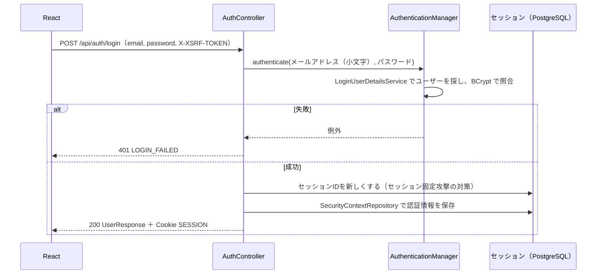

# 詳細設計書：トレロ風タスク管理アプリ

最終更新：2026-10-25（DBを PostgreSQL 18 に変更。開発用DBを Docker に変更）

要件は `requirements.md`、画面は `screen-design.md`、テーブルは `database-design.md`、APIは `api-design.md` を参照。
この設計書は、それらを「プログラムの中でどう作るか」に落とし込んだもの（内部設計）。

## 1. 方針

| # | 項目 | 決定 | 理由 |
|---|---|---|---|
| 1 | クラスの分け方 | Controller → Service → Repository の3層。フォルダ（パッケージ）は機能ごと | 「カードの処理は card を見ればよい」と説明しやすい。API設計書の章立てともそろう |
| 2 | パッケージ名 | `io.github.keiwebcreate.taskboard` | 自分のドメインを持っていない個人開発の一般的な付け方（GitHub のアドレスを逆にしたもの） |
| 3 | JSONの形 | エンティティとは別に DTO を作る。DTO は Java の `record` | パスワードなど返してはいけない項目を返さない。API設計書の形（`labelIds` など）をそのまま表せる |
| 4 | エンティティの関連 | 子→親（`@ManyToOne`）だけ書く。カードとラベルは `@ManyToMany`。親→子（`@OneToMany`）は書かない | N+1問題（SQLがデータの数だけ走る）を防ぐ。削除は DB の `ON DELETE CASCADE` に任せ、JPA と二重に管理しない |
| 5 | 所有者の確認 | Repository で「ID＋持ち主」を条件にして探す。見つからなければ 404 | SQLの段階で他人のデータが出てこないので、確認の入れ忘れが起きにくい |
| 6 | 入力チェック・エラー | 形のチェックは DTO の Bean Validation。ルール違反は Service が独自の例外を投げ、`@RestControllerAdvice` で Problem Details に変換する | Controller にエラー処理を書かずに済み、エラーの形が必ずそろう |
| 7 | React の言語 | TypeScript | APIの形を型にでき、書き間違いを動かす前に見つけられる |
| 8 | React の状態管理 | `useReducer`＋Context | 追加のライブラリがいらず、モックアップの `board-store.js` と同じ考え方。API設計書 6章の流れにそのまま合う |
| 9 | React のCSS | CSS Modules。共通の色などは CSS 変数にまとめる | モックアップの `style.css` を部品ごとに切り分けて移せる。クラス名がぶつからない |
| 10 | React のフォルダ | 機能ごと（`features/auth`・`board`・`card`・`label`）と共通（`shared`） | サーバー側と同じ考え方にそろえる |
| 11 | セッションの置き場所 | PostgreSQL（Spring Session JDBC） | サーバーを再起動してもログイン状態が残る。API設計書の Cookie 名 `SESSION` とも合う |
| 12 | ビルドツール | Gradle | Spring Initializr の初期値。設定が短く書ける |
| 13 | Lombok | 使わない | 書いたコードがそのまま動くので説明しやすい。DTO は record なので、getter が必要なのはエンティティだけ |

おすすめで決めた小さなこと（変えたくなったら変えてよい）：

| 項目 | 決定 |
|---|---|
| フォルダ | `beginner_version/backend`（Spring Boot）、`beginner_version/frontend`（React）。リポジトリは1つのまま |
| 画面の切り替え | React Router |
| APIの呼び出し | ブラウザ標準の `fetch` を包んだ関数を自作する（axios は使わない） |
| フォーム | `useState` で自作する（フォーム用のライブラリは使わない。入力欄が少ないため） |
| 開発用DB | Docker Compose（`compose.yaml`）で PostgreSQL 18 を動かす。起動・停止は自分で `docker compose up -d`・`stop`。データは Docker のボリュームに保存（2026-10-25 決定） |
| サーバーのテスト用DB | Testcontainers（テストのたびに Docker で PostgreSQL 18 を立ち上げる）。本番と同じ PostgreSQL で確かめられ、GitHub Actions でも動く |
| ゲストのサンプルデータ | モックアップの `mockup/js/sample-data.js` の `createGuestSampleBoard` と同じ中身（`database-design.md` 11章の未決事項） |
| バージョン | Java は 25（最新のLTS。講座の指定）。Spring Boot・Gradle・React などは、ひな形を作るときの最新の安定版にする（Java 25 には Gradle 9.1 以上が必要） |

## 2. 全体の構成

```
beginner_version/
├─ compose.yaml 開発用の PostgreSQL 18（Docker。ポート 5432）
├─ backend/    Spring Boot（ポート 8080）
├─ frontend/   React（Vite。開発中はポート 5173）
├─ docs/       設計書
└─ mockup/     モックアップ（本番では使わない）
```

- 開発中は、ブラウザで `http://localhost:5173` を開く。React（Vite）が `/api` で始まる通信を Spring Boot（8080）へ転送する（Vite の proxy 機能。API設計書 2.3）
- 本番での配信のしかたは、AWS の構成で決める

## 3. サーバー（Spring Boot）

### 3.1 パッケージ構成

```
io.github.keiwebcreate.taskboard
├─ TaskBoardApplication          起動クラス
├─ auth/                          ログイン関係（A-01〜A-05、A-19）
│   ├─ AuthController
│   ├─ AuthService               登録・ゲスト作成・退会
│   ├─ GuestSampleData           ゲストのサンプルデータを作る
│   ├─ GuestCleanupJob           24時間たったゲストを1時間ごとに削除する
│   ├─ LoginUser                 ログイン中のユーザー（Spring Security の UserDetails）
│   ├─ LoginUserDetailsService   メールアドレスからユーザーを探す（ログイン時）
│   └─ dto/                      SignupRequest, LoginRequest, WithdrawRequest, UserResponse
├─ user/
│   ├─ User                      エンティティ
│   └─ UserRepository
├─ board/                         ボード（A-06・A-07）
│   ├─ Board, BoardRepository
│   ├─ BoardController, BoardService
│   └─ dto/                      BoardResponse, BoardNameRequest, BoardNameResponse
├─ column/                        リスト（A-08〜A-11）
│   ├─ BoardColumn, BoardColumnRepository
│   ├─ ColumnController, ColumnService
│   └─ dto/                      ColumnRequest, ColumnResponse
├─ card/                          カード（A-12〜A-15）
│   ├─ Card, CardRepository, Level（重要度・緊急度の enum）
│   ├─ CardController, CardService
│   └─ dto/                      CardCreateRequest, CardRequest, CardResponse
├─ label/                         ラベル（A-16〜A-18）
│   ├─ Label, LabelRepository, LabelColor（8色の一覧）
│   ├─ LabelController, LabelService
│   └─ dto/                      LabelRequest, LabelResponse
└─ common/
    ├─ security/                 SecurityConfig、401・403 を Problem Details にする部品
    ├─ error/                    独自の例外、ApiExceptionHandler（@RestControllerAdvice）
    ├─ position/                 PositionRequest（並び替えの共通DTO）、並び順の振り直し
    └─ config/                   LimitsProperties（上限の設定値）など
```

### 3.2 層の役割とルール

| 層 | 役割 | ルール |
|---|---|---|
| Controller | APIの受け口。URL・HTTPメソッド・ステータスコードを決め、DTO を受け取って Service を呼び、DTO を返す | 処理の中身（判断）を書かない。リクエストの DTO には `@Valid` を付ける。ログイン中のユーザーは `@AuthenticationPrincipal LoginUser` で受け取る |
| Service | 処理の中身。所有者の確認、上限のチェック、重複のチェック、並び順の振り直し | 変更するメソッドには `@Transactional` を付ける（途中で失敗したら全部元に戻す）。読むだけのメソッドは `@Transactional(readOnly = true)`。ルール違反は独自の例外を投げる。エンティティを DTO に変換して返す |
| Repository | DBとのやりとり（Spring Data JPA） | 持ち主を確認しないで1件を探すメソッド（`findById` など）は、Service から使わない（3.5） |

### 3.3 エンティティ

テーブル設計書 3章の1テーブルにつき1クラス（`card_labels` は `Card` の `@ManyToMany` で表すので、クラスは作らない）。

| クラス | テーブル | 親へのつながり | ほかの項目 |
|---|---|---|---|
| `User` | users | なし | email, passwordHash, guest（is_guest）, createdAt |
| `Board` | boards | `@ManyToOne User user` | name |
| `BoardColumn` | board_columns | `@ManyToOne Board board` | name, position |
| `Card` | cards | `@ManyToOne BoardColumn column` | title, description, importance, urgency, dueDate, position, `@ManyToMany Set<Label> labels`（card_labels） |
| `Label` | labels | `@ManyToOne User user` | name, color |

- `@ManyToOne` は `fetch = FetchType.LAZY`（必要になるまで親を読まない）にする
- `Level`（`HIGH`・`MEDIUM`・`LOW`）は `@Enumerated(EnumType.STRING)` で文字列として保存する
- `created_at`・`updated_at` は DB が自動で入れる（更新日時はトリガー。テーブル設計書 3.8）ので、Java からは書き込まない（`insertable = false, updatable = false`）。型は `Instant`
- setter は作らず、変えてよい項目だけを変えるメソッドを用意する（例：`Card.update(title, description, ...)`、`Card.moveTo(column, position)`）
- 削除は DB の `ON DELETE CASCADE` に任せる。JPA の `cascade` 設定は使わない
- 設定 `spring.jpa.open-in-view: false`（画面に返したあとで勝手にSQLが走るのを防ぐ）、`spring.jpa.hibernate.ddl-auto: validate`（テーブルは Flyway だけが作る。JPA はクラスとテーブルが合っているかを確かめるだけ）

### 3.4 DTO

API設計書 5章のJSONと1対1で対応させる。項目名はキャメルケース（`dueDate`・`labelIds`）。

| API | リクエスト | レスポンス |
|---|---|---|
| A-01 登録 | `SignupRequest(email, password)` | `UserResponse(id, email, isGuest)` |
| A-02 ログイン | `LoginRequest(email, password)` | `UserResponse` |
| A-03 ゲスト | なし | `UserResponse` |
| A-05 自分 | なし | `UserResponse` |
| A-19 退会 | `WithdrawRequest(password)` | なし（204） |
| A-06 ボード | なし | `BoardResponse(id, name, labels, columns)`。中に `LabelResponse`、`ColumnWithCardsResponse(id, name, cards)`、`CardResponse` |
| A-07 ボード名 | `BoardNameRequest(name)` | `BoardNameResponse(id, name)` |
| A-08・A-09 リスト | `ColumnRequest(name)` | `ColumnResponse(id, name)` |
| A-11・A-15 並び替え | `PositionRequest(position)`、カードは `CardPositionRequest(columnId, position)` | なし（204） |
| A-12 カード追加 | `CardCreateRequest(title)` | `CardResponse` |
| A-13 カード保存 | `CardRequest(title, description, importance, urgency, dueDate, labelIds)` | `CardResponse(id, title, description, importance, urgency, dueDate, labelIds)` |
| A-16・A-17 ラベル | `LabelRequest(name, color)` | `LabelResponse(id, name, color)` |

入力チェックの付け方（例）：

```java
public record CardRequest(
        @NotBlank(message = "タイトルを入力してください")
        @Size(max = 100, message = "タイトルは100文字以内で入力してください")
        String title,
        @Size(max = 2000, message = "説明は2000文字以内で入力してください")
        String description,
        @NotNull Level importance,
        @NotNull Level urgency,
        LocalDate dueDate,
        @NotNull List<Long> labelIds) {}
```

- メッセージは `screen-design.md` 7章の文言にそろえる
- 前後の空白の除去（API設計書 2.5）は Service で行う。`@Size` は除去前の長さで数えるので、「空白を足して101文字以上」は 400 になる（画面側でも同じ長さで止めるので、ふつうは起きない）
- 色が8色のどれかは `LabelColor` を使って Service で確かめる

### 3.5 Repository と所有者の確認

持ち主（ログイン中のユーザーのID）を条件に入れて探すメソッドだけを使う（テーブル設計書 7章）。

| Repository | 主なメソッド | 内容 |
|---|---|---|
| `BoardRepository` | `findByUserId(userId)` | 自分のボード |
| `BoardColumnRepository` | `findByIdAndBoardUserId(columnId, userId)` | 自分のリスト1件 |
| | `findByBoardIdOrderByPosition(boardId)` | ボードのリスト一覧（並び順） |
| | `countByBoardId(boardId)` | 上限の確認 |
| `CardRepository` | `findByIdAndColumnBoardUserId(cardId, userId)` | 自分のカード1件 |
| | `findByColumnIdOrderByPosition(columnId)` | リストのカード一覧（振り直し用） |
| | `findAllForBoard(boardId)`（`@Query` で自作） | ボードの全カードを、ラベルと一緒に1回のSQLで取る（3.8.1） |
| | `countByColumnId(columnId)` | 上限の確認 |
| `LabelRepository` | `findByIdAndUserId(labelId, userId)` | 自分のラベル1件 |
| | `findAllByIdInAndUserId(labelIds, userId)` | カードに付けるラベル（全部が自分のものか） |
| | `findByUserIdOrderById(userId)` | ラベル一覧（作成順） |
| | `existsByUserIdAndName(userId, name)` | 名前の重複 |
| `UserRepository` | `findByEmail(email)`、`existsByEmail(email)` | ログイン・登録 |
| | `deleteGuestsCreatedBefore(time)`（`@Modifying @Query`） | 古いゲストの削除 |

- Service では、見つからなければ `NotFoundException`（404）を投げる。他人のデータも存在しないデータも同じ扱いになる
- カードにラベルを付けるとき：`findAllByIdInAndUserId` で取れた件数が、送られてきたID（重複を除く）の数より少なければ 404

### 3.6 例外とエラーの変換

Service は次の独自の例外を投げる。`common/error/ApiExceptionHandler`（`@RestControllerAdvice`）がまとめて受け取り、API設計書 4章の Problem Details に変換する。

| 例外 | ステータス | code | 投げる場面 |
|---|---|---|---|
| `NotFoundException` | 404 | NOT_FOUND | 他人・存在しないデータ |
| `LimitExceededException(message)` | 409 | LIMIT_EXCEEDED | 上限（リスト20・カード100・ラベル30） |
| `EmailDuplicatedException` | 409 | EMAIL_DUPLICATED | 登録済みのメールアドレス |
| `LabelNameDuplicatedException` | 409 | LABEL_NAME_DUPLICATED | 同じ名前のラベル |
| `InvalidPositionException` | 400 | INVALID_POSITION | 並び替えの位置が範囲外 |
| `FieldValidationException(field, message)` | 400 | VALIDATION_ERROR | Bean Validation では表せない入力のエラー（例：退会のパスワード違い、8色以外の色、空白だけの名前） |
| `GuestNotAllowedException` | 403 | GUEST_NOT_ALLOWED | ゲストの退会 |
| `LoginFailedException` | 401 | LOGIN_FAILED | ログイン失敗 |

Spring が投げる例外も同じ形にそろえる：

| 例外 | 変換先 |
|---|---|
| `MethodArgumentNotValidException`（`@Valid` の失敗） | 400 VALIDATION_ERROR。`errors` に項目ごとのメッセージ |
| `HttpMessageNotReadableException`（JSONが壊れている、enum にない値） | 400 VALIDATION_ERROR |
| `NoResourceFoundException`（存在しないURL） | 404 NOT_FOUND |
| 上のどれでもない例外 | 500 INTERNAL_ERROR。詳細（スタックトレース）はログにだけ出し、レスポンスには含めない（要件 5.2） |
| 未ログイン（Spring Security） | 401 UNAUTHENTICATED。`AuthenticationEntryPoint` で作る |
| CSRFトークンの不一致（Spring Security） | 403 CSRF_INVALID。`AccessDeniedHandler` で作る |

### 3.7 設定（application.yml）

| 設定 | 値 |
|---|---|
| DBの接続先・ユーザー・パスワード | 環境変数 `DB_URL`・`DB_USERNAME`・`DB_PASSWORD` から読む。コードやGitには書かない |
| DBの接続URL（ローカル） | `jdbc:postgresql://localhost:5432/task_app`。DB は `beginner_version/compose.yaml` の Docker（PostgreSQL 18）。`DB_URL`・`DB_USERNAME` は省略するとこの値と `task_app_user` を使う |
| JVMのタイムゾーン | UTC（ログの時刻などをそろえるため。テーブル設計書 6章） |
| セッション | `spring.session.timeout: 30m`（要件 U-09）。保存先は JDBC。テーブルは Flyway で作る（3.9） |
| 上限 | `app.limits.columns: 20`・`cards-per-column: 100`・`labels: 30`。`LimitsProperties`（`@ConfigurationProperties`）で読む（要件 3.7） |
| Flyway | `src/main/resources/db/migration/` の SQL を起動時に流す |

### 3.8 主な処理の流れ

#### 3.8.1 ボードの取得（A-06）

SQLはカードの枚数に関係なく、次の3回で済ませる。

1. `findByUserId` で自分のボード
2. `findByBoardIdOrderByPosition` でリスト一覧
3. `findAllForBoard` で全カード（`left join fetch c.labels` でラベルも一緒に。`order by c.position`）
4. ラベル一覧は `findByUserIdOrderById`

Service でカードを `columnId` ごとに振り分け、`BoardResponse` を組み立てる。カードの `labelIds` は、付いているラベルのIDを並べたもの。

#### 3.8.2 並び替え（A-11・A-15）

テーブル設計書 4章のとおり、0からの連番に振り直す。

カードの移動（`CardService.move`）：

1. 自分のカードと、自分の移動先のリストを探す（なければ 404）
2. 位置の範囲を確かめる。同じリスト内は 0〜枚数−1、別のリストへは 0〜枚数（範囲外は 400 INVALID_POSITION）
3. 別のリストへ移すとき、移動先が100枚なら 409 LIMIT_EXCEEDED
4. 移動先のリストのカードを並び順で取り、Java の `List` の上で「取り除いて、指定の位置に差し込む」
5. 先頭から 0, 1, 2 … と `position` を付け直す。別のリストから移した場合は、移動元のリストも付け直す
6. 1〜5 を1つのトランザクションで行う（`@Transactional`）

リストの並び替え（`ColumnService.move`）も同じ手順。振り直しの処理は `common/position` に共通の部品として置き、リストとカードで使い回す。

#### 3.8.3 ログイン（A-02）とセッション



- `AuthenticationManager` を自分で呼ぶので、認証情報のセッションへの保存とセッションIDの変更は自分で書く（API設計書 7章）。登録（A-01）・ゲスト（A-03）のあとも同じ処理でログイン状態にする。この処理は `AuthService` の1つのメソッドにまとめる
- `LoginUser` にはユーザーのID・メールアドレス・ゲストかどうかを持たせる。Controller はここからユーザーのIDを取り出して Service に渡す
- ゲストのメールアドレスでのログインは、パスワードがランダムなので成功しない（API設計書 A-02）
- 回数制限（要件 U-10）の実装方法は未決（7章）

#### 3.8.4 CSRF

- Spring Security の SPA 向けの設定を使う。`CookieCsrfTokenRepository.withHttpOnlyFalse()` で Cookie `XSRF-TOKEN` を渡し、ヘッダー `X-XSRF-TOKEN` と照合する（API設計書 2.3）
- Cookie が確実に返るように、すべてのレスポンスでトークンを読み込む設定にする（ひな形を作るときに、そのバージョンの Spring Security の公式ドキュメントの書き方に合わせる）

#### 3.8.5 ユーザー登録（A-01）とゲスト（A-03）

登録：

1. メールアドレスを小文字にそろえ、前後の空白を取り除く
2. 登録済みなら 409 EMAIL_DUPLICATED
3. パスワードを BCrypt でハッシュ化し、users・boards・board_columns（未着手・作業中・完了）を作る（テーブル設計書 9.1）
4. 3.8.3 と同じ処理でログイン状態にする

ゲスト：

1. メールアドレス `guest-（ランダムな文字列）@guest.local`、ランダムなパスワードのハッシュで users を作る（`is_guest = true`）
2. `GuestSampleData` でボード・リスト・カード・ラベルを作る（中身は1章のとおり、モックアップと同じ）
3. ログイン状態にする

#### 3.8.6 ログアウト（A-04）とゲストの削除

- ログアウト：ゲストなら users の行を削除する（関連データは `ON DELETE CASCADE` で消える）。そのあとセッションを破棄する
- `GuestCleanupJob`：`@Scheduled(cron = "0 0 * * * *")`（毎時0分）で `deleteGuestsCreatedBefore(現在時刻(UTC) − 24時間)` を呼ぶ（テーブル設計書 5章）。起動クラスに `@EnableScheduling` を付ける
- 削除されたゲストのセッションが残っていた場合：`GET /api/auth/me` はユーザーが見つからなければセッションを破棄して 401 を返す。ほかのAPIはボードなどが見つからないので 404 になる

#### 3.8.7 退会（A-19）

1. ゲストなら 403 GUEST_NOT_ALLOWED
2. パスワードを `PasswordEncoder.matches` で照合する。違えば 400 VALIDATION_ERROR（`errors` の `password` に「パスワードが正しくありません」）
3. users の行を削除し（関連データは CASCADE で消える）、セッションを破棄する

### 3.9 Flyway のファイル

| ファイル | 内容 |
|---|---|
| `V1__create_tables.sql` | テーブル設計書 10章の CREATE TABLE と、更新日時のトリガー |
| `V2__create_session_tables.sql` | Spring Session JDBC のテーブル（`SPRING_SESSION`・`SPRING_SESSION_ATTRIBUTES`）。Spring Session に入っている PostgreSQL 用の SQL（`schema-postgresql.sql`）を元にする |

### 3.10 テスト（要件 5.5）

- JUnit 5 と Spring Boot のテスト機能を使う。DBは Testcontainers で PostgreSQL 18 を立ち上げる（Flyway でテーブルも作る）
- APIを実際に呼ぶ形のテスト（MockMvc）を中心にする。確かめること：所有者の確認（他人のIDで 404）、並び順の振り直し、上限、入力チェック、ログイン・ログアウト・ゲストの削除、CSRF
- 並び順の振り直しなど、ロジックだけの部品は、DBを使わない単体テストも書く

## 4. 画面（React）

### 4.1 フォルダ構成

```
frontend/src/
├─ main.tsx                 入口
├─ App.tsx                  画面の切り替え（React Router）
├─ api/
│   ├─ client.ts            fetch を包んだ関数（CSRF・エラーの変換。4.3）
│   └─ types.ts             APIのJSONの型（API設計書 5章）
├─ features/
│   ├─ auth/                AuthContext、LoginPage（W-01）、SignupPage（W-02）、WithdrawModal（W-08）、authApi
│   ├─ board/               BoardPage（W-03）、BoardHeader、Column、AddColumnForm、BoardContext、boardReducer、boardApi、columnApi
│   ├─ card/                CardItem、AddCardForm、CardModal（W-04）、cardApi
│   └─ label/               LabelModal（W-05）、LabelChip、LabelPicker、labelApi
├─ shared/
│   ├─ ui/                  Modal、ConfirmDialog（W-06）、Toast、InlineEdit（その場での名前変更）
│   ├─ lib/                 formatDue・dueStatus・linkify・validation・constants（モックアップの utils.js などを移す）
│   └─ pages/               NotFoundPage（W-07）
└─ styles/
    ├─ variables.css        色・影・角の丸みなどの CSS 変数
    └─ global.css           body などの全体の設定
```

- 1つの部品につき `Card.tsx` と `Card.module.css` を同じフォルダに置く
- モックアップとの対応は `mockup/README.md` の表のとおり

### 4.2 画面の切り替えとログイン状態

| URL | 部品 | 条件 |
|---|---|---|
| `/` | BoardPage | ログインが必要。していなければ `/login` へ |
| `/login` | LoginPage | ログイン済みなら `/` へ |
| `/signup` | SignupPage | ログイン済みなら `/` へ |
| それ以外 | NotFoundPage | なし |

- `AuthContext` がログイン中のユーザー（`UserResponse` または「ログインしていない」）を持つ。アプリを開いたときに `GET /api/auth/me` を1回呼んで決める（API設計書 6.1）
- セッション切れのお知らせなど、次の画面に1回だけ出すメッセージは React Router の `state` で渡す

### 4.3 APIの呼び出し（api/client.ts）

すべてのAPIはこの関数を通す。

1. `fetch` で `/api/...` を呼ぶ。JSONを送るときは `Content-Type: application/json`
2. POST・PUT・PATCH・DELETE では、Cookie `XSRF-TOKEN` の値を **送るたびに読み**、ヘッダー `X-XSRF-TOKEN` に付ける（API設計書 2.3）
3. 成功したらJSONを返す（204 なら何も返さない）
4. 失敗したら Problem Details を読み、`ApiError`（`status`・`code`・`detail`・`errors`）を投げる。レスポンスがない（つながらない）ときは INTERNAL_ERROR と同じ扱いにする
5. 401 UNAUTHENTICATED のときは、ログイン中だったなら「ログインの有効期限が切れました…」を付けて `/login` へ移す（API設計書 4.3）

機能ごとの `xxxApi.ts` は、API設計書の A-01〜A-19 と1対1の関数を持つ（モックアップの `api.js` と同じ名前にする）。

### 4.4 ボードの状態（BoardContext・boardReducer）

- `BoardContext` が `useReducer(boardReducer)` でボードのデータ（`BoardResponse` の形）を持つ
- データの変え方は `boardReducer` の1か所にまとめる。出来事（action）の一覧：

| action | いつ |
|---|---|
| `loaded` | `GET /api/board` が成功した |
| `boardRenamed` | ボード名を変えた |
| `columnAdded`・`columnRenamed`・`columnDeleted`・`columnMoved` | リストの操作 |
| `cardAdded`・`cardSaved`・`cardDeleted`・`cardMoved` | カードの操作 |
| `labelAdded`・`labelUpdated`・`labelDeleted` | ラベルの操作。`labelDeleted` はカードの `labelIds` からも外す |
| `restored` | ドラッグの保存に失敗したので、移動前のデータに戻す |

- 追加・変更・削除：APIが成功してから、返ってきたデータで action を送る（API設計書 6.3）
- ドラッグ＆ドロップ：先に `columnMoved`・`cardMoved` を送って画面を変え、APIが失敗したら `restored` で戻して通知を出す（API設計書 6.2）
- 画面だけの状態（どのモーダルが開いているか、どこを編集中か、説明文を開いているカード）は、それぞれの部品の `useState` で持つ。サーバーに送らない

### 4.5 ドラッグ＆ドロップ（@hello-pangea/dnd）

- `BoardPage` 全体を `DragDropContext` で包み、リストの並び（横）とカードの並び（縦）をそれぞれ `Droppable` にする
- `onDragEnd` で、動かしたものと移動先の位置（`destination.index`）から A-11・A-15 を呼ぶ。位置の数え方は API設計書と同じ（0から、移動したあとの並びで何番目か）
- 満杯（100枚）のリストへ動かしたときは、APIを呼ぶ前に通知を出して何もしない（`screen-design.md` W-03）

### 4.6 画面側の決まりごと

| 項目 | 決定 |
|---|---|
| XSS | 文字は React の自動エスケープに任せる。`dangerouslySetInnerHTML` は使わない。説明文のリンク化は、文字列を分けて `<a>` の部品を作る（`http://`・`https://` で始まるものだけ） |
| 日本語入力 | Enter で送信する入力欄では、`event.nativeEvent.isComposing` が true のときは送信しない（`screen-design.md` 5章） |
| 入力チェック | 送信したときに `shared/lib/validation.ts` で行い、エラーを入力欄の下に出す。サーバーの `errors` も同じ場所に出す |
| 文言 | メッセージは `shared/lib/constants.ts` にまとめる（`screen-design.md` 7章） |

### 4.7 テスト（要件 5.5）

Vitest で、ロジックのある部分だけを自動テストする。

- `formatDue`・`dueStatus`（期限の表示と色分け。今日の日付を引数で渡せるようにしてテストする）
- `linkify`（URLのリンク化。`javascript:` などはリンクにしない）
- `validation`（入力チェック）
- `boardReducer`（各 action でデータが正しく変わるか。特に `cardMoved` と `labelDeleted`）

## 5. 使うライブラリ

| 区分 | ライブラリ | 用途 |
|---|---|---|
| サーバー | Spring Web、Spring Data JPA、Spring Security、Spring Session JDBC、Validation、Flyway（PostgreSQL 用も）、PostgreSQL JDBC Driver | 本体 |
| サーバーのテスト | Spring Boot Test、Spring Security Test、Testcontainers（PostgreSQL） | テスト |
| 画面 | React、React Router、@hello-pangea/dnd | 本体 |
| 画面の開発 | Vite、TypeScript、Vitest、oxlint | 開発・テスト。リンターは Vite のひな形に入っている oxlint を使う（2026-10-31 に ESLint から変更） |
| （外した） | MSW（Mock Service Worker） | ログインと `BoardController` ができるまで、ブラウザの中で `GET /api/board` を横取りしてサンプルの JSON を返していた。画面のログインを作ったときに外した（2026-10-31） |

### 5.1 使っているバージョン（2026-10-31 時点）

1章のとおり、Java 25 と PostgreSQL 18 は講座の指定、それ以外はひな形を作ったときの最新の安定版。正確な値は `backend/build.gradle`（Gradle が決める）と `frontend/package.json`・`package-lock.json` が持つ。この表は人が読むための一覧なので、バージョンを上げたらここも直す。

**サーバー（`backend/`）**

| もの | バージョン | 備考 |
|---|---|---|
| Java（Eclipse Temurin） | 25.0.4 | 最新の LTS（講座の指定） |
| Gradle | 9.8.2 | Groovy 形式（`build.gradle`） |
| Spring Boot | 4.1.2 | |
| Spring Framework（Spring Web MVC） | 7.0.10 | Spring Boot が決める |
| Spring Security | 7.1.2 | Spring Boot が決める |
| Spring Session JDBC | 4.1.1 | Spring Boot が決める |
| Hibernate ORM（Spring Data JPA の中身） | 7.4.13 | Spring Boot が決める |
| Flyway | 12.4.0 | Spring Boot が決める |
| PostgreSQL JDBC Driver | 42.7.14 | Spring Boot が決める |
| Jackson（JSON の変換） | 3.1.7 | Spring Boot が決める |
| JUnit | 6.0.3 | Spring Boot が決める |
| Testcontainers | 2.0.5 | Spring Boot が決める |

**データベース**

| もの | バージョン | 備考 |
|---|---|---|
| PostgreSQL | 18.6 | 開発中は Docker の `postgres:18`（`compose.yaml`）。テストも Testcontainers で `postgres:18` |

**画面（`frontend/`）**

| もの | バージョン | 備考 |
|---|---|---|
| Node.js ／ npm | 26.12.1 ／ 11.10.0 | 開発する人のパソコンに入れるもの |
| React（react-dom も同じ） | 19.3.1 | |
| React Router | 8.5.1 | |
| TypeScript | 7.0.2 | |
| Vite | 8.3.5 | ひな形は create-vite 9.3.3（`react-ts`） |
| Vitest | 5.0.5 | |
| oxlint | 1.90.0 | |
| @hello-pangea/dnd | （まだ入れていない） | ドラッグ＆ドロップを作るときに入れる |

## 6. 書き方のルール

AI に守ってほしいルールは `beginner_version/CLAUDE.md` にまとめる（この設計書の要点と、コマンドの一覧）。

## 7. まだ決めていないこと

- 回数制限（要件 U-10）の数え方の実装（メモリに持つか、DBに持つか）。AWS の構成とあわせて決める（API設計書 8章）
- AWS の構成（本番での画面とAPIの配信のしかた、ドメイン）
