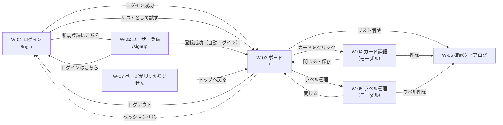

# 画面設計書：トレロ風タスク管理アプリ

最終更新：2026-10-25

要件は `requirements.md` を参照。画面イメージは `wireframes.html`（ブラウザで開く）を参照。

## 1. 方針

| 項目 | 決定 |
|---|---|
| 雰囲気 | シンプルな業務ツール風。白とグレーを基調にし、ラベル・優先度・期限の色を目立たせる |
| 対象の画面幅 | PCが中心（幅1280px前後）。スマートフォンではリストを横にスクロールして見られる程度 |
| モーダル | カード詳細・ラベル管理・確認ダイアログはボード画面の上に重ねて開く。URLは変えない |
| 文言 | すべて日本語 |

## 2. 画面一覧

| ID | 画面 | URL | ログイン | 内容 |
|---|---|---|---|---|
| W-01 | ログイン | `/login` | 不要 | メールアドレスとパスワードでログインする。「ゲストとして試す」とユーザー登録へのリンクを置く |
| W-02 | ユーザー登録 | `/signup` | 不要 | アカウントを作る |
| W-03 | ボード | `/` | 必要 | メインの画面。リストとカードを表示する |
| W-04 | カード詳細 | （W-03の上のモーダル） | 必要 | カードの項目を編集・削除する |
| W-05 | ラベル管理 | （W-03の上のモーダル） | 必要 | ラベルを追加・編集・削除する |
| W-06 | 確認ダイアログ | （モーダル） | 必要 | 削除などの前に確認する |
| W-07 | ページが見つかりません | 上記以外のURL | 不要 | ボード（またはログイン）へのリンクを置く |

## 3. 画面遷移図

### 画面の出し分けのルール

| 状況 | 動き |
|---|---|
| ログインしていない状態で `/` を開いた | `/login` に移動する |
| ログインしている状態で `/login`・`/signup` を開いた | `/` に移動する |
| 操作中にセッションが切れた（無操作30分。要件 U-09） | `/login` に移動し、「ログインの有効期限が切れました。もう一度ログインしてください」と表示する |
| ゲストがログアウトした | データを削除し（要件 U-08）、`/login` に移動する |

## 4. 画面ごとの項目と動き

### W-01 ログイン

| 項目 | 種類 | 内容 |
|---|---|---|
| メールアドレス | 入力欄 | 必須 |
| パスワード | 入力欄（伏せ字） | 必須 |
| ログイン | ボタン | 失敗したら「メールアドレスまたはパスワードが正しくありません」と表示する |
| ゲストとして試す | ボタン | 一時ユーザーを作ってボードへ進む（要件 U-06） |
| 新規登録はこちら | リンク | W-02 へ |

回数制限（要件 U-10）を超えたら「しばらくしてから再度お試しください」と表示する。

### W-02 ユーザー登録

| 項目 | 種類 | 内容 |
|---|---|---|
| メールアドレス | 入力欄 | 必須。形式チェック、254文字まで。登録済みなら「このメールアドレスは登録済みです」 |
| パスワード | 入力欄（伏せ字） | 必須。8〜64文字、半角の英数字と記号のみ。入力欄の下にルールを常に表示する |
| パスワード（確認） | 入力欄（伏せ字） | 必須。パスワードと一致すること（画面側だけでチェックする） |
| 登録する | ボタン | 成功したら自動でログインしてボードへ進む（要件 U-01） |
| ログインはこちら | リンク | W-01 へ |

### W-03 ボード

**ヘッダー**

| 項目 | 内容 |
|---|---|
| アプリ名 | 左端に表示 |
| ボード名 | クリックするとその場で入力欄に変わり、名前を変更できる。1〜50文字。初期値は「マイボード」 |
| ラベル管理 | ボタン。W-05 を開く |
| ログイン中の人 | メールアドレスを表示。ゲストのときは「ゲスト」 |
| ログアウト | ボタン |
| ゲストの注意書き | ゲストのときだけ、ヘッダーの下に「ゲストモード：データはログアウトするか24時間たつと削除されます」の帯を出す（要件 U-07） |

**リスト**

| 項目 | 内容 |
|---|---|
| リスト名 | クリックするとその場で入力欄に変わる。Enter で確定、Esc で取り消し |
| カードの枚数 | リスト名の横に表示する（例：3） |
| 「…」メニュー | 「リストを削除」を出す。選ぶと W-06 で「このリストと中のカード3件を削除しますか？」と確認する（要件 L-04） |
| ＋ カードを追加 | 押すとタイトルの入力欄が出る。Enter で追加し、続けて次のカードを入力できる。Esc で閉じる |
| ＋ リストを追加 | 一番右に常に表示する。押すと名前の入力欄が出る |
| 並び替え | リストの見出しをドラッグして並び替える（要件 L-05） |

リストが0個のときは「＋ リストを追加」だけを表示する。

**カード**

| 項目 | 内容 |
|---|---|
| 優先度 | 左端の色の帯（高＝赤、中＝黄、低＝グレー。要件 C-06） |
| ラベル | 色付きの小さな札で表示（要件 C-07） |
| タイトル | 全文を表示し、長いときは折り返す |
| 期限 | 今年なら「10/30」、年が違うなら「2027/1/5」。期限切れは赤、今日か明日なら黄色、それ以外はグレー（要件 C-05） |
| 説明文アイコン | 説明文が入っているときだけ表示する |
| クリック | W-04 を開く |
| ドラッグ | 同じリスト内の並び替えと、別のリストへの移動（要件 C-04） |

**上限に達したとき（要件 3.7）**：追加しようとした時点で「リストは20個までです」「このリストのカードは100枚までです」と表示する。

### W-04 カード詳細（モーダル）

| 項目 | 種類 | 内容 |
|---|---|---|
| タイトル | 入力欄 | 必須。1〜100文字 |
| 所属リスト | 表示のみ | 「リスト：作業中」のように表示する |
| ラベル | 選択 | 「＋」を押すとラベルの一覧が出て、付ける・外すを切り替えられる。一覧の下に「ラベルを管理」へのリンクを置く |
| 優先度 | 選択（高・中・低） | 初期値は「中」 |
| 期限 | 日付の入力欄 | 「期限をクリア」で空にできる |
| 説明文 | 複数行の入力欄 | 2000文字まで。残りの文字数を表示する。保存後は改行を反映して表示し、`http://`・`https://` で始まるURLはリンクにする（新しいタブで開く）。表示部分をクリックすると入力欄に戻る |
| 保存 | ボタン | 全項目をまとめて保存する |
| キャンセル・× | ボタン | 変更があれば「変更を破棄しますか？」と確認してから閉じる。背景のクリックと Esc も同じ |
| カードを削除 | ボタン（赤） | W-06 で確認してから削除する（要件 C-03） |

入力エラーは、該当する項目のすぐ下に赤字で表示する。

### W-05 ラベル管理（モーダル）

| 項目 | 内容 |
|---|---|
| 件数 | 「12 / 30」のように、今の件数と上限を表示する |
| ラベルの一覧 | 色の札と名前を並べる。行ごとに「編集」「削除」 |
| 編集 | 行がその場で入力欄と色の選択肢に変わる |
| 削除 | W-06 で「ラベル「仕事」を削除しますか？付いているカード3枚から外れます」と確認する（要件 T-03） |
| 新しいラベル | 名前（1〜20文字）と色を選んで「追加」。同じ名前があれば「同じ名前のラベルがあります」 |

### W-06 確認ダイアログ

| 項目 | 内容 |
|---|---|
| メッセージ | 何が消えるかを具体的に書く（例：「このリストと中のカード3件を削除しますか？」） |
| 削除する | 赤いボタン |
| キャンセル | 何もせずに閉じる。最初に選ばれているのはこちら（Enter の押し間違いで消さないため） |

### W-07 ページが見つかりません

「ページが見つかりません」と表示し、「トップへ戻る」リンクを置く。

## 5. 共通の表示

| 状況 | 表示 |
|---|---|
| 読み込み中 | ボードを最初に開いたときは、リストの形をした灰色の枠（スケルトン）を表示する。ボタンを押して処理している間は、ボタンを押せない状態にする |
| 通信エラー・サーバーエラー（要件 G-03） | 画面の右下に赤い通知を5秒間出す。例：「通信に失敗しました。時間をおいて再度お試しください」 |
| ドラッグ＆ドロップの保存に失敗 | 通知を出し、並びを移動前に戻す |

## 6. ラベルの色

| 名前 | 色コード | 文字色 |
|---|---|---|
| 赤 | `#e5484d` | 白 |
| オレンジ | `#f76b15` | 白 |
| 黄 | `#ffc53d` | 黒 |
| 緑 | `#30a46c` | 白 |
| 水色 | `#0090ff` | 白 |
| 青 | `#3e63dd` | 白 |
| 紫 | `#8e4ec6` | 白 |
| グレー | `#8b8d98` | 白 |

Radix Colors の色見本から選んだ。この一覧は Java（入力チェック用）と React（表示用）の両方に持つ。

## 7. メッセージ一覧

| 場面 | メッセージ |
|---|---|
| 必須項目が空 | 〇〇を入力してください |
| 文字数オーバー | 〇〇は△文字以内で入力してください |
| メールアドレスの形式 | メールアドレスの形式が正しくありません |
| パスワードのルール | パスワードは8〜64文字の半角英数字・記号で入力してください |
| パスワードの確認 | パスワードが一致しません |
| メールアドレスの重複 | このメールアドレスは登録済みです |
| ログイン失敗 | メールアドレスまたはパスワードが正しくありません |
| 回数制限 | しばらくしてから再度お試しください |
| セッション切れ | ログインの有効期限が切れました。もう一度ログインしてください |
| ラベル名の重複 | 同じ名前のラベルがあります |
| 上限（リスト） | リストは20個までです |
| 上限（カード） | このリストのカードは100枚までです |
| 上限（ラベル） | ラベルは30個までです |
| 通信エラー | 通信に失敗しました。時間をおいて再度お試しください |
| 対象が見つからない | 対象のデータが見つかりません。画面を再読み込みしてください |
