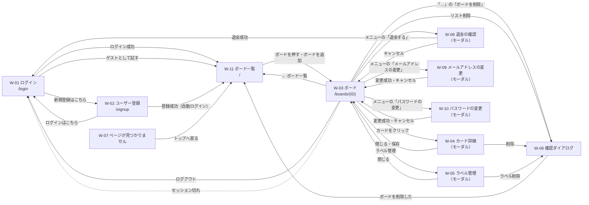

# 画面設計書：トレロ風タスク管理アプリ

最終更新：2026-11-01（複数ボード：W-11 ボード一覧を追加し、W-03 の URL を `/boards/{ID}` にした。イシュー #51）

要件は `requirements.md` を参照。画面イメージは `wireframes.html`（ブラウザで開く）を参照。実際に触って動きを確かめられるモックアップは `mockup/`（開き方は `mockup/README.md`）。

## 1. 方針

| 項目 | 決定 |
|---|---|
| 雰囲気 | シンプルな業務ツール風。白とグレーを基調にし、ラベル・重要度・緊急度・期限の色を目立たせる |
| 対象の画面幅 | PCが中心（幅1280px前後）。スマートフォンではリストを横にスクロールして見られる程度。幅 640px 以下をスマートフォンとして、ヘッダーなどの並びを変える |
| モーダル | カード詳細・ラベル管理・確認ダイアログはボード画面の上に重ねて開く。URLは変えない |
| 文言 | すべて日本語 |

## 2. 画面一覧

| ID | 画面 | URL | ログイン | 内容 |
|---|---|---|---|---|
| W-01 | ログイン | `/login` | 不要 | メールアドレスとパスワードでログインする。「ゲストとして試す」とユーザー登録へのリンクを置く |
| W-02 | ユーザー登録 | `/signup` | 不要 | アカウントを作る |
| W-11 | ボード一覧 | `/` | 必要 | ログインしたあとの最初の画面。自分のボードを並べ、ボードを追加する（2026-11-01 追加） |
| W-03 | ボード | `/boards/{ID}` | 必要 | メインの画面。リストとカードを表示する |
| W-04 | カード詳細 | （W-03の上のモーダル） | 必要 | カードの項目を編集・削除する |
| W-05 | ラベル管理 | （W-03の上のモーダル） | 必要 | ラベルを追加・編集・削除する |
| W-06 | 確認ダイアログ | （モーダル） | 必要 | 削除などの前に確認する |
| W-07 | ページが見つかりません | 上記以外のURL。他人のボード・存在しないボードの `/boards/{ID}` も | 不要 | ボード一覧（またはログイン）へのリンクを置く |
| W-08 | 退会の確認 | （モーダル） | 必要 | パスワードを入力して退会する |
| W-09 | メールアドレスの変更 | （モーダル） | 必要 | 今のパスワードを入力して、メールアドレスを変える |
| W-10 | パスワードの変更 | （モーダル） | 必要 | 今のパスワードを入力して、パスワードを変える |

## 3. 画面遷移図

### 画面の出し分けのルール

| 状況 | 動き |
|---|---|
| ログインしていない状態で `/`・`/boards/{ID}` を開いた | `/login` に移動する |
| ログインしている状態で `/login`・`/signup` を開いた | `/` に移動する |
| 操作中にセッションが切れた（無操作30分。要件 U-09） | `/login` に移動し、「ログインの有効期限が切れました。もう一度ログインしてください」と表示する |
| 他人のボード・存在しない（消した）ボード・数字でない（大きすぎる）ID の `/boards/{ID}` を開いた | W-07「ページが見つかりません」を表示する |
| ゲストがログアウトした | データを削除し（要件 U-08）、`/login` に移動する |
| 退会した | データを削除し（要件 U-11）、`/login` に移動して「退会しました。ご利用ありがとうございました」と表示する |

## 4. 画面ごとの項目と動き

### W-01 ログイン

| 項目 | 種類 | 内容 |
|---|---|---|
| メールアドレス | 入力欄 | 必須 |
| パスワード | 入力欄（伏せ字） | 必須 |
| ログイン | ボタン | 失敗したら「メールアドレスまたはパスワードが正しくありません」と表示し、パスワード欄を空にする |
| ゲストとして試す | ボタン | 一時ユーザーを作ってボードへ進む（要件 U-06） |
| 新規登録はこちら | リンク | W-02 へ |

回数制限（要件 U-10）を超えたら「しばらくしてから再度お試しください」と表示する。

### W-02 ユーザー登録

| 項目 | 種類 | 内容 |
|---|---|---|
| メールアドレス | 入力欄 | 必須。形式チェック、254文字まで。登録済みなら「このメールアドレスは登録済みです」 |
| パスワード | 入力欄（伏せ字） | 必須。8〜64文字、半角の英数字と記号のみ。入力欄の下にルールを常に表示する |
| パスワード（確認） | 入力欄（伏せ字） | 必須。パスワードと一致すること（画面側だけでチェックする） |
| 登録する | ボタン | 成功したら自動でログインしてボードへ進む（要件 U-01） |
| ログインはこちら | リンク | W-01 へ |

### W-11 ボード一覧

2026-11-01 に追加（要件 B-02・B-03。イシュー #51）。ログイン・登録・ゲストログインのあとは、この画面に来る。

| 項目 | 内容 |
|---|---|
| ヘッダー | W-03 と同じ形。ボード名・「← ボード一覧」・検索欄・「絞り込み」・「ラベル管理」は出さない（アプリ名とログイン中の人だけ） |
| 見出し | 「ボード一覧」 |
| ボードのタイル | ボード名を書いた青いタイルを、作った順に左上から並べる（幅に合わせて折り返す。スマートフォンでは2列）。長い名前は2行まで出して「…」で切る。押すとそのボード（W-03）を開く |
| ＋ ボードを追加 | タイルの最後に置く。押すとボード名の入力欄が出る（1〜50文字）。Enter で作り、作ったボードを開く。Esc か ✕ で閉じる。10個あるときは入力欄を開かず「ボードは10個までです」の通知を出す |
| ボードがないとき | 「ボードがありません。「＋ ボードを追加」から作ってください。」と「＋ ボードを追加」だけを出す（要件 B-04） |
| 読み込み中・失敗 | 読み込み中はタイルの形の灰色の枠（スケルトン）。失敗したら「ボードを読み込めませんでした」とエラーの内容、「再読み込み」ボタン |

### W-03 ボード

**ヘッダー**

| 項目 | 内容 |
|---|---|
| アプリ名 | 左端に表示 |
| ← ボード一覧 | アプリ名の右。押すと W-11 に戻る（要件 B-02） |
| ボード名 | クリックするとその場で入力欄に変わり、名前を変更できる。1〜50文字。確定・取り消しの操作はリスト名と同じ |
| 「…」メニュー | ボード名の右。「ボードを削除」（赤字）を出す。選ぶと W-06 で「「仕事」と中のリスト・カードをすべて削除します。ラベルはほかのボードで使えるので残ります。この操作は取り消せません。」と確認する。消したら W-11 に戻り、「ボードを削除しました」（緑の通知）を出す（要件 B-04） |
| 検索欄 | 「カードを検索」。入力するたびにカードを絞り込む（要件 S-01） |
| 絞り込み | ボタン。選んだ条件の数を青い丸で出す。押すと小窓が開き、ラベル（「ラベルなし」も）・期限・重要度・緊急度をチェックボックスで選ぶ。下に「選んだ条件をクリア」（検索の文字は残す）。外のクリックか Esc で閉じる。スマートフォンでは画面の下から出す（要件 S-02） |
| ラベル管理 | ボタン。W-05 を開く |
| ログイン中の人 | メールアドレスを「▾」付きのボタンで表示する。押すとメニューが開き、「メールアドレスの変更」「パスワードの変更」「ログアウト」「退会する」（赤字）を選べる。それぞれ W-09・W-10・W-08 を開く。メニューの外をクリックするか Esc で閉じる |
| ログイン中の人（ゲスト） | 「ゲスト」の札と「ログアウト」ボタンを並べる。メニュー（メールアドレス・パスワードの変更、退会）は出さない |
| スマートフォンの幅（640px 以下） | ヘッダーを2段にする。1段目：アプリ名・「←」（「ボード一覧」の文字は読み上げ用に残して見た目からは隠す）・ボード名・☰（ハンバーガーメニュー）。2段目：検索欄（横いっぱい）と「絞り込み」。「ラベル管理」、ボードの「…」とアカウントの操作は ☰ にまとめる。☰ を押すとボタンの下にメニューが開き、見出しにメールアドレス（ゲストは「ゲストとして利用中」）、続けて「ラベル管理」「ボードを削除」（赤字）「メールアドレスの変更」「パスワードの変更」（ゲストには出さない）「ログアウト」「退会する」（赤字。ゲストには出さない）。外のクリックか Esc で閉じる（イシュー #47・#49・#51）。W-11 では「ラベル管理」と「ボードを削除」を出さない |
| ゲストの注意書き | ゲストのときだけ、ヘッダーの下に「ゲストモード：データはログアウトするか24時間たつと削除されます」の帯を出す（要件 U-07） |
| 絞り込み中の帯 | 検索か絞り込みの条件があるときだけ、ヘッダーの下に青い帯を出す。「5件中2件のカードを表示しています。絞り込み中は、カードの移動と追加はできません。」と「条件をクリア」（検索の文字も含めて全部消す）。合うカードがなければ「条件に合うカードはありません。…」（要件 S-03） |

**リスト**

| 項目 | 内容 |
|---|---|
| リスト名 | クリックするとその場で入力欄に変わる。Enter で確定、Esc で取り消し。入力欄の外をクリックしても確定する。空のときは、Enter ならエラーを出して編集を続け、外をクリックしたら元の名前に戻す |
| カードの枚数 | リスト名の横に表示する（例：3）。絞り込み中は「合う枚数 / 全部の枚数」（例：2 / 5） |
| 「…」メニュー | 「リストを削除」を出す。選ぶと W-06 で「このリストと中のカード3件を削除しますか？」と確認する（要件 L-04） |
| ＋ カードを追加 | 押すとタイトルの入力欄が出る。Enter で追加し、続けて次のカードを入力できる。Esc で閉じる |
| ＋ リストを追加 | 一番右に常に表示する。押すと名前の入力欄が出る。Enter で追加し、続けて次のリストを入力できる。Esc で閉じる |
| 並び替え | リストの見出しをドラッグして並び替える（要件 L-05） |

リストが0個のときは「＋ リストを追加」だけを表示する。

**カード**

| 項目 | 内容 |
|---|---|
| 重要度 | 左端の色の帯（高＝赤、中＝黄、低＝グレー。要件 C-06） |
| 緊急度 | 「高」のときだけ「至急」の札を出す（赤い文字＋赤い枠。期限切れの札は赤く塗りつぶしなので区別できる。要件 C-08） |
| ラベル | 色付きの小さな札で表示（要件 C-07） |
| タイトル | 全文を表示し、長いときは折り返す |
| 期限 | 今年なら「10/30」、年が違うなら「2027/1/5」。期限切れは赤、今日か明日なら黄色、それ以外はグレー（要件 C-05） |
| 説明文 | 説明文が入っているときだけ、タイトルの下に3行まで表示する（改行を反映し、URLはリンクにする）。3行を超えるときだけ「▼ もっと見る」を出し、押すとカードの中で全文を開く。開いたら「▲ 閉じる」で戻す。開いた状態は保存しない（要件 C-09） |
| クリック | W-04 を開く。ただし「もっと見る」と説明文のリンクを押したときは開かない |
| ドラッグ | 同じリスト内の並び替えと、別のリストへの移動（要件 C-04） |

**上限に達したとき（要件 3.7）**：「＋ リストを追加」「＋ カードを追加」を押した時点で、画面右下の通知で「リストは20個までです」「このリストのカードは100枚までです」と知らせる。カードを満杯のリストへドラッグしたときも同じ通知を出し、元の位置に戻す。

### W-04 カード詳細（モーダル）

| 項目 | 種類 | 内容 |
|---|---|---|
| タイトル | 入力欄 | 必須。1〜100文字 |
| 所属リスト | 表示のみ | 「リスト：作業中」のように表示する |
| ラベル | 選択 | 「＋」を押すとラベルの一覧が出て、付ける・外すを切り替えられる。一覧の下に「ラベルを管理」へのリンクを置く。W-05 はカード詳細の上に重ねて開き、閉じるとカード詳細に戻る。W-05 で削除したラベルは、編集中のカードからも外れる |
| 重要度 | 選択（高・中・低） | 初期値は「中」 |
| 緊急度 | 選択（高・中・低） | 初期値は「中」 |
| 期限 | 日付の入力欄 | 「期限をクリア」で空にできる |
| 説明文 | 複数行の入力欄 | 2000文字まで。残りの文字数を表示する。保存後は改行を反映して表示し、`http://`・`https://` で始まるURLはリンクにする（新しいタブで開く）。表示部分をクリックすると入力欄に戻る。入力中は入力欄のままにし、表示の形に戻るのは保存して次に開いたとき。説明文が空のときは、最初から入力欄を出す |
| 保存 | ボタン | 全項目をまとめて保存する |
| キャンセル・× | ボタン | 変更があれば「変更を破棄しますか？」と確認してから閉じる。背景のクリックと Esc も同じ |
| カードを削除 | ボタン（赤） | W-06 で確認してから削除する（要件 C-03） |

入力エラーは、該当する項目のすぐ下に赤字で表示する。

### W-05 ラベル管理（モーダル）

| 項目 | 内容 |
|---|---|
| 件数 | 「12 / 30」のように、今の件数と上限を表示する |
| ラベルの一覧 | 色の札と名前を並べる。行ごとに「編集」「削除」 |
| 編集 | 行がその場で入力欄と色の選択肢に変わる |
| 削除 | W-06 で「ラベル「仕事」を削除しますか？付いているカード3枚から外れます」と確認する（要件 T-03） |
| 新しいラベル | 名前（1〜20文字）と色を選んで「追加」（Enter でも追加）。同じ名前があれば「同じ名前のラベルがあります」、上限（30個）に達していれば「ラベルは30個までです」を、名前の入力欄の下に表示する |

### W-06 確認ダイアログ

| 項目 | 内容 |
|---|---|
| メッセージ | 何が消えるかを具体的に書く（例：「このリストと中のカード3件を削除しますか？」） |
| 削除する | 赤いボタン |
| キャンセル | 何もせずに閉じる。最初に選ばれているのはこちら（Enter の押し間違いで消さないため） |

### W-07 ページが見つかりません

「ページが見つかりません」と表示し、「トップへ戻る」リンクを置く。

### W-08 退会の確認（モーダル）

| 項目 | 種類 | 内容 |
|---|---|---|
| メッセージ | 表示 | 「アカウントと、すべてのリスト・カード・ラベルを削除します。この操作は取り消せません。」 |
| パスワード | 入力欄（伏せ字） | 必須。間違っていたら「パスワードが正しくありません」を入力欄の下に表示する。回数制限（要件 U-10）を超えたら「しばらくしてから再度お試しください」を同じ場所に出す |
| キャンセル | ボタン | 何もせずに閉じる。最初に選ばれているのはこちら。背景のクリックと Esc も同じ |
| 退会する | ボタン（赤） | パスワードが空のときは押せない。成功したら `/login` に移動して「退会しました。ご利用ありがとうございました」と表示する（要件 U-11） |

### W-09 メールアドレスの変更（モーダル）

2026-11-01 に追加（要件 U-12。イシュー #49）。

| 項目 | 種類 | 内容 |
|---|---|---|
| メッセージ | 表示 | 「今のメールアドレス：（今のアドレス）」「変更すると、ほかのブラウザ・端末ではログアウトされます。」 |
| 新しいメールアドレス | 入力欄 | 必須。入力ルールは W-02 と同じ。登録済みなら「このメールアドレスは登録済みです」。開いたときにカーソルを置く |
| 今のパスワード | 入力欄（伏せ字） | 必須。間違っていたら「パスワードが正しくありません」を入力欄の下に出し、欄を空にする。回数制限（要件 U-10）を超えたら「しばらくしてから再度お試しください」を同じ場所に出す |
| キャンセル | ボタン | 何もせずに閉じる。背景のクリックと Esc も同じ |
| 変更する | ボタン（青） | 成功したら閉じて、画面の右下に「メールアドレスを変更しました」（緑の通知）。ヘッダーのメールアドレスも変わる |

### W-10 パスワードの変更（モーダル）

2026-11-01 に追加（要件 U-13。イシュー #49）。

| 項目 | 種類 | 内容 |
|---|---|---|
| メッセージ | 表示 | 「変更すると、ほかのブラウザ・端末ではログアウトされます。」 |
| 今のパスワード | 入力欄（伏せ字） | 必須。間違い・回数制限のときは W-09 と同じ。開いたときにカーソルを置く |
| 新しいパスワード | 入力欄（伏せ字） | 必須。入力ルールは W-02 と同じ。下に「8〜64文字の半角英数字・記号」 |
| 新しいパスワード（確認） | 入力欄（伏せ字） | 必須。新しいパスワードと違えば「パスワードが一致しません」 |
| キャンセル | ボタン | 何もせずに閉じる。背景のクリックと Esc も同じ |
| 変更する | ボタン（青） | 成功したら閉じて、画面の右下に「パスワードを変更しました」（緑の通知） |

- W-09・W-10 とも、入力チェックは送信したときに行い、エラーは入力欄の下に出す。エラーが出たら、いちばん上のエラーの入力欄にカーソルを置く

## 5. 共通の表示

| 状況 | 表示 |
|---|---|
| 読み込み中 | ボードを最初に開いたときは、リストの形をした灰色の枠（スケルトン）を表示する。ボタンを押して処理している間は、ボタンを押せない状態にする |
| 通信エラー・サーバーエラー（要件 G-03） | 画面の右下に赤い通知を5秒間出す。例：「通信に失敗しました。時間をおいて再度お試しください」 |
| 成功の知らせ | 画面の右下に緑の通知（「✓」）を5秒間出す。今はメールアドレス・パスワードの変更（W-09・W-10）とボードの削除（W-03）だけ（2026-11-01 追加） |
| ドラッグ＆ドロップの保存に失敗 | 通知を出し、並びを移動前に戻す |
| ボードの読み込みに失敗 | スケルトンの代わりに「ボードを読み込めませんでした」とエラーの内容、「再読み込み」ボタンを表示する |
| 入力チェックのタイミング | 送信したとき（Enter・ボタン）に行う。入力のたびには行わない |
| 日本語入力 | 変換を確定するための Enter では、追加・確定しない（Enter で送信するすべての入力欄） |

## 6. ラベルの色

| 名前 | 色コード | 文字色 |
|---|---|---|
| 赤 | `#e5484d` | 白 |
| オレンジ | `#f76b15` | 白 |
| 黄 | `#ffc53d` | 黒 |
| 緑 | `#30a46c` | 白 |
| 水色 | `#0090ff` | 白 |
| 青 | `#3e63dd` | 白 |
| 紫 | `#8e4ec6` | 白 |
| グレー | `#8b8d98` | 白 |

Radix Colors の色見本から選んだ。この一覧は Java（入力チェック用）と React（表示用）の両方に持つ。

## 7. メッセージ一覧

| 場面 | メッセージ |
|---|---|
| 必須項目が空 | 〇〇を入力してください |
| 文字数オーバー | 〇〇は△文字以内で入力してください |
| メールアドレスの形式 | メールアドレスの形式が正しくありません |
| パスワードのルール | パスワードは8〜64文字の半角英数字・記号で入力してください |
| パスワードの確認 | パスワードが一致しません |
| メールアドレスの重複 | このメールアドレスは登録済みです |
| ログイン失敗 | メールアドレスまたはパスワードが正しくありません |
| 回数制限 | しばらくしてから再度お試しください |
| セッション切れ | ログインの有効期限が切れました。もう一度ログインしてください |
| ラベル名の重複 | 同じ名前のラベルがあります |
| ラベルの色が8色以外（APIを直接呼んだときだけ） | 色を選んでください |
| 上限（ボード） | ボードは10個までです |
| 上限（リスト） | リストは20個までです |
| 上限（カード） | このリストのカードは100枚までです |
| 上限（ラベル） | ラベルは30個までです |
| 通信エラー | 通信に失敗しました。時間をおいて再度お試しください |
| 対象が見つからない | 対象のデータが見つかりません。画面を再読み込みしてください |
| 退会・メールアドレスの変更・パスワードの変更のパスワード違い | パスワードが正しくありません |
| 退会の完了 | 退会しました。ご利用ありがとうございました |
| メールアドレスの変更の完了 | メールアドレスを変更しました |
| パスワードの変更の完了 | パスワードを変更しました |
| ボードの削除の完了 | ボードを削除しました |
| 絞り込み中 | 5件中2件のカードを表示しています。絞り込み中は、カードの移動と追加はできません。 |
| 絞り込みで合うカードがない | 条件に合うカードはありません。絞り込み中は、カードの移動と追加はできません。 |
